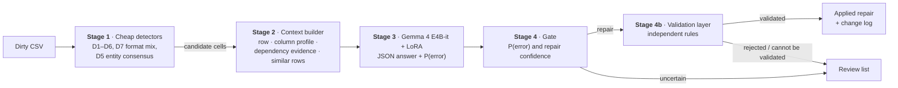

<div align="center">

# ContextGuard

**Find the wrong cells in a table, say what is wrong, and repair only what can be checked.**

A small language model that runs locally, fine-tuned for cell-level data cleaning, with an independent validation layer in front of every automatic repair.

[](LICENSE)


[Overview](#overview) ·
[Architecture](#architecture) ·
[Results](#results) ·
[Quick start](#quick-start) ·
[Repository layout](#repository-layout) ·
[Design decisions](#design-decisions) ·
[Limitations](#limitations) ·
[Progress](#project-progress) ·
[Team](#team)

*DSAI Lab course project · IIT Madras BS in Data Science and Applications · Group 1*

</div>

---

## Overview

A well-formed value can still be wrong given the rest of its row. ContextGuard takes a CSV, flags suspicious cells, names the error type (missing value, pattern, rule violation, outlier), proposes a repair and attaches a confidence. A repair is applied only if the model is confident **and** the repair passes independent rules. Everything else goes to a human review list. Every applied repair keeps its old value in a change log, so it can be reverted.

| | |
|---|---|
| **Model** | Gemma 4 E4B-it with LoRA adapters, run locally. No hosted model. |
| **Detection, mean F1 on five test tables** | **0.741** (dBoost 0.435, Raha with 20 labelled rows 0.433, HoloClean 0.207) |
| **Applied repairs on the scored test rows** | **975 right, 13 wrong** (98.7%) |
| **Best on** | Hospital, Beers, Rayyan, Movies. Flights is the exception: Raha with 20 labels scores 0.898 against 0.852. |
| **Labels needed** | None from the test tables |

<details>
<summary><b>Why not an existing cleaner?</b></summary>

Rule systems (NADEEF, HoloClean) need constraints written for every dataset. Statistical detectors flag rare values, but a rare value is often correct, and a wrong value that looks ordinary is missed. Learning-based cleaners (Raha, Baran) need labelled rows for every new table. Recent LLM-based cleaners mostly rely on large hosted models, detect without repairing, and report no calibrated confidence. ContextGuard asks whether a small, locally run, fine-tuned model that sees the row, the column's usual behaviour and cross-column evidence can detect, type and repair errors safely. The full problem statement is in [`docs/milestones/M1/`](docs/milestones/M1/).

</details>

## Architecture



| Stage | What it does | Code |
|:--:|---|---|
| **1** | Cheap detectors choose the candidate cells. Only candidates reach the model, so cost grows with the number of candidates, not with the table size. | [`src/detectors/`](src/detectors/) |
| **2** | One prompt per candidate, built from the **dirty table only**: the row with the suspect cell marked, a column profile, dependency evidence and similar rows. The same code builds the training and inference prompts. | [`src/profiling/context.py`](src/profiling/context.py) |
| **3** | The model answers in JSON (`is_error`, `error_type`, `evidence`, `repair`). The answer starts with a fixed prefix, so the first generated token is the decision and P(error) is read from it. | [`src/llm/infer.py`](src/llm/infer.py) |
| **4** | Flag at P ≥ 0.5. Repair at P ≥ 0.8, and only if the model is sure of the repair value (minimum token probability ≥ 0.9). Thresholds were fixed before the runs, not tuned. | `gate_decision` in [`scripts/run_pipeline.py`](scripts/run_pipeline.py) |
| **4b** | Every repair the gate accepts is checked against independent rules: format, range, permitted values, relations between columns and rows, and record consistency before and after. Outcomes: *validated*, *rejected*, *cannot be validated*, *no change*. Passing is consistency validation, not proof of correctness. | [`src/validation/repair_validator.py`](src/validation/repair_validator.py) · [`configs/validation/`](configs/validation/) |
| | Scoring of every cell at its natural error rate | [`src/evaluation/metrics.py`](src/evaluation/metrics.py) |

**Outputs of one run** (`outputs/runs/<run-id>/`, not committed; summary tables are copied to `docs/tables/`):

| File | Content |
|---|---|
| `predictions.jsonl` | one record per candidate cell: raw answer, parsed fields, P(error), decision |
| `change_log.csv` | old and new value of every applied repair |
| `validation_log.jsonl` | every check, its source, before/after result and outcome |
| `metrics.json`, `stage_times.csv`, `run.json` | scores, time per stage, arguments and library versions |

The frozen final configuration is [`configs/m4_final_pipeline.yaml`](configs/m4_final_pipeline.yaml). Architecture and design decisions in depth: [Milestone 3](docs/milestones/M3/Milestone3_Report.md) and [Milestone 4](docs/milestones/M4/Milestone4_Report.md) reports.

## Results

### Detection F1 on the test splits

Raha's 20 labelled rows are left out of scoring for every method ([`docs/tables/m4_test_vs_baselines.csv`](docs/tables/m4_test_vs_baselines.csv)).

| Table | **ContextGuard** | HoloClean | dBoost | Raha, 20 labels |
|---|:--:|:--:|:--:|:--:|
| Hospital | **0.886** | 0.842 | 0.350 | 0.350 |
| Flights | 0.852 | 0.087 | 0.566 | **0.898** |
| Beers | **0.972** | 0.106 | 0.537 | 0.903 |
| Rayyan | **0.493** | 0.000 | 0.299 | 0.014 |
| Movies | **0.503** | 0.000 | 0.422 | 0.000 |
| **Mean** | **0.741** | 0.207 | 0.435 | 0.433 |

Applied repairs on the same cells: Hospital 55 right / 0 wrong, Flights 325 / 13, Beers 595 / 0. Rayyan and Movies have no rule file, so their repairs go to review.

### What each step of the pipeline added

Validation subset, 3,500 cells.

| Configuration | Detection F1 | Gate repairs (right / wrong) |
|---|:--:|:--:|
| Base model, detectors D1–D6 | 0.570 | |
| Fine-tuned, detectors D1–D6 | 0.714 | 156 / 113 |
| + D7 format detector | 0.890 | 274 / 113 |
| + entity evidence in the prompt | 0.894 | 330 / 36 |
| **+ repair-confidence gate (final)** | **0.894** | **313 / 8** |

### Repair validation layer

On the fine-tuned run (validation subset) the layer turns **113 wrong gate repairs into 5** (false-repair rate 42.0% → 3.6%), at the cost of 21 correct repairs sent to review. It takes about 4 ms per repair. In the final pipeline the repair-confidence gate already removes most wrong repairs, so the layer removes fewer. Details: report Section 13 and [`docs/tables/m4_validation_comparison.csv`](docs/tables/m4_validation_comparison.csv).

### Training

Validation loss on one fixed sample of 1,024 examples: **1.2014** for the base model, **0.0430** for the final adapter (best step 1,200 of 1,722, about six hours). Training curves and the calibration diagram: [`docs/figures/m4/`](docs/figures/m4/). Sample outputs for every outcome: [`docs/milestones/M4/sample_outputs.md`](docs/milestones/M4/sample_outputs.md).

**Full report:** [PDF](docs/milestones/M4/Milestone4_Report.pdf) · [Markdown](docs/milestones/M4/Milestone4_Report.md) · [Slides](docs/milestones/M4/slides/) · [Worklog](docs/milestones/M4/Milestone4_Worklog.md)

## Quick start

Python 3.12. The tests, the data build and the validation layer need no GPU. Training and inference need a CUDA GPU (training peaked at 30.5 GiB of memory, inference needs about 18 GiB).

```bash
git clone https://github.com/SidhaarthShree07/Group-1-DS-and-AI-Lab-Project.git
cd Group-1-DS-and-AI-Lab-Project
python -m venv .venv && source .venv/bin/activate
pip install -r requirements.txt
python -m pytest -q          # 145 passed, 3 skipped (the skipped tests need the built data)
```

The Gemma 4 weights come from the Hugging Face Hub (`google/gemma-4-E4B-it`) after accepting its licence. The trained adapter (about 140 MB) is not stored in git; pass its folder with `--adapter`.

<details>
<summary><b>1 · Build the data</b> (Milestone 2)</summary>

One command downloads every public source at a pinned version (checked by SHA-256), builds the tables, splits, synthetic data and fine-tuning examples, and runs the leakage checks:

```bash
bash scripts/build_all.sh            # add --skip-download if data/raw/ is already filled
```

The one manual step is TableEG's annotation files, which exist only on [Google Drive](https://drive.google.com/drive/folders/10LdB9LGgymbI6W8D2936uRF6eFRL24xy). Put the two `TableEG-<date>-00N.zip` files, unchanged, into `data/raw/tableeg/`; `scripts/download_data.py` extracts what it needs.

A correct build ends with `Milestone 2 data build finished` and gives:

| Check | Expected |
|---|---|
| Records in `train.jsonl` / `val.jsonl` / `test.jsonl` | 55,091 / 9,341 / 9,547 |
| Core error cells | 18,414 (Hospital 509, Flights 4,920, Beers 4,362, Rayyan 948, Movies 7,675) |
| `python src/data/check_leakage.py` | 29 of 29 checks pass |

Details: [`docs/milestones/M2/Milestone2_Report.md`](docs/milestones/M2/Milestone2_Report.md).

</details>

<details>
<summary><b>2 · Train the adapter</b> (Milestone 4)</summary>

The full run: one epoch on all 55,091 examples, best checkpoint kept, early stopping with patience 3. Settings: [`configs/m4_f1_full.yaml`](configs/m4_f1_full.yaml).

```bash
python src/llm/train_lora.py --model <gemma-4-E4B-it> --out <run dir> \
    --n-train 0 --epochs 1 --patience 3 --eval-steps 200 --save-steps 200

bash scripts/run_m4_screening.sh                  # short hyper-parameter, seed and E5 runs
python scripts/eval_adapters.py --model <gemma-4-E4B-it> \
    --runs <run dirs> --out <csv>                 # every adapter on one fixed validation sample
```

</details>

<details>
<summary><b>3 · Run the pipeline</b> (frozen final configuration)</summary>

```bash
python scripts/run_pipeline.py --model <gemma-4-E4B-it> --adapter <run dir>/adapter \
    --d7-format-mix --d5-entity-consensus --evidence-threshold 0.5 --skip-missing-keys \
    --weighted-majority --repair-conf 0.9 --validate \
    --source data/splits/core --split test --out outputs/runs/<run-id>

python scripts/score_like_baselines.py outputs/runs/<run-id> \
    --source data/splits/core --split test --labelled data/labelled
```

The whole final evaluation, and the baselines:

```bash
MODEL=<gemma-4-E4B-it> ADAPTER=<run dir>/adapter bash scripts/run_m4_final_eval.sh
python scripts/run_baselines_full.py             # reads data/processed/baselines
```

</details>

<details>
<summary><b>4 · Re-run the validation layer on a finished run</b> (no GPU)</summary>

```bash
python scripts/validate_repairs.py <run dir> --source data/subsets/m3 --split val
```

Writes `validation_comparison.csv` (existing against enhanced pipeline), `validation_log.jsonl`, `change_log_validated.csv` and `review_list_validated.csv` into the run folder.

</details>

Every number in the Milestone 4 report is in [`docs/tables/`](docs/tables/) (`m4_*.csv`); the report's Appendix B names the script that produced each one.

## Repository layout

| Folder | What is in it |
|---|---|
| [`src/`](src/) | The ContextGuard code, one folder per stage (below) |
| [`scripts/`](scripts/) | Entry points: the pipeline, training and evaluation drivers, data build, audits |
| [`configs/`](configs/) | The frozen pipeline, one training config per run, and the validation rule files |
| [`tests/`](tests/) | pytest suite, 145 tests |
| [`docs/`](docs/) | Milestone reports, worklogs and slides (`milestones/`), every reported number (`tables/`), figures |
| [`data/`](data/) | Sources and licences, a 20-record sample. Raw, processed and split data are not in git |
| [`outputs/`](outputs/) | Model-comparison reports. Run outputs are not committed |
| [`models/`](models/) | Placeholder. Adapters are not stored in git |

**Inside `src/`**

| Folder | Stage | Content |
|---|:--:|---|
| [`detectors/`](src/detectors/) | 1 | D1–D6, D7 format mix, D5 entity consensus, stage 0 rules |
| [`profiling/`](src/profiling/) | 2 | Prompt context, column profiles, dependencies |
| [`llm/`](src/llm/) | 3 | Fine-tuning examples, dataset loader, LoRA training, inference |
| [`validation/`](src/validation/) | 4b | Repair validation layer |
| [`evaluation/`](src/evaluation/) | scoring | Metrics, outcome scoring, calibration |
| [`data/`](src/data/) | data | Loaders, splits, synthetic data, leakage checks |

**Main scripts**

| Script | Use |
|---|---|
| [`run_pipeline.py`](scripts/run_pipeline.py) | The pipeline end to end |
| [`run_m4_screening.sh`](scripts/run_m4_screening.sh), [`run_m4_variants.sh`](scripts/run_m4_variants.sh), [`run_m4_pipeline_runs.sh`](scripts/run_m4_pipeline_runs.sh) | Hyper-parameter runs, pipeline variants, experiment runs |
| [`run_m4_final_eval.sh`](scripts/run_m4_final_eval.sh) | Final evaluation on the test and validation splits |
| [`validate_repairs.py`](scripts/validate_repairs.py) | Validation layer on a finished run, with the before/after comparison |
| [`score_like_baselines.py`](scripts/score_like_baselines.py), [`run_baselines_full.py`](scripts/run_baselines_full.py) | Scoring on the baselines' cells, and the baselines |
| [`build_all.sh`](scripts/build_all.sh) | One-command data build |
| [`model_bakeoff/`](scripts/model_bakeoff/) | Milestone 1 model comparison |

Contribution rules and branch conventions: [`CONTRIBUTING.md`](CONTRIBUTING.md) · Changes per milestone: [`CHANGELOG.md`](CHANGELOG.md)

## Design decisions

| Decision | Choice | Why |
|---|---|---|
| **Model** | Gemma 4 E4B-it (Apache-2.0, 7.9 B parameters loaded, 4.5 B effective) | Won the zero-shot comparison below on all three seeds, with the best score and the lowest false-repair rate. Small enough to run locally. A short fine-tune of a Qwen model to back the choice with trained results is planned for Milestone 5. |
| **Fine-tuning** | LoRA, rank 16, alpha 32, dropout 0.05, on the attention and MLP projections; 34.9 M trainable parameters (0.44%) | Memory and time. Settings around this one change the validation loss less than the spread between seeds (0.0023). |
| **Loss** | Cross-entropy on the answer tokens only | The prompt carries the data; only the answer is learned. |
| **Confidence** | P(error) from the first answer token, plus a separate confidence for the repair value | P(error) says the old value is wrong. It does not say the new one is right. |
| **Thresholds** | 0.5 / 0.8 on raw P(error), repair confidence 0.9, fixed in advance | Calibration and prior shift are reported as a study ([`m4_calibration.csv`](docs/tables/m4_calibration.csv)), not used to tune the final result. |
| **Candidate stage** | Cheap detectors first, then the model | Sending every cell costs 4.6× the model calls and lowers precision on Flights (0.90 → 0.73). |
| **Validation rules** | Written from domain sources, each naming its source; never learned from the table being cleaned | Rules mined from a dirty table can hold only because of which rows a split contains. Stage 0 (rules proposed by the model) added +0.45 points of candidate recall and was dropped. |

<details>
<summary><b>Zero-shot model comparison</b> (Milestone 1; three seeds, 1,500 cells each)</summary>

Score = 0.4 × detection macro-F1 + 0.3 × repair accuracy + 0.3 × AUROC, mean ± std over three sampling seeds.

| Model | Macro-F1 | AUROC | Repair accuracy | False-repair rate | Score |
|---|:--:|:--:|:--:|:--:|:--:|
| Qwen3-4B-Instruct-2507 | 0.585 ± 0.017 | 0.776 ± 0.013 | 0.271 ± 0.004 | 0.677 ± 0.010 | 0.548 ± 0.009 |
| Qwen3.5-9B | 0.642 ± 0.008 | 0.838 ± 0.001 | 0.317 ± 0.008 | 0.701 ± 0.003 | 0.603 ± 0.005 |
| **Gemma 4 E4B-it** | **0.698 ± 0.011** | **0.864 ± 0.004** | **0.357 ± 0.014** | **0.393 ± 0.022** | **0.645 ± 0.007** |

These are zero-shot numbers on a sample with one error cell in three. They are not comparable with the pipeline results above, which are scored at each table's natural error rate. Method and caveats: [`outputs/reports/model_bakeoff/README.md`](outputs/reports/model_bakeoff/README.md).

</details>

## Data

Ground truth follows Raha: a cell is an error when its dirty value differs from its clean value after unescaping HTML, collapsing whitespace and stripping.

| Role | Tables |
|---|---|
| Training | Hospital, Flights, Beers, Rayyan, Movies (Raha copies), plus Tax, Inpatient and Facilities |
| Unseen-table test | Restaurant, Marketing, Soccer, Billionaire, and an address slice of Clean Me If You Can |
| Downstream test | Credit (Kaggle "Give Me Some Credit"); Beers ABV as a second check |
| Augmentation | Synthetic errors on UCI Adult, Bike Sharing and Wine Quality |

The five core tables hold 18,414 verified error cells. The public TableEG copies of Beers and Movies had lost errors, so the Raha originals are used. 73,979 instruction–response examples are built from them, with entity-aware splits and 29 leakage checks. Sources, licences and audit details: [`data/README.md`](data/README.md). Raw data is never committed.

## Limitations

- **Flights.** Raha with 20 labelled rows beats ContextGuard on detection (0.898 against 0.852). The model has to guess the true time among valid times that disagree between sources, and all 13 wrong applied repairs are here.
- **Candidate recall.** On Rayyan and Movies fewer than half of the errors reach the model (44.5% and 37.5%), so detection recall is low (0.40 and 0.38).
- **Rule files exist for three tables** (Hospital, Flights, Beers). Without one, every repair is sent to review, so Rayyan and Movies apply none. Passing the layer means consistent with the rules, not correct.
- **Baseline comparison:** the baselines run once, with settings fixed on the training split and Raha given 20 labelled rows. Milestone 5 repeats the comparison at several label budgets.
- **Fixed thresholds.** The gate is not tuned per table. The shift between the balanced training data and the real error rates (13% to 91% of candidates) is studied but not used in the gate.
- **Not yet measured:** unseen tables and the downstream effect of cleaning (Milestone 5). The hyper-parameter screening cannot rank settings more finely than the seed spread.

## Project progress

| | Milestone | Delivered | Status |
|:--:|---|---|:--:|
| 1 | Problem, data audit, model comparison | Audit of the benchmark tables, zero-shot comparison of three open models | ✅ |
| 2 | Training-ready data | 73,979 examples, entity-aware splits, 29 leakage checks, one-command rebuild | ✅ |
| 3 | Architecture and pipeline | Detectors, context builder, inference, gate, end-to-end run on a subset, LoRA smoke run | ✅ |
| 4 | **Training and evaluation** | Full LoRA training and hyper-parameter study, two new detectors, entity evidence, repair-confidence gate, repair validation layer, calibration study, baselines on the test splits | ✅ |
| 5 | Unseen tables and downstream test | Restaurant, Marketing, Soccer, Billionaire, German slice; Credit; EM prior in the gate; Qwen pilot | ⏳ |
| 6 | Demo | Gradio demo and API returning a cleaned CSV, a change log and a review list | ⏳ |

## Team

| Member | Area |
|---|---|
| **Sidhaarth Shree** ([@SidhaarthShree07](https://github.com/SidhaarthShree07)) | LLM, training, pipeline, validation layer, evaluation, integration, repository owner |
| **Jashan** ([@jashantiwari044](https://github.com/jashantiwari044)) | Benchmark tables and splits; training records, hyper-parameter analysis, sample outputs |
| **Sahilpreet** ([@23f3000115](https://github.com/23f3000115)) | External datasets; decision scoring, prior estimation, calibration study |
| **Aaradhya** ([@adhi1911](https://github.com/adhi1911)) | Detectors and baselines, candidate recall, missed-error analysis |

Worklogs: [M1](docs/milestones/M1/Milestone1_Worklog.md) · [M2](docs/milestones/M2/Milestone2_Worklog.md) · [M3](docs/milestones/M3/Milestone3_Worklog.md) · [M4](docs/milestones/M4/Milestone4_Worklog.md)

## References

Full lists are in the milestone reports.

- Mahdavi et al. *Raha: A Configuration-Free Error Detection System.* SIGMOD 2019.
- Mahdavi and Abedjan. *Baran: Effective Error Correction via a Unified Context Representation and Transfer Learning.* PVLDB 13(11), 2020.
- Ni et al. *ZeroED: Hybrid Zero-shot Error Detection through Large Language Model Reasoning.* arXiv:2504.05345, 2025.
- Liu et al. *Towards Practical Benchmarking of Data Cleaning Techniques: On Generating Authentic Errors via Large Language Models (TableEG).* arXiv:2507.10934.
- Li et al. *CleanML: A Study for Evaluating the Impact of Data Cleaning on ML Classification Tasks.* ICDE 2021.
- Saerens et al. *Adjusting the Outputs of a Classifier to New a Priori Probabilities.* Neural Computation, 2002.
- Hu et al. *LoRA: Low-Rank Adaptation of Large Language Models.* ICLR 2022.

## License

Code is released under Apache-2.0 ([`LICENSE`](LICENSE)). Third-party data, models and tools and their licences are listed in [`THIRD_PARTY.md`](THIRD_PARTY.md). The Clean Me If You Can data is ODbL share-alike, TableEG states no licence, and none of these raw files are redistributed here.
