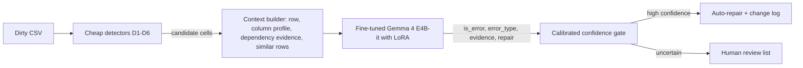

# ContextGuard

Cell-level error detection, typing and repair for relational tables: cheap detectors decide where to look, a fine-tuned open language model decides what is wrong, and a calibrated confidence gate decides what is changed automatically.

DSAI Lab course project (IIT Madras BS in Data Science and Applications), Group 1. **Current stage: Milestone 2 (dataset preparation).** Sections below say plainly what exists today and what later milestones add.

## 1. Overview

Real tables contain errors that cannot be seen by looking at a cell alone: a well-formed value can be wrong given the rest of its row. ContextGuard takes a CSV, flags suspicious cells, names the error type (missing value, pattern violation, rule violation, outlier), proposes a repair and attaches a confidence score. Only high-confidence repairs are applied; the rest go to a human review list. The system is evaluated on benchmark tables with known errors, on tables it never saw in training, and on the effect that cleaning has on a downstream classifier.

## 2. Problem statement

Existing cleaners cover part of the problem. Rule systems (NADEEF, HoloClean) need constraints written for every dataset. Statistical detectors flag rare values, but a rare value is often correct and a wrong value that looks ordinary is missed. Learning-based cleaners (Raha, Baran) need labelled rows for every new table. Recent LLM-based cleaners (ZeroED, Cocoon, ForestED) mostly depend on large hosted models, detect without repairing, and report no calibrated confidence. ContextGuard asks whether a small, locally run, fine-tuned model that sees the row, the column's usual behaviour and cross-column evidence can detect, type and repair errors safely, including on tables it has not seen. The full problem statement, stakeholders, scope and objectives are in the Milestone 1 report ([`docs/milestones/M1/`](docs/milestones/M1/)).

## 3. Features

| Feature | Status |
|---|---|
| Audit of the benchmark tables under Raha's ground-truth rule, with recovered errors that a public copy had lost | Done (Milestone 1) |
| Zero-shot comparison of three open models on a fixed 1,500-cell test set, with mean ± std over three sampling seeds | Done (Milestone 1) |
| Training-ready data: 73,979 instruction–response examples from eight benchmark and five synthetic tables, entity-aware splits, 29 leakage checks, rebuilt by one command | Done (Milestone 2) |
| Input files of the baselines (HoloClean with mined constraints, dBoost, Raha + Baran) on the test split | Done (Milestone 2); first runs in Milestone 3 |
| Cheap detectors (missing values, rare patterns, robust outliers, multivariate outliers, approximate dependencies, typos) | Planned, Milestone 3 |
| LoRA fine-tuning for detection, typing and repair with JSON output | Planned, Milestones 3–4 |
| Calibrated confidence gate (temperature scaling) with separate flag and auto-repair thresholds | Planned, Milestones 3–5 |
| Baseline comparison (rule-based, dBoost, Raha + Baran, zero-shot and few-shot LLM) | Planned, Milestone 5 |
| Gradio demo and API that return a cleaned CSV, a change log and a review list | Planned, Milestone 6 |

## 4. Architecture



Only the candidate cells reach the language model, so cost grows with the number of flagged cells, not with the table size. The model answers in JSON; P(is_error) is read from the logits of the first answer token and calibrated on validation data. (Design status: the architecture is fixed for planning; its components are built in Milestones 3–4.)

## 5. Dataset details

Ground truth follows Raha: a cell is an error when its dirty value differs from its clean value after unescaping HTML, collapsing whitespace and stripping.

| Role | Tables |
|---|---|
| Training | Hospital, Flights, Beers, Rayyan, Movies (Raha copies), plus Tax, Inpatient and Facilities |
| Unseen-table test | Restaurant, Marketing, Soccer, Billionaire, and an address slice of Clean Me If You Can |
| Downstream test | Credit (Kaggle "Give Me Some Credit"); Beers ABV as a second check |
| Augmentation | Synthetic errors on UCI Adult, Bike Sharing and Wine Quality |

The five core tables hold 18,414 verified error cells (Hospital 509, Flights 4,920, Beers 4,362, Rayyan 948, Movies 7,675). The public TableEG copies of Beers and Movies had lost errors (1,005 and a net 668), so the Raha originals are used. Sources, licences and audit details are in [`data/README.md`](data/README.md) and [`docs/milestones/M1/`](docs/milestones/M1/). Raw data is never committed.

## 6. Models

**Base model: Gemma 4 E4B-it** (Apache-2.0, 7.9B parameters loaded, 4.5B effective), fine-tuned with LoRA from Milestone 3. It was chosen in a zero-shot comparison against Qwen3-4B-Instruct-2507 and Qwen3.5-9B (details under Results). No adapters or weights are in this repository; fine-tuned adapters will be published on the Hugging Face Hub and linked from `models/`.

## 7. Installation

Python 3.12. The scripts that exist today (the model comparison) need a CUDA GPU.

```bash
git clone https://github.com/SidhaarthShree07/Group-1-DS-and-AI-Lab-Project.git
cd Group-1-DS-and-AI-Lab-Project
python -m venv .venv && source .venv/bin/activate
pip install -r requirements.txt
```

`requirements.txt` pins the versions the reported results were produced with. The Gemma 4 weights are downloaded from the Hugging Face Hub (`google/gemma-4-E4B-it`) after accepting the licence there.

## 8. Running instructions

The model comparison in `scripts/model_bakeoff/` reproduces the results table below. The paths at the top of each script point to the working folder (`E` environment variable); set `E` to a folder that contains `data/raha_src/datasets` (a clone of the [Raha repository](https://github.com/BigDaMa/raha)) and `weights/<model folder>`.

```bash
export E=/path/to/workdir
SEED=1 python scripts/model_bakeoff/prep_prompts.py          # build the 1,500-cell test set for one seed
python scripts/model_bakeoff/run_model_seeds.py gemma4_e4b --seeds 1 2 3
python scripts/model_bakeoff/score_seeds.py 1 2 3            # mean ± std over the seeds
```

**Data preparation (Milestone 2).** One command downloads every public source at a pinned version (checked by SHA-256), builds the tables, splits, synthetic data and the fine-tuning examples, and runs the leakage checks and tests:

```bash
bash scripts/build_all.sh            # add --skip-download if data/raw/ is already filled
```

TableEG's annotation files exist only on Google Drive (link in the TableEG README): copy its two zip files into `data/raw/tableeg/` once before the first run. The result is `data/processed/examples/{train,val,test}.jsonl` (about 137 MB, not in git; a 20-record sample is in `data/sample/`). Details and the rules behind them are in [`docs/milestones/M2/Milestone2_Report.md`](docs/milestones/M2/Milestone2_Report.md).

Training and demo commands are added with the milestones that deliver them.

## 9. Results

Zero-shot comparison of base models (no fine-tuning yet), three fresh samples of 1,500 cells from five tables (100 error and 200 correct cells per table), greedy decoding. Score = 0.4 × detection macro-F1 + 0.3 × repair accuracy + 0.3 × AUROC. Mean ± std over three sampling seeds:

| Model | Macro-F1 | AUROC | Repair accuracy | False-repair rate | Score |
|---|---|---|---|---|---|
| Qwen3-4B-Instruct-2507 | 0.585 ± 0.017 | 0.776 ± 0.013 | 0.271 ± 0.004 | 0.677 ± 0.010 | 0.548 ± 0.009 |
| Qwen3.5-9B | 0.642 ± 0.008 | 0.838 ± 0.001 | 0.317 ± 0.008 | 0.701 ± 0.003 | 0.603 ± 0.005 |
| **Gemma 4 E4B-it** | **0.698 ± 0.011** | **0.864 ± 0.004** | **0.357 ± 0.014** | **0.393 ± 0.022** | **0.645 ± 0.007** |

Gemma 4 E4B-it won on all three seeds. These are zero-shot numbers on one prompt and are not results of ContextGuard; fine-tuning may change the order. Method, caveats and bootstrap intervals: [`outputs/reports/model_bakeoff/README.md`](outputs/reports/model_bakeoff/README.md). Baseline and ContextGuard results are reported from Milestone 5.

## 10. Demo screenshots

The demo is built in Milestone 6; there are no screenshots yet.

## 11. Team members

| Member | Area |
|---|---|
| Sidhaarth Shree ([@SidhaarthShree07](https://github.com/SidhaarthShree07)) | LLM, evaluation, integration, repository owner |
| Jashan ([@jashantiwari044](https://github.com/jashantiwari044)) | Benchmark tables: audit, entity-aware splits, description |
| Sahilpreet ([@23f3000115](https://github.com/23f3000115)) | External datasets: audit, licences, synthetic data |
| Aaradhya ([@adhi1911](https://github.com/adhi1911)) | Outlier and dependency analysis, baselines |

Work is tracked per milestone in the worklogs, [`docs/milestones/M1/Milestone1_Worklog.md`](docs/milestones/M1/Milestone1_Worklog.md) and [`docs/milestones/M2/Milestone2_Worklog.md`](docs/milestones/M2/Milestone2_Worklog.md).

## 12. References

Full reference lists are in the milestone reports. The works this README relies on:

- Mahdavi et al. *Raha: A Configuration-Free Error Detection System.* SIGMOD 2019.
- Mahdavi and Abedjan. *Baran: Effective Error Correction via a Unified Context Representation and Transfer Learning.* PVLDB 13(11), 2020.
- Ni et al. *ZeroED: Hybrid Zero-shot Error Detection through Large Language Model Reasoning.* arXiv:2504.05345, 2025.
- Liu et al. *Towards Practical Benchmarking of Data Cleaning Techniques: On Generating Authentic Errors via Large Language Models (TableEG).* arXiv:2507.10934.
- Li et al. *CleanML: A Study for Evaluating the Impact of Data Cleaning on ML Classification Tasks.* ICDE 2021.

## Licences and limitations

Code is released under Apache-2.0 ([`LICENSE`](LICENSE)). Third-party data, models and tools and their licences are listed in [`THIRD_PARTY.md`](THIRD_PARTY.md); the Clean Me If You Can data is ODbL share-alike, TableEG states no licence, and none of these raw files are redistributed here. Limitations known today: the model comparison is zero-shot and uses one prompt; Credit's "clean" income values were imputed, so its downstream test is checked against a second table; results on unseen tables are not yet measured.

## Repository layout

```
app/          demo (Milestone 6)
data/         README with sources and licences, a 20-record sample; raw/, processed/ and splits/ stay empty in git
docs/         milestone reports, worklogs, tables and figures
models/       links to adapters on the Hugging Face Hub (no weights in git)
notebooks/    exploration
outputs/      reports, figures, logs, predictions
scripts/      download_data.py, build_all.sh (one-command data build), data audits, EDA, model_bakeoff/
src/          data (loaders, splits, synthetic, leakage checks, baseline files), profiling (prompt context, dependencies),
              llm (fine-tuning examples); detectors and evaluation follow in later milestones
tests/        unit tests (pytest)
```

Contribution rules, branches and conventions: [`CONTRIBUTING.md`](CONTRIBUTING.md). Changes per milestone: [`CHANGELOG.md`](CHANGELOG.md).
