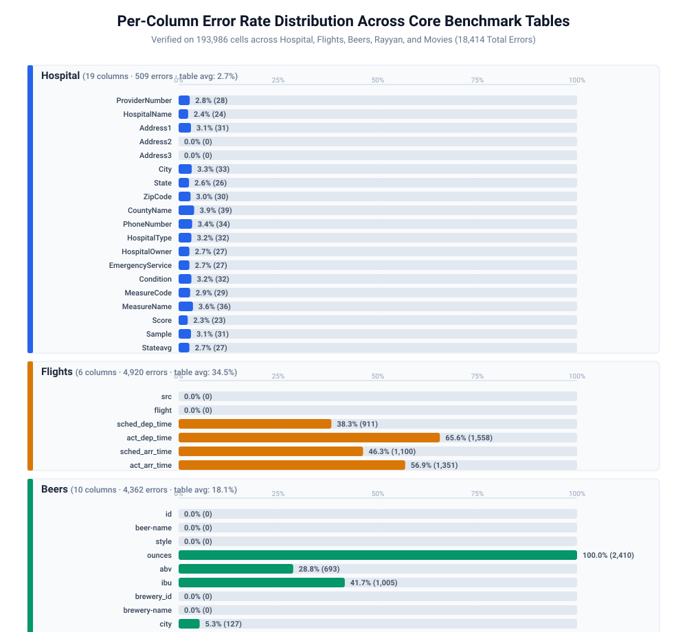
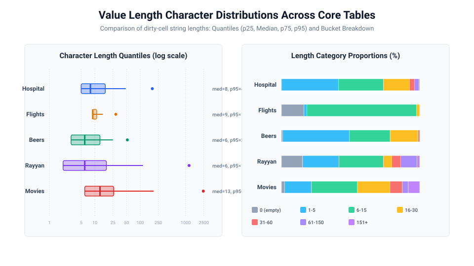
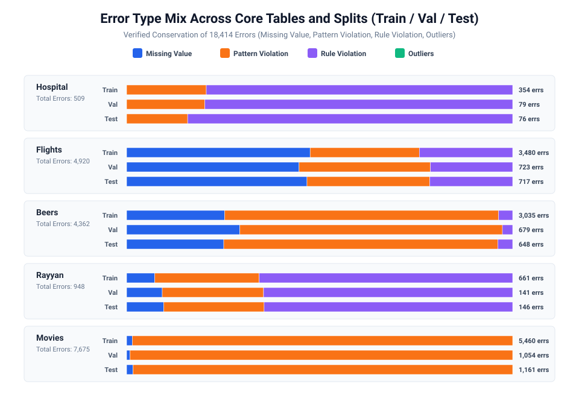

# ContextGuard: Milestone 2 Report
## Dataset Preparation

**Course:** DSAI Lab Project, IIT Madras BS in Data Science and Applications · **Group 1** · **Submitted:** 29 Oct 2026
**Team:** Sidhaarth Shree, Jashan, Sahilpreet, Aaradhya · **Repository:** https://github.com/SidhaarthShree07/Group-1-DS-and-AI-Lab-Project

**Contents:** 1 Introduction · 2 Dataset identification · 3 Dataset description · 4 Data governance · 5 Exploratory data analysis · 6 Data preprocessing · 7 Dataset integration · 8 Data augmentation · 9 Dataset splitting · 10 Final prepared dataset · 11 Challenges encountered · 12 Deliverables produced · 13 Summary and next steps · Team sign-off

**In one paragraph.** This milestone turns the benchmark tables into a training-ready dataset: eight benchmark tables and five synthetic tables, split without leakage, turned into 73,979 instruction–response examples (55,091 for training) that another team can use for fine-tuning without further preparation. One command (`bash scripts/build_all.sh`) rebuilds every file from the public sources, and 29 automated leakage checks pass.

---

## 1. Introduction

**Project in brief.** ContextGuard finds cell-level errors in a table, names the error type, proposes a repair and says how confident it is. Cheap detectors choose the cells to look at, a fine-tuned open model (Gemma 4 E4B-it) decides, and a calibrated gate applies only confident repairs (Milestone 1 report).

**Objectives of Milestone 2.** (1) Identify and verify every data source. (2) Describe and audit it. (3) Split it without leakage. (4) Turn it into training-ready instruction–response examples, so that another team can start a fine-tuning run without further preparation. (5) Fix the rules (selection, token budget, statistics) in writing.

**How the data serves the project goals.**

| Role | Tables | Serves |
|---|---|---|
| Training and in-domain test | Hospital, Flights, Beers, Rayyan, Movies; Tax sample, Inpatient, Facilities | O1, O2 (detection and safe repair) |
| Unseen-table test | Restaurant, Marketing, Soccer, Billionaire, Germany address slice | O3 (never used for training, prompts or thresholds) |
| Downstream test | Credit (never in training); Beers ABV on its held-out test split only (Section 9.4) | O5 |
| Augmentation | UCI Adult, Bike Sharing, Wine Quality (clean tables, synthetic errors, at most 20% of training) | rare error types, O1 |

## 2. Dataset identification

### 2.1 Core benchmark tables

ContextGuard adopts the five landmark benchmark datasets from the data cleaning literature: **Hospital**, **Flights**, **Beers**, **Rayyan**, and **Movies** (derived from `movies_1`). These datasets originate from the canonical Raha/Baran benchmark suite ([Mahdavi et al., PVLDB 2019 / ACM SIGMOD 2020](https://github.com/BigDaMa/raha)). Cell-level error type annotations are sourced from the TableEG benchmark repository ([Liu et al., arXiv 2507.10934](https://github.com/viviancircle/TableEG)).

To ensure byte-for-byte reproducibility across clean checkouts, ContextGuard anchors the Raha data sources to the immutable pinned commit **`7be1334b8c7bbdac3f47ef514fb3e1e8c5fc181c`** (dated 5 June 2025). The integrity of all clean and dirty table pairs is validated on disk via SHA-256 cryptographic hashes computed by `src/data/load_core.py`.

#### Core Table Provenance, Checksums, and Alternatives Considered
*(Computed directly from repository files by `src/data/load_core.py` and logged in `docs/tables/m2_core_quality.csv`)*

| Table Name | Source Repository & Download Link | Pinned Commit / Release | File | Size (Bytes) | SHA-256 Checksum | Licence | Why Selected & Alternatives Considered |
|---|---|---|---|---:|---|---|---|
| **Hospital** | [BigDaMa/raha](https://github.com/BigDaMa/raha/tree/master/datasets/hospital) | `7be1334b8c` | `clean.csv` `dirty.csv` | 303,324 303,306 | `ea3ee44998455c0b491750c348509de176c758a3bbf58e4530c0a136bb248b4b` `dbc5575b915fe8b5e0ac6dc6172f38ba91e611fdb76d09a8f4a81cb7ea9925ac` | Apache-2.0 | Standard clinical quality benchmark from US CMS. *Alternatives considered:* HoloClean's Hospital copy was evaluated but discarded due to differing error injection rates; Raha's version is the field standard. |
| **Flights** | [BigDaMa/raha](https://github.com/BigDaMa/raha/tree/master/datasets/flights) | `7be1334b8c` | `clean.csv` `dirty.csv` | 173,159 154,776 | `0acfcfd8985b06fdd363965c9e8d9522c43e7589a93d79ae7dc311e1c37fdf3b` `1b5c1afa10aa0e7c20fd7e14d05c56772715b2771aa0f5fa67ed1709e1eecd46` | Apache-2.0 | Multi-source scraped flight schedules containing real temporal conflicts. *Alternatives considered:* TableEG's Flights was audited, but had 904 unannotated format differences; we restored Raha's master copy and classified the 904 cells deterministically. |
| **Beers** | [BigDaMa/raha](https://github.com/BigDaMa/raha/tree/master/datasets/beers) | `7be1334b8c` | `clean.csv` `dirty.csv` | 233,019 255,295 | `373227df59ad197e154dd5149125789e415019535c7223355e9486ee1b3b93de` `7110bf4931a9445a1675e544d6c996817c739136239f8a2b02e088c7ec0a1f68` | Apache-2.0 | Craft beer product catalogue. *Alternatives considered:* TableEG's copy silently converted `"N/A"` string values into blanks, corrupting 1,005 legitimate missing-value errors; we rejected TableEG's copy in favour of Raha's canonical version. |
| **Rayyan** | [BigDaMa/raha](https://github.com/BigDaMa/raha/tree/master/datasets/rayyan) | `7be1334b8c` | `clean.csv` `dirty.csv` | 272,785 273,084 | `23159f43c0706782388ed8957ad0c74eb7b88bc98f34d65bd49296e186d4673f` `7e25e6db262b0c72ca2d9735d5959599cf5a582e1c705459507c7b45d0d1d174` | Apache-2.0 | Real-world citation screening metadata from systematic reviews. Selected for its realistic textual citations and bibliographic functional dependencies. |
| **Movies** | [BigDaMa/raha](https://github.com/BigDaMa/raha/tree/master/datasets/movies_1) | `7be1334b8c` | `clean.csv` `dirty.csv` | 4,399,162 4,550,868 | `22a84e70d153d809341c55cf8e8154beebe1836456f617bf8277b953a762bfca` `bed752115dd0a5925ea36db443ff6835d10a5a8d2f549299535b14f8ac324316` | Apache-2.0 | Large web-scraped media metadata ($7,390 \times 17$). *Alternatives considered:* TableEG truncated `RatingValue` (`7.0` $\to$ `7`), dropping 668 true errors; we restored Raha `movies_1`, recovering all 7,675 errors. `University` from TableEG was completely dropped as it was omitted from their public release. |

---

### 2.2 External, unseen-test and augmentation sources: licences and status

All raw files are downloaded from their owners at a pinned version and checked by SHA-256 (`scripts/download_data.py`); nothing is stored in git. **Licence status.** The team reviewed the licences on 28 Oct 2026 and approved use for research and sharing with attribution. Where a repository has no licence file, the basis is the terms of the benchmarks it bundles; this is stated in the table, not hidden.

| Table | Role | Source and link | Version | Licence basis | Purpose and why selected | Alternatives considered |
|---|---|---|---|---|---|---|
| Hospital, Flights, Beers, Rayyan, Movies | Training and in-domain test | [Raha](https://github.com/BigDaMa/raha) | commit `7be1334b8c…` (5 Jun 2025) | Apache-2.0 | The benchmarks of the cleaning literature; the published baselines were scored on them | TableEG's copies lost errors in Beers (1,005) and Movies (668): rejected |
| Tax (20,000-row sample) | Training | [Raha](https://github.com/BigDaMa/raha) | same commit | Apache-2.0 | Large table with injected errors and strong column redundancy; 97.6% of its changed cells are formatting only, so only 302 error cells in the sample are true errors and Tax stays a small part of training | Full 200,000 rows: rejected, it would outweigh every other table |
| Inpatient, Facilities | Training | [BClean](https://github.com/thethe-github/BClean) | commit `bb8e09e3119d…` (15 Apr 2024) | No licence file; terms inherited from the benchmarks it bundles | Tables of health-care providers and facilities with injected errors of all three typed kinds; more error cells than the core tables (4,465 and 8,318) | The BClean paper's other copy (`yyssl88/BClean`) differs by one byte per file: the paper's own repository is used |
| Billionaire | Unseen-table test | [ZeroED](https://github.com/ZJU-DataVIP-Lab/ZeroED) | commit `2b84266e1d8b…` (28 Feb 2025) | No licence file; inherited | A new domain (a wealth list) with a clean and a dirty file | none needed |
| Germany address slice (5,000 rows) | Unseen-table test | [Clean Me If You Can](https://zenodo.org/records/20841898) | AddressTable v1.0-2026-06-26, `de_slice/named` | Data: ODbL 1.0 (OpenStreetMap-derived ground truth; the Zenodo record lists CC BY 4.0); code: MIT | The only table with **real** errors from web data in a new domain (addresses) | Other country slices: out of scope |
| Restaurant, Marketing, Soccer, Credit | Unseen-table and downstream tests | [TableEG](https://github.com/viviancircle/TableEG) release (Google Drive) | release linked from its README (Google Drive) | Released with its artifacts; model outputs fall under the Llama 3.1 Community Licence | New domains; Credit for the downstream test | TableEG's Airbnb, Company, Sensor and Movie_BoxOffice: Sensor has almost no errors, Movie_BoxOffice has one pattern only (M1 audit) |
| Adult (`adult.data`), Bike Sharing, Wine Quality | Augmentation (synthetic errors) | [UCI repository](https://archive.ics.uci.edu/) | files of 28 Oct 2026, SHA-256 in `download_data.py` | CC BY 4.0 | Clean tables with real dependencies and numeric columns, used to create the error types that the benchmark tables lack | other UCI tables: not needed |

TableEG's error-type annotation files supply the types for the core tables. TableEG's training files (`dataset/train/*.jsonl`) and Jellyfish-Instruct are not used.

### 2.3 Alternatives considered: how competitors prepare their data

We checked how the systems we compare against, or could have copied from, prepare, split and label their data (full table with references in [`m2_competitor_data_practice.csv`](../../tables/m2_competitor_data_practice.csv)).

| System | Tables | Split and supervision | Risk for a fair comparison | What ContextGuard does |
|---|---|---|---|---|
| **Raha** (SIGMOD 2019) | Hospital, Flights, Beers, Rayyan, Movies, Tax | One dirty table at a time; 20 labelled tuples; scored on the rest of the same table | The labelled and the scored cells come from the same table instance | Held-out test split per table (entity-aware) and unseen tables with 0 labels; the 20 labelled rows are excluded from every method's scoring (Rule D8) |
| **Baran** (PVLDB 2020) | Hospital, Flights, Beers, Rayyan, Tax | Same, plus repair after Raha's detection or with perfect detection | Same | End-to-end repair, detection errors included |
| **HoloClean** (PVLDB 2017) | Hospital, Flights, Food, Physicians | No labels; inference over the whole table; hand-written denial constraints | Constraints written by people who know the table | B1 mines the constraints automatically on the test table, so a rule baseline exists for every table |
| **TableEG** (arXiv 2025) | 12 source tables | Releases training files (29,527 examples) built from all 12 tables | **Its training files contain our unseen test tables** (checked in M1) | Not used for training; only annotations and the unseen test tables are used |
| **Jellyfish** (EMNLP 2024) | Data-preprocessing benchmarks | Instruction tuning of 7 to 13B local models | Hospital was in its training data, so its Hospital F1 is not an unseen-table result | Its instruction set is not used |
| **ZeroED** (arXiv 2025) | Hospital, Flights, Beers, Rayyan, Billionaire, Movies, Tax | Zero-shot; open models (Qwen2.5-72B by default, Llama 3.1) via vLLM; GPT-4o-mini only for cost | Public tables may appear in LLM pre-training data; open for any pre-trained model, ours included | Billionaire is an unseen test table; the exposure of the base model is stated as a limitation |

**Rejected alternatives**
1. *Training on TableEG's released training files.* Rejected: they contain our unseen test tables, which would make the unseen-table result meaningless.
2. *Raha's in-table evaluation.* Rejected for the main result: it trains and scores on one table. We keep it only for baseline B3, with the labelled rows excluded from scoring.
3. *Random row splits.* Rejected: Hospital has 45 real hospitals in 1,000 rows, so a row split puts the same hospital in train and test (Section 9).

## 3. Dataset description

### 3.1 Core benchmark tables

The five core benchmark tables comprise **14,176 rows** and **193,986 cells**, exhibiting a diverse collection of data types, cardinality profiles, and error distributions.

#### Table Schema and Target Variables
- **Input Data Formats:** Tabular CSV files containing relational attributes.
- **Output Fine-Tuning Format:** Standardized JSONL instruction–response records.
- **Cell-Level Target Variables:**
  1. `is_error` (boolean): `True` if the cell value in `dirty.csv` deviates from `clean.csv` under the Raha normalisation rule; `False` otherwise.
  2. `error_type` (categorical string): One of four taxonomical classes (`missing_value`, `pattern_violation`, `rule_violation`, `outliers`), or empty string `""` for clean cells.
  3. `repair` (string): The ground-truth clean text value from `clean.csv` required to correct the error.

#### Dimensional Summary of Core Tables
*(Exported to `docs/tables/m2_core_quality.csv` by `scripts/generate_m2_outputs.py`)*

| Table Name | Rows | Data Cols | Total Cols | Numeric Cols | Categorical Cols | Total Cells | Error Cells | Error Rate (%) |
|---|---:|---:|---:|---:|---:|---:|---:|---:|
| **Hospital** | 1,000 | 19 | 20 | 3 | 16 | 19,000 | 509 | 2.68% |
| **Flights** | 2,376 | 6 | 7 | 0 | 6 | 14,256 | 4,920 | 34.51% |
| **Beers** | 2,410 | 10 | 11 | 5 | 5 | 24,100 | 4,362 | 18.10% |
| **Rayyan** | 1,000 | 11 | 11 | 3 | 8 | 11,000 | 948 | 8.62% |
| **Movies** | 7,390 | 17 | 17 | 3 | 14 | 125,630 | 7,675 | 6.11% |
| **Total** | **14,176** | **63** | **66** | **14** | **49** | **193,986** | **18,414** | **9.49%** |

#### Sample Records (from Apache-2.0 Tables Only)
In accordance with course guidelines, three raw representative records per core table are presented below:

##### 1. Hospital (Dirty Records)
- **Record 1:** `ProviderNumber: '10018'`, `HospitalName: 'callahan eye foundation hospital'`, `Address1: '1720 university blvd'`, `City: 'birmingham'`, `State: 'al'`, `ZipCode: '35233'`, `PhoneNumber: '2053258100'`, `HospitalType: 'acute care hospitals'`, `Condition: 'surgical infection prevention'`, `MeasureCode: 'scip-card-2'`, `MeasureName: 'surgery patients who were taking heart drugs caxxed beta bxockers...'`, `Score: 'empty'`
- **Record 2:** `ProviderNumber: '10018'`, `HospitalName: 'callahan eye foundation hospital'`, `Address1: '1720 university blvd'`, `City: 'birmingham'`, `State: 'al'`, `ZipCode: '35233'`, `PhoneNumber: '2053258100'`, `HospitalType: 'acute care hospitals'`, `Condition: 'surgical infection prevention'`, `MeasureCode: 'scip-inf-1'`, `MeasureName: 'surgery patients who were given an antibiotic at the right time...'`, `Score: 'empty'`
- **Record 3:** `ProviderNumber: '10018'`, `HospitalName: 'callahan eye foundation hospital'`, `Address1: '1720 university blvd'`, `City: 'birmingham'`, `State: 'al'`, `ZipCode: '35233'`, `PhoneNumber: '2053258100'`, `HospitalType: 'acute care hospitals'`, `Condition: 'surgical infection prevention'`, `MeasureCode: 'scip-inf-2'`, `MeasureName: 'surgery patients who were given the right kind of antibiotic...'`, `Score: 'empty'`

##### 2. Flights (Dirty Records)
- **Record 1:** `src: 'aa'`, `flight: 'AA-3859-IAH-ORD'`, `sched_dep_time: '7:10 a.m.'`, `act_dep_time: '7:16 a.m.'`, `sched_arr_time: '9:40 a.m.'`, `act_arr_time: '9:32 a.m.'`
- **Record 2:** `src: 'aa'`, `flight: 'AA-1733-ORD-PHX'`, `sched_dep_time: '7:45 p.m.'`, `act_dep_time: '7:58 p.m.'`, `sched_arr_time: '10:30 p.m.'`, `act_arr_time: ''` *(missing)*
- **Record 3:** `src: 'aa'`, `flight: 'AA-1640-MIA-MCO'`, `sched_dep_time: '6:30 p.m.'`, `act_dep_time: ''` *(missing)*, `sched_arr_time: '7:25 p.m.'`, `act_arr_time: ''` *(missing)*

##### 3. Beers (Dirty Records)
- **Record 1:** `id: '1436'`, `beer_name: 'Pub Beer'`, `style: 'American Pale Lager'`, `ounces: '12.0 oz'`, `abv: '0.05'`, `ibu: 'N/A'`, `brewery_id: '408'`, `brewery_name: '10 Barrel Brewing Company'`, `city: 'Bend'`, `state: 'OR'`
- **Record 2:** `id: '2265'`, `beer_name: "Devil's Cup"`, `style: 'American Pale Ale (APA)'`, `ounces: '12.0 oz.'`, `abv: '0.066'`, `ibu: 'N/A'`, `brewery_id: '177'`, `brewery_name: '18th Street Brewery'`, `city: 'Gary'`, `state: 'IN'`
- **Record 3:** `id: '2264'`, `beer_name: 'Rise of the Phoenix'`, `style: 'American IPA'`, `ounces: '12.0 ounce'`, `abv: '0.071'`, `ibu: 'N/A'`, `brewery_id: '177'`, `brewery_name: '18th Street Brewery'`, `city: 'Gary'`, `state: 'IN'`

##### 4. Rayyan (Dirty Records)
- **Record 1:** `id: '235295'`, `article_title: 'Late repair of injuries of the anal sphincter'`, `article_language: 'eng'`, `journal_title: 'Proc R Soc Med'`, `jounral_abbreviation: 'Proceedings of the Royal Society of Medicine'`, `journal_issn: '0035-9157 (Print) 0035-9157'`, `article_jvolumn: '64'`, `article_jissue: '12'`, `article_jcreated_at: '1/1/71'`, `article_pagination: '1187-9'`, `author_list: '{"A. G. Parks","J. F. McPartlin"}'`
- **Record 2:** `id: '498345'`, `article_title: 'Ebola Virus GP Gene Polyadenylation Versus RNA Editing.'`, `article_language: 'ENG'`, `journal_title: 'The Journal of infectious diseases'`, `jounral_abbreviation: 'J. Infect. Dis.'`, `journal_issn: '1537-6613'`, `article_jvolumn: ''`, `article_jissue: ''`, `article_jcreated_at: '4/2/15'`, `article_pagination: ''`, `author_list: '{"Valentina A Volchkova","Jaroslav Vorac","Philip Lawrence"}'`
- **Record 3:** `id: '789958'`, `article_title: 'Duane retraction syndrome associated with oculocutaneous albinism: an ocular miswiring.'`, `article_language: 'eng'`, `journal_title: 'Indian journal of ophthalmology'`, `jounral_abbreviation: 'Indian J Ophthalmol'`, `journal_issn: '0301-4738'`, `article_jvolumn: '54'`, `article_jissue: '4'`, `article_jcreated_at: '12/1/06'`, `article_pagination: '283-4'`, `author_list: '{"Jitendra Jethani","Shashikant Shetty"}'`

##### 5. Movies (Dirty Records)
- **Record 1:** `Id: 'tt0054215'`, `Name: 'Psycho'`, `Year: '1960'`, `Release Date: '8 September 1960 (USA)'`, `Director: 'Alfred Hitchcock'`, `Creator: 'Joseph Stefano,Robert Bloch'`, `Actors: 'Anthony Perkins,Janet Leigh,Vera Miles'`, `Language: 'English'`, `Country: 'USA'`, `Duration: '109 min'`, `RatingValue: '8.6'`, `RatingCount: '379,998'`, `ReviewCount: '976 user,290 critic'`, `Genre: 'Horror,Mystery,Thriller'`, `Description: 'A Phoenix secretary steals $40,000...'`
- **Record 2:** `Id: 'tt0088993'`, `Name: 'Day of the Dead'`, `Year: '1985'`, `Release Date: '19 July 1985 (USA)'`, `Director: 'George A. Romero'`, `Creator: 'George A. Romero'`, `Actors: 'Lori Cardille,Terry Alexander'`, `Language: 'English'`, `Country: 'USA'`, `Duration: '96 min'`, `RatingValue: '7.2'`, `RatingCount: '46,421'`, `ReviewCount: '414 user,177 critic'`, `Genre: 'Action,Drama,Horror'`, `Description: 'A small group of military officers...'`
- **Record 3:** `Id: 'tt0032484'`, `Name: 'Foreign Correspondent'`, `Year: '1940'`, `Release Date: '16 August 1940 (USA)'`, `Director: 'Alfred Hitchcock'`, `Creator: 'Charles Bennett,Joan Harrison'`, `Actors: 'Joel McCrea,Laraine Day'`, `Language: 'English,Dutch,Latvian'`, `Country: 'USA'`, `Duration: '120 min'`, `RatingValue: '7.6'`, `RatingCount: '12,684'`, `ReviewCount: '124 user,73 critic'`, `Genre: 'Romance,Thriller,War'`, `Description: 'On the eve of WWII, a young American reporter...'`

---

### 3.2 External tables

| Table | Rows used | Data columns | Cells | Error cells (Raha rule) | Format-only | True errors | Error rate |
|---|---:|---:|---:|---:|---:|---:|---:|
| Tax (sample) | 20,000 | 15 | 300,000 | 12,120 | 11,818 | 302 | 4.04% |
| Inpatient | 4,017 | 11 | 44,187 | 4,465 | 0 | 4,465 | 10.10% |
| Facilities | 7,992 | 10 | 79,920 | 8,318 | 0 | 8,318 | 10.41% |
| Billionaire | 2,614 | 22 | 57,508 | 5,195 | 18 | 5,177 | 9.03% |
| Germany (sample) | 5,000 | 9 | 45,000 | 18,678 | 4 | 18,674 | 41.51% |

- **Format.** Each table is a CSV pair (clean and dirty). The dirty BClean files carry a leading unnamed index column 0, 1, 2, …; it is checked and dropped.
- **Target variables.** `is_error`, `error_type` (missing, pattern, rule, outlier) and `repair`, as for the core tables. External tables ship no error types, so a documented heuristic types each changed cell: a placeholder against a real value is *missing*; the same number in another format is a *format artifact*; a value that is valid elsewhere in the column is a *rule* violation; any other new string is a *pattern* violation.
- **Features and schema.** One row per column in [`m2_external_dictionary.csv`](../../tables/m2_external_dictionary.csv): name, type, meaning, an example and the missing rate in the dirty file.
- **Sample records** (Tax, Apache-2.0; selected columns, dirty against clean):

| city | state | zip (dirty / clean) | rate (dirty / clean) |
|---|---|---|---|
| SWAMPSCOTT | MA | `01907` / `1907` | 5.3 / 5.3 |
| LAS VEGAS | NV | 89140 / 89140 | `0.0` / `0` |
| HASTY | AR | 72640 / 72640 | `7.0` / `7` |

Rows 2 and 3 show what a format-only difference looks like: the same number written differently. These are not labelled as errors for training.

### 3.3 Record format for fine-tuning

Input is a pair of CSV files per table (dirty and clean). The output is a JSON-lines file of **one record per cell**:

| Field | Meaning |
|---|---|
| `id` | `<table>:<split>:<row>:<column>` |
| `table`, `split`, `row`, `column` | where the cell comes from (`split` is train, val or test) |
| `source` | `benchmark` or `synthetic` |
| `is_error`, `error_type` | the label; `error_type` is missing, pattern, rule, outlier or none |
| `prompt` | the question: task text, table and column, the row with the cell marked, column profile, dependency evidence, similar rows |
| `response` | the answer to learn: `{"is_error", "error_type", "evidence", "repair"}` as a JSON string |

The target variables are `is_error`, `error_type` and `repair` (the clean value; `null` for a correct cell, the empty string when the clean value is empty). A 20-record sample from the Apache-2.0 core tables is in `data/sample/m2_examples_sample.jsonl`.

## 4. Data governance

### 4.1 Licensing and privacy of the external tables

**Licensing.** See the table in Section 2. Obligations we keep: attribution for every source (the attribution table in `THIRD_PARTY.md`); files derived from the Germany slice stay under ODbL 1.0 with attribution to OpenStreetMap contributors and are published separately from the training files because they are test-only; the Llama 3.1 Community Licence terms are noted for TableEG outputs, which we use only for labels and test tables, never for training; the Adult test file (`adult.test`) is never read.

**Privacy: is there personal data?**

| Table | What it contains | Assessment and handling |
|---|---|---|
| Tax | Names, phone numbers, addresses, salaries | Appears to be generated data (invented-looking names, round salaries); treated as personal-like data anyway: no Tax row in the public sample |
| Inpatient | First and last names, NPI, telephone and street address of health professionals | Appears to be public provider-registry data about professionals; it holds no patient or health information; no re-identification is attempted; no row in the public sample |
| Facilities | Facility names, addresses, telephone numbers | Organisations, not persons |
| Billionaire | Names, age, citizenship and wealth of well-known people; the ZeroED repository does not name the owner of the original list | Test table only; not part of the training files |
| Germany | Names and addresses of places and organisations from OpenStreetMap, and the URL of the page each record came from | Test table only; ODbL attribution |
| UCI Adult | Census attributes (age, sex, race, marital status, native country), anonymised | Sensitive attributes. Used only as a clean table for synthetic errors; the model is not trained to predict them |

The public repository holds no raw or processed data: only scripts, counts, checksums, the data dictionaries and a 20-record sample from the Apache-2.0 core tables.

### 4.2 Core tables: licensing, privacy and data quality

#### 1. Licensing and Usage Rights
All five core tables are distributed under the **Apache License 2.0** via the BigDaMa/raha open-source repository. Under Apache-2.0, ContextGuard is fully authorized to process, transform, split, and evaluate these datasets for academic research and software benchmarking.

#### 2. Core Privacy Scan & Identifier Analysis
We conducted a comprehensive privacy audit across all 63 data columns in the core tables to assess the theoretical presence of Personal Identifiable Information (PII):
- **Hospital:** Contains institutional identifiers (`ProviderNumber`), public facility names (`HospitalName`), physical street addresses (`Address1`, `Address2`), and general switchboard phone numbers (`PhoneNumber`). These represent public corporate/institutional contact information for healthcare facilities registered with US CMS Medicare, not private patient health information (PHI). No individual patient identifiers exist.
- **Flights:** Contains carrier codes (`src`), flight numbers (`flight`), and scheduled/actual timestamps. These are public transportation logistics records with zero individual passenger PII.
- **Beers:** Contains commercial brewing company names (`brewery-name`) and city/state locations. These are public commercial business entities with zero personal data.
- **Rayyan:** Contains academic author names (`author_list`) and article titles (`article_title`). These represent public academic publication citations already indexed in open bibliographic repositories (MEDLINE/PubMed).
- **Movies:** Contains public filmmaker and actor names (`Director`, `Creator`, `Actors`, `Cast`). These represent public artistic credits from IMDb.
- **Governance Policy:** Although the core tables contain only public institutional or artistic metadata, **ContextGuard enforces a strict privacy rule: raw benchmark tables, processed cell files, and split datasets are completely excluded from git via `.gitignore`**. The public repository tracks only code, checksums, data dictionaries, summary tables, and a 20-record sample from Apache-2.0 sources.

#### 3. Data Quality Audit & Clean Gaps Policy
Our data quality audit (logged in `docs/tables/m2_core_quality.csv`) evaluated clean-side completeness, dirty-side placeholder tokens, format discrepancies, and duplicate records:
- **Clean File Missing Gaps:** Canonical clean benchmarks contain genuine omissions where real-world data was never collected:
  * **Beers:** **1,072 missing clean cells** (unmeasured IBU bitterness ratings).
  * **Movies:** **2,680 missing clean cells** (mostly Filming Locations 1,046, ReviewCount 356, Duration 302 and RatingValue 232).
  * **Rayyan:** **1,609 missing clean cells** (mostly journal abbreviation 529, article language 358 and ISSN 316).
  * **Hospital:** **0 missing clean cells**.
  * **Flights:** **0 missing clean cells**.
- **Ground-Truth Policy:** Clean gaps are genuine omissions, and ContextGuard does not impute or invent clean labels. Cells are labelled by the Raha rule whatever the clean value is: a dirty placeholder against an empty clean value (for example Beers' 1,005 `N/A` against an empty `ibu`) is a missing-value error, and its repair target is the empty string. The gaps limit what repair accuracy means on these three tables, which the report states (M1 report, Section 7.8).
- **Dirty-Side Missing Tokens:** Dirty tables contain unstandardized missing indicators: Flights contains 2,370 placeholder cells (primarily `"Not Available"`), Beers contains 1,199 missing cells (1,005 `"N/A"` strings in IBU), Rayyan contains 1,684 empty cells, and Movies contains 2,787 empty cells.

---

### 4.3 Ethics, bias and reproducibility

**Ethics and bias.**
- *Domains.* Most training tables are US or English-language data (hospitals, flights, craft beer, film titles, health-care providers, tax records) and Rayyan is biomedical citations. Behaviour on other languages, scripts and domains is **not** established by this milestone (Section 8.6 of the M1 report states the generalisation limits).
- *Injected and real errors.* Some tables carry injected errors (for example typos in Hospital), others real ones (Flights, the Germany address slice). Results are reported per table so the two can be told apart.
- *Label source.* Error types for the core tables come from TableEG's annotation files and reflect that tool's classification. In Hospital, character typos such as `huntsvxlle hospxtal` are labelled `rule` because they break a dependency, not `pattern`. We keep the labels as released; type accuracy is only meaningful for annotated cells.
- *No outlier examples in the benchmark tables.* The benchmark training tables contain no `outlier` errors (0 of 22,025 benchmark error examples). All 1,652 outlier examples in training are synthetic. Outliers occur in the real tables only in Credit and Soccer, which are test tables, so results on outliers test a type the model has seen only in synthetic form.
- *Sensitive attributes.* UCI Adult carries age, sex, race and marital status. It is used only as a clean table for synthetic errors; the model is not trained to predict those attributes.
- *Responsible use.* The tool proposes repairs; it does not overwrite data without passing the confidence gate, and every change is logged.

**Reproducibility and compliance.**
- Every source is downloaded from its owner at a pinned version and checked by SHA-256 (`scripts/download_data.py`). Raw data are never committed. The repository holds scripts, counts, checksums, the data dictionaries and a 20-record sample.
- **One command rebuilds everything:** `bash scripts/build_all.sh` runs download, core tables, splits, external tables, synthetic data, description, baseline files, examples, leakage checks and tests, and stops at the first failure. It was run from a clean tree and produced byte-identical example files on two independent runs. The only manual step: TableEG's annotation files exist only on Google Drive, so its zip files are copied into `data/raw/tableeg/` first.
- Library versions are in `requirements.txt`. Licences and attributions are in `THIRD_PARTY.md` and `data/README.md`.

## 5. Exploratory data analysis

### 5.1 Core benchmark tables

#### Summary Statistics & Feature Distributions
- **Hospital (19 data cols, 1,000 rows):** Error rate is 2.68% (509 errors). Errors are uniformly distributed across administrative and clinical measure columns (2.3% to 3.9%). Functional dependencies tie `ZipCode` $\to$ `City`, `State`, `CountyName`, and `MeasureCode` $\to$ `MeasureName`.
- **Flights (6 data cols, 2,376 rows):** Overall error rate is 34.51% (4,920 errors). Errors are strictly isolated to the four flight time columns: `sched_dep_time` (38.3%), `act_dep_time` (65.6%), `sched_arr_time` (46.3%), and `act_arr_time` (56.9%). Routing identifiers (`src`, `flight`) have 0.0% errors.
- **Beers (10 data cols, 2,410 rows):** Overall error rate is 18.10% (4,362 errors). `ounces` displays a 100.0% error rate (2,410/2,410 cells) due to unit formatting (`12.0 oz.` vs `12`). `ibu` contains 1,005 missing errors (41.7%), while `abv` contains 693 errors (28.8%).
- **Rayyan (11 data cols, 1,000 rows):** Overall error rate is 8.62% (948 errors). Heavily concentrated in `article_jcreated_at` (722 errors, 72.2%), `author_list` (84 errors, 8.4%), and `article_jissue` (53 errors, 5.3%).
- **Movies (17 data cols, 7,390 rows):** Overall error rate is 6.11% (7,675 errors). Heavily dominated by `RatingCount` comma formatting (5,505 errors, 74.5%) and `RatingValue` float decimal discrepancies (856 errors, 11.6%). Core descriptive fields have uniform 2.5% error rates.

Figure 1 shows, for each of the 63 columns, the share of cells that are errors (the number of error cells is in brackets). Columns are sorted from the highest to the lowest rate within each table. Three things stand out: errors are concentrated in a few columns (Flights times, Beers `ounces`, Movies `RatingCount`, Rayyan `article_jcreated_at`), Hospital errors are spread evenly at about 3% per column, and many identifier and name columns have no errors at all.

#### Value Length Distributions & Context Window Planning
Figure 2 shows how long the cell values are, because long cells decide how much of a row fits into a prompt. The left panel gives the typical length (box and bar) and the long tail (line to the 95th percentile, dot for the longest cell); the right panel gives the share of cells in each length range.

- **Flights and Beers** have median lengths of 9 and 6 characters respectively, with 95th percentiles under 31 characters.
- **Hospital** exhibits a median of 8 characters and a 95th percentile of 48 characters, with long measure titles extending to 184 characters.
- **Rayyan and Movies** possess extreme long-tail textual attributes: Rayyan's longest cell reaches 1,187 characters (median 6, p95 115), while Movies' longest cell, a plot description, reaches 2,440 characters (median 13, p95 197). Long cells need to be cut in prompts to stay inside the token budget (set in Section 6 of the full report).

#### Duplicate Analysis (Decision D10)
- **Exact Duplicate Rows:** Evaluated across all data columns, there are **0 exact duplicate rows** in both clean and dirty CSVs for all five core tables.
- **Near-Duplicate Rows:** Real-world entities repeat across multiple rows with identical or near-identical attributes (Hospital providers repeating across quality measures, the same flight reported by several sources, breweries repeating across beers). In accordance with Decision D10, benchmark duplicate/near-duplicate rows are strictly preserved in the benchmark tables, while merged training prompts will be deduplicated after integration.

---

### 5.2 External tables

| Table | Missing or placeholder cells (dirty) | Exact duplicate rows (dirty / clean) | Error types: missing / pattern / rule | Columns with most true errors |
|---|---:|---|---|---|
| Tax (sample) | 19 | 0 / 0 | 0 / 211 / 91 | `l_name` 77, `state` 64, `zip` 36 |
| Inpatient | 1,800 | 0 / 4 | 1,800 / 1,684 / 981 | `frst_nm` 520, `prvdr_id` 520, `lst_nm` 520 |
| Facilities | 3,027 | 41 / 0 | 3,001 / 2,384 / 2,933 | `Address1` 1,100, `City` 1,100, `PhoneNumber` 800 |
| Billionaire | 1,386 | 0 / 0 | 1,386 / 3,049 / 742 | `Company Type` 413, `Company Name` 306 |
| Germany | 12,087 | 0 / 0 | 12,087 / 6,292 / 295 | `region` 4,096, `country_code` 4,064, `country` 3,643 |

- **Class distribution.** Inpatient and Facilities have all three typed kinds of error in comparable shares; Tax has almost no true errors and no missing-value errors; Germany has 41.5% error cells, mostly missing values, because many web-extracted fields are empty.
- **Duplicates.** The dirty Facilities file has 41 exact duplicate rows that the clean file does not; they are kept (we do not alter benchmark rows).
- **Splits.** Inpatient is split by clinician (NPI) and Facilities by facility (CCN) so that one clinician or facility never appears in two splits; Tax is split by row. Counts are in `m2_external_splits.csv`; the leakage checks in Section 9 pass.

### 5.3 Outliers and column dependencies

#### 5.1 Outlier analysis (numeric measure columns)

We ran a robust z-score (median absolute deviation, threshold 3.5) and an Isolation Forest (5% contamination, seed 42) on the numeric **measure** columns of the train split of the eight training tables. A column counts as a measure when at least 95% of its clean values are numbers, it has at least 20 distinct values, fewer than half of its values are distinct, and its name is not an identifier (id, zip, phone, code, number, NPI, CCN). Cells that are only a number in another format (`3` and `3.0`) are not errors here and are left out. Recall is given over all true errors of the column, because an error that is not a number (`0.09%`) cannot be found by a numeric detector.

| Table | Column | True errors | Of them numbers | MAD flagged (correct) | Isolation Forest flagged (correct) |
|---|---|---:|---:|---:|---:|
| Beers | `abv` | 487 | 0 | 22 (0) | 56 (0) |
| Beers | `ibu` | 678 | 0 | 4 (0) | 51 (0) |
| Rayyan | `article_jvolumn` | 14 | 0 | 40 (0) | 34 (0) |
| Rayyan | `article_jissue` | 34 | 0 | 34 (0) | 34 (0) |
| Movies | `year` | 142 | 0 | 194 (0) | 223 (0) |
| Movies | `rating_value` | 615 | 475 | 52 (5) | 216 (16) |
| Tax | `rate`, `salary` and three exemption columns | 37 | 0 | 0 (0) | 391 to 680 per column (0) |

Hospital, Flights, Inpatient and Facilities have no measure column. Full results are in [`m2_outliers.csv`](../../tables/m2_outliers.csv).

**What this shows**
1. In these benchmark tables the errors in numeric columns are almost never extreme numbers. Most are not numbers at all (a `%` sign in Beers' `abv`, empty or placeholder values in `ibu`), so a numeric outlier detector cannot see them. The only column with numeric errors, Movies' `rating_value`, gives 5 correct flags from MAD (1% of the 615 errors) and 16 from Isolation Forest (3%), at 7 to 10% precision.
2. Isolation Forest also flags correct cells in every column (for example 680 of 14,000 Tax salaries), because 5% contamination is a fixed share and not a measure of how many values are wrong.
3. This supports using the detectors only as *one cheap signal* for candidate selection (detectors D3 and D4) and not as a detector on their own. It does not show that outlier detection is useless in general: our core tables contain no outlier errors at all, which is why the synthetic data adds them (Section 8).

#### 5.2 Correlation analysis: approximate column dependencies

We scanned the dirty train table of each training table for approximate functional dependencies X → Y with the g3 measure (strength = 1 − g3 ≥ 0.90), for one-column and two-column determinants ([`src/profiling/dependencies.py`](../../../src/profiling/dependencies.py)). This is a TANE-style scan of all determinants up to two columns, **not** the pruned lattice search of TANE. Three filters remove dependencies that say nothing: the determinant must not be key-like (at most 60% distinct values), at least half of the rows must sit in groups of two or more rows, and the strength must exceed the share of the most common Y value by 0.05. A two-column determinant is reported only if neither column alone determines Y.

| Table | One-column | Two-column | Examples |
|---|---:|---:|---|
| Hospital | 54 | 20 | `zip → name` (0.978), `provider_number → name` (0.977) |
| Flights | 1 | 5 | `sched_arr_time, act_arr_time → flight` (0.965) |
| Beers | 7 | 2 | `brewery_id → brewery_name` (1.000), `city → state` (0.985) |
| Rayyan | 0 | 0 | none |
| Movies | 0 | 2 | `language, filming_locations → country` (0.930) |
| Tax (sample) | 2 | 20 | `f_name → gender` (1.000), `area_code, salary → rate` (1.000) |
| Inpatient | 3 | 127 | `phn_numbr → org_pac_id` (0.950) |
| Facilities | 0 | 122 | two-column combinations of address fields |
| **Total** | **67** | **298** | **365 dependencies** |

The first version of this scan reported 307 dependencies, but 149 of them had a key-like determinant (all of Movies and Rayyan, for example), which holds trivially. The filtered scan above replaces it; it finds 365 dependencies that carry information, more than before because every table now gets one-column and two-column determinants under the same threshold.

**Consequences.** (1) Dependency evidence exists for the structured tables (Hospital, Beers, Inpatient, Facilities, Tax) and is almost absent for Rayyan and Movies, so a rule-based baseline has nothing to work with there; B1 receives no constraint for Rayyan and one for Movies. (2) The same scan produces the dependency evidence in the model's prompt (detector D5), so the baseline and the detector use one definition. (3) A dependency that is only 95% true is still useful as evidence, because the rows that break it are the candidates.

## 6. Data preprocessing

### 6.1 Core tables: loading and ground truth

ContextGuard applies strict, reproducible preprocessing steps via `src/data/load_core.py` and `src/data/split.py`:

1. **HTML Unescaping & Normalisation (The Strict Raha Rule):**
   Values are unescaped (`html.unescape`) and normalized by collapsing runs of whitespace (`[\t\n ]+` $\to$ `' '`) and trimming outer whitespace. Nulls are cast to `""`.
2. **Positional Column Alignment:**
   Dirty and clean CSVs are aligned strictly by column index, bypassing header naming discrepancies (e.g. `HospitalName` vs `name`). Metadata columns (`index`, `tuple_id`, `row_id`, `id_col`) are excluded.
3. **Format Artifact Recovery:**
   In Movies, TableEG's float truncation of `RatingValue` (`7.0` $\to$ `7`) dropped 668 true errors. Loading Raha's original table recovers all 7,675 true errors; 669 of its error cells are the same number written differently, and they stay errors because the benchmark annotates them as pattern errors.
4. **Label Error Recovery:**
   TableEG omitted 1,005 `"N/A"` cells in Beers and 904 time format variations in Flights. Our deterministic fallback rule recovers 100% of these unannotated cells.
5. **Dirty Data Preservation:**
   Dirty tables are **not cleaned or repaired during preprocessing**. They serve as the raw, authentic input to our fine-tuned LLM and baseline detectors.
6. **Non-Applicable Steps:**
   Image, audio, numerical feature scaling, and categorical one-hot encoding are non-applicable to relational text error detection and are omitted.

---

### 6.2 Features, example selection and token budget

| Step | What is done | Why |
|---|---|---|
| Normalisation | Raha rule: unescape HTML, collapse runs of tab, newline and space, strip ends. One implementation shared by all scripts | Same ground truth as the published baselines |
| Column alignment | Dirty and clean columns are matched by position; index and row-id columns are dropped | Headers differ between the files |
| Dirty tables are not cleaned | The dirty table is the model's input | Cleaning it would remove the task |
| Missing values | Not imputed. An empty or placeholder value is an error type (`missing`) | It is part of the task |
| Label recovery | Unannotated changed cells are typed by a documented rule (core loader, external loader) | The annotation files are incomplete |
| Format-only changes | Cells that differ only by number format (3 and 3.0) are skipped as examples, neither positive nor negative (8,166 in train, nearly all Tax) | Not errors for training (M1 decision). Applies to external tables, which have no official annotation; core tables follow the benchmark's annotation (Movies keeps its 669 such cells as `pattern`) |
| Text cleaning | Cell values are cut at 40 characters in prompts (24 if the prompt is still too long); the cell value and its pattern are cut at 80 and 60 characters | Long text cells would use the token budget |
| Tokenisation | Prompt and answer length is measured per table (below) | Fixes the token budget |
| Feature engineering | The three context blocks (below) | The evidence the model reads |
| Feature selection | Each block can be switched off (`--blocks`); the effect is measured in experiment E2 | Tests whether the context helps |
| Not applicable | Image and audio steps, scaling and normalisation of numbers, one-hot encoding | Inputs are text prompts |

**Feature engineering (Decision D4).** For each cell the prompt contains: the row with the cell marked; a **column profile** (type, distinct values, share missing, five most frequent values, three most common patterns, numeric range, the pattern and frequency of this value); **dependency evidence** (up to two columns that usually determine this one, with the majority value in the cell's group; and columns this value usually determines, shown only when this row disagrees); and up to three **similar rows** (same value of the strongest determinant). All of it is computed from the **dirty table of the same split**: training examples use the train table, test examples the test table. This is what the app will see (the uploaded table), and no test row enters training statistics. No clean value is read anywhere.

**Example selection (Decision D3).** In each table and split: every error cell, plus correct cells at **one correct cell per error cell**, half of them *hard negatives* (a rare value, occurring at most twice, in a column that repeats values). Correct cells come from all columns, not only columns with errors, because the app does not know which columns are clean. One to one keeps the training set at a size one GPU can train and the confidence is calibrated on validation data later, which corrects the shift from the real error rate (about 9.5% of cells in the core tables). Error cells whose clean value is longer than 200 characters are left out (27 in train, 3 in validation, 3 in test, all in Rayyan and Movies), because an exact long repair is not a realistic target.

**Synthetic cap.** Synthetic examples are at most 20% of the training examples. After the benchmark examples are counted (44,077), the builder takes 5,507 synthetic error examples and as many correct ones (11,014 examples, 19.99% of 55,091), drawn by type (missing 20%, pattern 25%, rule 25%, outlier 30%) so that the rare types are covered.

**The answer.** The label (`is_error`, `error_type`, `repair`) comes from the ground truth. The `evidence` sentence is built from a template that states only facts that are in the prompt (for example "Rows with provider_number='10039' have 'huntsville hospital' in 24 of 25 rows, but this row has 'huntsvxlle hospxtal'"). It is not written by a language model, so it cannot invent facts.

**Token budget (Decision D5).** Prompt and answer are limited to 1,500 tokens. If a prompt is too long, trimming happens in a fixed order: fewer similar rows (3, 1, 0), shorter values (40, then 24 characters), then the list of most frequent values is dropped. Measured with the Gemma 4 E4B-it tokenizer (`--tokenizer google/gemma-4-E4B-it`), the median is 484 to 759 tokens per table and the longest example is 1,009 tokens (Hospital, train), so no example exceeds the budget and none needs trimming. The quick length estimate (characters divided by 3.2) that `build_all.sh` uses by default is stored in `m2_token_lengths.csv` and understates Hospital's longest example (958); the tokenizer count is stored in `m2_token_lengths_gemma.csv`. The budget is our own limit, not the model's.

| Table | Median | 95th percentile | Maximum |
|---|---:|---:|---:|
| Hospital | 759 | 945 | 1009 |
| Flights | 494 | 711 | 780 |
| Beers | 492 | 631 | 695 |
| Rayyan | 541 | 614 | 720 |
| Movies | 624 | 669 | 753 |
| Tax | 510 | 613 | 621 |
| Inpatient | 610 | 717 | 946 |
| Facilities | 484 | 550 | 592 |
| Synthetic (5 tables) | 520 to 578 | 544 to 716 | 578 to 764 |

(Train split, Gemma tokens, prompt plus answer; all splits are in `m2_token_lengths_gemma.csv`.)

## 7. Dataset integration

**Datasets combined.** Eight benchmark training tables (Hospital, Flights, Beers, Rayyan, Movies, Tax, Inpatient, Facilities) and five synthetic tables (Adult, Bike day, Bike hour, Wine red, Wine white). All pass through the same builder.

**Schema alignment.** Every table becomes the one record schema of Section 3, so no table needs special handling after this step. Core and external tables share one split layout (`<split>.csv`, `<split>_clean.csv`, `<split>_cells.csv`).

**Conflicting attributes: error-type names.** Three sources label error types. They are mapped to one set:

| Source | Names | Mapped to |
|---|---|---|
| TableEG annotation files (core tables) | `missing_value`, `pattern_violation`, `rule_violation`, `outliers` | missing, pattern, rule, outlier |
| Documented heuristic for unannotated cells and for the external tables | `missing_value`, `format_artifact`, `rule_violation`, `pattern_violation` | missing, (skipped), rule, pattern |
| Synthetic recipes | the four names above | same mapping; `source=synthetic` |

**Deduplication after merging.** No prompt appears twice across train, validation and test (checked, Section 9). Duplicate rows inside a benchmark table (41 in the dirty Facilities file) are kept; benchmark rows are not altered.

## 8. Data augmentation

**Why.** The five core tables contain **no outlier errors** and few rule violations outside Flights, Rayyan and Hospital, so a model trained on them alone would never see an outlier. Synthetic errors on clean tables supply the missing types.

**Generator** ([`src/data/synthetic.py`](../../../src/data/synthetic.py), seed 42). Clean UCI tables: Adult (32,561 rows, `adult.test` never read), Bike Sharing (`day` 731 rows, `hour` 17,379 rows) and Wine Quality (red 1,599, white 4,898). Each cell receives at most one corruption, with probabilities 1.5% (missing), 2.0% (pattern), 1.5% (rule), 2.0% (outlier) in eligible cells:

| Type | Recipe | Example (clean → dirty) |
|---|---|---|
| Missing | Placeholder (empty, N/A, NULL, ?, Not Available) | `Male` → `?` |
| Pattern | One character typo: x substitution, deletion, doubling, swap or case flip | `Married-civ-spouse` → `Marred-civ-spouse` |
| Rule | A dependency of the **clean table**, discovered by scan (not hard-coded), is broken: the dependent value is replaced by another valid value | `education` `Bachelors` → `7th-8th` (given `education_num` 13) |
| Outlier | A number moved more than five interquartile ranges beyond the column's range | `hours_per_week` `40` → `140` |

Dependencies found: Adult `education ↔ education_num`; Bike hour `dteday → season, yr, mnth, holiday, weekday, workingday`; none in Bike day and Wine (continuous columns), which therefore get no rule errors. Truth is decided by the Raha rule, so a corruption it ignores is not counted.

**Generated:** 40,132 corrupted cells in five tables (missing 12,922; pattern 17,076; rule 2,474; outlier 7,660), written as dirty tables with cell-level truth in the same layout as the benchmark tables (`data/splits/synthetic/`, train only).

**Cap.** Synthetic examples are at most 20% of the training examples. The example builder takes **5,507 error examples with 5,507 correct ones (11,014 examples, 19.99% of 55,091)**, drawn by type (missing 1,101, pattern 1,377, rule 1,377, outlier 1,652), so the rare types are well covered. Every synthetic record carries `source=synthetic`, so it can be removed for the ablation E5.

**Limitations.** The recipes are simple. A character typo or an outlier of 140 hours is easier to detect than a real error, and the rule recipe exists only where a dependency exists. The synthetic data teaches the *form* of the types; real-world generalisation is tested on the unseen tables.

## 9. Dataset splitting

### 9.1 Strategy and results

#### Splitting Rationale & Entity Repetition Evidence (Decision D2)
Standard machine learning pipelines frequently split tabular data via uniform random row sampling. In relational data, this practice introduces severe **data leakage**: when multiple rows belong to the same real-world entity (e.g., the same hospital, flight route, or brewery), row-level splitting places records from the same entity into both training and test sets. The model can then memorize entity-specific constants (such as hospital phone numbers or brewery locations) rather than learning generalizable error patterns.

To prevent this leakage, ContextGuard implements **Decisions D1 & D2**:
1. **Decision D1 (70/15/15 Split Ratio):** Data is partitioned into 70% Train, 15% Validation, and 15% Test with fixed random seed `42`, matching the evaluation protocol established in M1 (§8.4).
2. **Decision D2 (Group-Aware Splitting):** Splits are performed at the **entity group level** on the dirty table whenever entity repetition exists. All rows sharing an entity key are assigned to the exact same partition.

##### Empirical Entity Repetition
*(Measured by `src/data/split.py` on the entity column of the **clean** table. The clean value only forms the groups and is never shown to the model. A dirty key has typos: Hospital's dirty `provider_number` shows 72 values for 45 real hospitals, and splitting on it put 12 hospitals into more than one split.)*

| Table Name | Entity Column Selected | Role / Rationale | Total Rows | Unique Entities | Mean Rows / Entity | Max Rows / Entity | Multi-Row Entities | Rows Sharing Entity Key | Repetition Rate (%) |
|---|---|---|---:|---:|---:|---:|---:|---:|---:|
| **Hospital** | `provider_number` | Hospital Provider ID (clinical measures per hospital) | 1,000 | 45 | 22.22 | 28 | 44 | 999 | **99.90%** |
| **Flights** | `flight` | Flight Route / Flight Number (daily schedules) | 2,376 | 100 | 23.76 | 29 | 100 | 2,376 | **100.00%** |
| **Beers** | `brewery_id` | Brewery Manufacturing Key (multiple beers per brewery) | 2,410 | 558 | 4.32 | 62 | 431 | 2,283 | **94.73%** |
| **Rayyan** | `id` | Bibliographic Article ID (1 row per article) | 1,000 | 1,000 | 1.00 | 1 | 0 | 0 | **0.00%** |
| **Movies** | `id` | IMDb Movie ID (1 row per movie production) | 7,390 | 7,390 | 1.00 | 1 | 0 | 0 | **0.00%** |

#### Split Breakdown & Exact Error Conservation
Figure 3 displays the error-type mix across core tables and splits:

Table 4 presents the complete group-aware split results generated by `src/data/split.py` and exported to `docs/tables/m2_core_splits.csv`.

#### Table 4: Group-Aware Split Results Across Core Benchmark Tables
*(Directly generated by `src/data/split.py`; stored in `docs/tables/m2_core_splits.csv`)*

| Table | Split | Entities | Rows | Error cells (rate) | Missing / pattern / rule |
|---|---|---:|---:|---:|---|
| Hospital | train | 31 | 688 | 354 (2.71%) | 0 / 73 / 281 |
| Hospital | val | 6 | 153 | 79 (2.72%) | 0 / 16 / 63 |
| Hospital | test | 8 | 159 | 76 (2.52%) | 0 / 12 / 64 |
| **Hospital** | **total** | **45** | **1,000** | **509 (2.68%)** | **0 / 101 / 408** |
| Flights | train | 70 | 1,651 | 3,480 (35.13%) | 1,654 / 985 / 841 |
| Flights | val | 15 | 360 | 723 (33.47%) | 323 / 246 / 154 |
| Flights | test | 15 | 365 | 717 (32.74%) | 335 / 228 / 154 |
| **Flights** | **total** | **100** | **2,376** | **4,920 (34.51%)** | **2,312 / 1,459 / 1,149** |
| Beers | train | 397 | 1,686 | 3,035 (18.00%) | 770 / 2,155 / 110 |
| Beers | val | 68 | 363 | 679 (18.71%) | 199 / 462 / 18 |
| Beers | test | 93 | 361 | 648 (17.95%) | 163 / 460 / 25 |
| **Beers** | **total** | **558** | **2,410** | **4,362 (18.10%)** | **1,132 / 3,077 / 153** |
| Rayyan | train | 700 | 700 | 661 (8.58%) | 48 / 179 / 434 |
| Rayyan | val | 150 | 150 | 141 (8.55%) | 13 / 37 / 91 |
| Rayyan | test | 150 | 150 | 146 (8.85%) | 14 / 38 / 94 |
| **Rayyan** | **total** | **1,000** | **1,000** | **948 (8.62%)** | **75 / 254 / 619** |
| Movies | train | 5,172 | 5,172 | 5,460 (6.21%) | 79 / 5,381 / 0 |
| Movies | val | 1,109 | 1,109 | 1,054 (5.59%) | 9 / 1,045 / 0 |
| Movies | test | 1,109 | 1,109 | 1,161 (6.16%) | 19 / 1,142 / 0 |
| **Movies** | **total** | **7,390** | **7,390** | **7,675 (6.11%)** | **107 / 7,568 / 0** |
| **All tables** | **total** | — | **14,176** | **18,414 (9.49%)** | **3,626 / 12,459 / 2,329** |

##### Zero-Leakage Verification
- **Exact Error Conservation:** $354+79+76 = 509$ (Hospital); $3,480+723+717 = 4,920$ (Flights); $3,035+679+648 = 4,362$ (Beers); $661+141+146 = 948$ (Rayyan); $5,460+1,054+1,161 = 7,675$ (Movies). Sum $= 18,414$ error cells across all 5 tables (100.0% exact conservation).
- **Zero Row Overlap (`row_overlap = 0`):** Set intersection of row indices between Train, Val, and Test is strictly $\emptyset$ for all tables.
- **Zero Entity Overlap (`entity_overlap = 0`):** No provider ID, flight route, brewery, article ID, or movie ID (read from the clean table) appears in more than one partition. `src/data/check_leakage.py` repeats this check, and also checks duplicate rows and prompts (Section 9 of the full report).

---

### 9.2 Justification against competitors

- **Entity leakage.** Raha, Baran and HoloClean evaluate on the table they clean, so the question of entities across train and test does not arise for them. A learned model does raise it: Hospital has 1,000 rows but only 45 real hospitals (up to 28 rows each), Flights 100 flights, Beers 558 breweries. A row split would put the same hospital in train and test, and the model could memorise a hospital's phone number. We split by entity (Decision D2).
- **Unseen tables.** TableEG and Jellyfish release training data that overlaps the tables they are evaluated on. Our five unseen tables (Restaurant, Marketing, Soccer, Billionaire, Germany slice) are never touched during preparation.
- **Baseline protocol (Decision E, Rule D8).** Every method is scored on the test split of each table. B3 (Raha and Baran) receives 20 labelled tuples drawn with seed 42 from the test table, and those 20 rows are excluded from the scoring of **all** methods, so no method is rewarded for the rows that were used as labels.

### 9.3 Leakage checks

The split itself (70 / 15 / 15 by entity, seed 42; Hospital, Flights, Beers, Inpatient and Facilities are grouped by entity, the other tables by row) is described in the sections of Jashan and Sahilpreet. `src/data/check_leakage.py` verifies the result and the examples; its output is stored in `docs/tables/m2_leakage_checks.csv`. **29 of 29 checks pass.**

| Check | Scope | Result |
|---|---|---|
| Row overlap between splits | 8 training tables | 0 shared row keys |
| Entity overlap, read from the **clean** key (45 hospitals, 100 flights, 558 breweries, 411 clinicians' NPI groups in the Inpatient table, 888 facilities; the others one row per entity) | 8 training tables | 0 entities in more than one split |
| Exact duplicate rows, validation or test against train | 8 training tables | 0 |
| Identical prompts between splits | examples | 0 |
| Examples from an unseen table, or prompts naming one | examples | 0 |
| Synthetic examples outside train | examples | 0 |

The checker found a real problem in the first version of the split: Hospital had been grouped by the dirty provider number, whose typos made 72 apparent hospitals instead of 45, and **12 of the 45 real hospitals appeared in more than one split**. Grouping by the clean key fixed it (the clean value only forms the groups; it is never shown to the model). The check now runs on every change.

### 9.4 Beers in training and in the downstream test

Beers is a training table (O1, O2) and also the second downstream check (O5, ABV). The same rows must not serve both purposes, otherwise the downstream gain would be inflated by rows the model has already seen. The rule is fixed here, before any result exists:

- **Credit** is an unseen table: it is never in training, prompts or thresholds, so no overlap is possible. It is the main downstream test.
- **Beers** enters the downstream test only through its **test split** (361 rows, 648 error cells). The cleaning model never saw these rows or their breweries in training, because the split is by brewery and the leakage check reports 0 of 558 breweries in more than one split. Train and validation rows are never used to score the downstream effect, and the downstream classifier is fitted and scored inside the test split only (with brewery-grouped cross-validation).
- Beers is a table the model has seen other breweries of, so it is an **in-domain** check, not an unseen-table result, and the final report will label it that way. If 361 rows turn out to be too few for a stable classifier, Beers is dropped from the downstream test and Credit alone is reported.

## 10. Final prepared dataset

| Split | Source | Examples | Wrong | Correct | Missing | Pattern | Rule | Outlier | Hard negatives |
|---|---|---:|---:|---:|---:|---:|---:|---:|---:|
| Train | benchmark | 44,077 | 22,025 | 22,052 | 5,856 | 11,694 | 4,475 | 0 | 5,609 |
| Train | synthetic | 11,014 | 5,507 | 5,507 | 1,101 | 1,377 | 1,377 | 1,652 | 987 |
| **Train total** | | **55,091** | **27,532** | **27,559** | **6,957** | **13,071** | **5,852** | **1,652** | **6,596** |
| Validation | benchmark | 9,341 | 4,669 | 4,672 | 1,282 | 2,469 | 918 | 0 | 1,254 |
| Test (sampled) | benchmark | 9,547 | 4,772 | 4,775 | 1,289 | 2,542 | 941 | 0 | 1,323 |
| **All splits** | | **73,979** | **36,973** | **37,006** | **9,528** | **18,082** | **7,711** | **1,652** | **9,173** |

- **Features.** Each record has 8 metadata fields, a prompt and a response. The prompt describes the row (6 to 19 columns per table) and three context blocks.
- **Class distribution.** Wrong and correct examples are balanced by construction. Among wrong training examples: pattern 47%, missing 25%, rule 21%, outlier 6% (all synthetic). Counts per table and split are in `m2_final_dataset_summary.csv`.
- **Size.** The training file is about 102 MB of text; the three files together about 137 MB (release asset, not in git).
- **Full test set.** The sampled test set is for quick checks. For the final evaluation (Milestone 5) the script writes every cell of the test split with `--full-test`.
- **Readiness.** The dataset is ready for a fine-tuning run: the files exist, parse, fit the token budget, are reproducible from one command and pass all leakage checks. The token count with the Gemma tokenizer and the build on the final merged repository have both been done (Handover_Check.md).

## 11. Challenges encountered

| Challenge | What happened | What we did |
|---|---|---|
| Data availability | TableEG's data are only on Google Drive; the others are on GitHub, Zenodo and UCI | `download_data.py` fetches everything that can be fetched; the TableEG zips are copied by hand once |
| Data quality | Format-only differences (Tax, Credit), gaps in the clean files, incomplete annotations | Format-only cells skipped; gaps and annotation limits stated (M1 report, Section 7.8) |
| Leakage | Hospital's dirty entity key hid shared hospitals across splits | Group on the clean key; automated checks |
| Missing error type | No outlier errors in the benchmark training tables | Synthetic outlier recipes; the generalisation claim is limited accordingly |
| Label source | TableEG labels some typos as `rule` | Labels kept as released; limitation stated |
| Privacy | Names of professionals (Inpatient), of well-known people (Billionaire) | No raw data in the repository; no such rows in the public sample (Sahilpreet's Section 4) |
| Licensing | Several sources have no licence file; Germany data is ODbL share-alike | Team licence review approved use and sharing with attribution; Germany files kept separate |
| Class imbalance | Real tables have about 9.5% wrong cells | One-to-one training mix; calibration on validation data |
| Long text | A few Rayyan and Movies cells are very long | Values cut in prompts; 33 examples with a repair over 200 characters left out |
| Limitation that remains | The synthetic types are simpler than real errors | Test on unseen tables |

## 12. Deliverables produced

### 12.1 Overview

| Deliverable | Path |
|---|---|
| Reference (clean) tables | pinned sources, checked by SHA-256 (not committed) |
| Processed cell files and split files | `data/processed/`, `data/splits/{core,external,synthetic}/` (not committed) |
| Train, validation and test examples | `data/processed/examples/{train,val,test}.jsonl` (release asset linked from `data/README.md`; not in git because of size) |
| 20-record sample | `data/sample/m2_examples_sample.jsonl` |
| Download and one-command rebuild | `scripts/download_data.py`, `scripts/build_all.sh` |
| Preprocessing scripts | `src/data/load_core.py`, `split.py`, `load_external.py`, `synthetic.py`, `check_leakage.py`, `export_baselines.py`; `src/profiling/context.py`, `dependencies.py`; `src/llm/build_examples.py` |
| Tests | `tests/test_context.py`, `tests/test_data_pipeline.py` |
| Documentation | this report, `data/README.md`, `THIRD_PARTY.md` |
| Data dictionary | `docs/tables/m2_core_dictionary.csv`, `m2_external_dictionary.csv`; record schema in Section 3 |
| Baseline inputs | `data/processed/baselines/` (Section 12.4) |
| Hand-over check | `docs/milestones/M2/Handover_Check.md` |

### 12.2 Core tables

The core data engineering pipeline produced the following verified deliverable artifacts:

#### 1. Data Dictionaries & Specification Tables
- **Core Data Dictionary:** [`docs/tables/m2_core_dictionary.csv`](../../tables/m2_core_dictionary.csv) — Complete 63-column specification containing `table_name, column_name, data_type, semantic_meaning, example_value, missing_rate_percent`.
- **Group-Aware Split Table:** [`docs/tables/m2_core_splits.csv`](../../tables/m2_core_splits.csv) — Exact row counts, entity counts, cell counts, error counts, and error-type breakdowns across Train, Val, Test, and Total for all 5 core tables.
- **Quality Audit Table:** [`docs/tables/m2_core_quality.csv`](../../tables/m2_core_quality.csv) — Dimensionality, numeric/text column counts, distinct values, dirty missing cells, format artifacts, clean-file missing gaps, exact duplicate rows, and training impact.

#### 2. Publication Figures
- **Figure 1:** [`docs/figures/m2/error_rate_per_column.svg`](../../figures/m2/error_rate_per_column.svg) — Per-column error rate distribution across 63 attributes.
- **Figure 2:** [`docs/figures/m2/value_length_distribution.svg`](../../figures/m2/value_length_distribution.svg) — Character length quantiles and bucket proportions.
- **Figure 3:** [`docs/figures/m2/error_type_mix.svg`](../../figures/m2/error_type_mix.svg) — Stacked error type mix across tables and Train/Val/Test splits.

#### 3. Pipeline Scripts & Processed Data
- **Core Loader Script:** [`src/data/load_core.py`](../../../src/data/load_core.py) — SHA-256 verification, column alignment, Raha rule normalisation, TableEG mapping, and cell export.
- **Group Splitter Script:** [`src/data/split.py`](../../../src/data/split.py) — Entity repetition measurement, group-aware 70/15/15 splitting (`seed=42`), zero-leakage assertions.
- **Output Generator Script:** [`scripts/generate_m2_outputs.py`](../../../scripts/generate_m2_outputs.py) — Builds quality CSV, data dictionary, and standalone SVG figures.
- **Processed & Split Files:** Cell ground-truth files in `data/processed/core/` and partitioned split files in `data/splits/core/<table_name>/` (all excluded from git tracking via `.gitignore`).

### 12.3 External tables and synthetic data

| Deliverable | Path |
|---|---|
| Download of every raw source with checksums | `scripts/download_data.py` |
| Loader, audit, cell files and splits for external tables | `src/data/load_external.py` |
| Synthetic generator | `src/data/synthetic.py` |
| Source and licence table; data dictionary; split counts; synthetic summary; Germany sample metadata | `docs/tables/m2_external_sources.csv`, `m2_external_dictionary.csv`, `m2_external_splits.csv`, `m2_synthetic_summary.csv`, `m2_germany_sample_metadata.json` |
| Processed and split files | `data/processed/external/`, `data/splits/external/`, `data/splits/synthetic/` (not committed) |

### 12.4 Baseline files

[`src/data/export_baselines.py`](../../../src/data/export_baselines.py) writes the baseline inputs from the test split of the five core tables (`data/processed/baselines/`, not committed).

| Baseline | Files | Content |
|---|---|---|
| B1 HoloClean | `dirty.csv`, `constraints.txt` | Test-split table and the dependencies mined on it, written in HoloClean's syntax `t1&t2&EQ(t1.X,t2.X)&IQ(t1.Y,t2.Y)`: Hospital 67, Flights 7, Beers 9, Rayyan 0, Movies 1 constraints |
| B2 dBoost | `dirty.csv`, `config.json` | Test-split table and Raha's dBoost grid (25 histogram and 9 gaussian settings); the setting is chosen on the train split, never on test labels |
| B3 Raha + Baran | `dirty.csv`, `clean.csv`, `labelled_tuples_20.json`, `scoring_mask.csv`, manifest | Test-split table with identical headers, 20 labelled rows, and the mask that excludes them; manifest shows `rule_d8_verified = true` for all five tables |

Test rows and scoring rows: Hospital 159 / 139, Flights 365 / 345, Beers 361 / 341, Rayyan 150 / 130, Movies 1,109 / 1,089.

**What is verified and what is not.** The files are produced deterministically and the Rule D8 check passes. The first run of HoloClean, dBoost and Raha on these files is a Milestone 3 task; until then the constraint syntax follows HoloClean's documented format but has not been loaded by HoloClean.

## 13. Summary and next steps

**Done.** Eight benchmark tables and five synthetic tables are loaded, verified, split (by entity where tables repeat an entity) and turned into 73,979 instruction–response examples (55,091 for training) with a documented selection rule, a token budget and 29 passing leakage checks. One command rebuilds the whole set.

**Observations.** (1) The benchmark tables contain no outlier errors, which makes the synthetic data essential. (2) Entity repetition is very high in Hospital, Flights, Beers, Inpatient and Facilities, so a plain row split would have leaked. (3) Most error cells are pattern errors, many of them formatting, and the numeric outlier detectors find almost none of them (Aaradhya's analysis).

**Readiness.** The dataset is ready for model training. The clean-tree rebuild passed (Handover_Check.md, Check 1); the dry pass of a data loader on a second machine (Check 2) also passed (Aaradhya, 29 October 2026: 18 of 18 tests, 55,091 training records parsed with none bad). The token count with the Gemma tokenizer gives a longest example of 1,009 tokens against the 1,500 limit.

**Milestone 3 (5 Nov).** Build the cheap detectors and measure candidate recall; fix the model input format and the loss; run experiment E2 (with and without context) on the zero-shot model; run the baselines B1 to B3 on the files in `data/processed/baselines/`; set the numerical targets after the pilot.

## Team sign-off

We confirm that we have read the final version of this report, that the sections we own are accurate, that every number in them comes from a script in the repository, and that the report is ready for submission.

| Name | GitHub | Sections owned | Review date | Confirmation |
|---|---|---|---|---|
| Sidhaarth Shree | SidhaarthShree07 | 1, 4.3, 6.2, 7, 9.3, 9.4, 10 to 13 | 29 Oct 2026 | confirmed in writing |
| Jashan | jashantiwari044 | 2.1, 3.1, 4.2, 5.1, 6.1, 9.1, 12.2 | 29 Oct 2026 | confirmed in writing |
| Sahilpreet | 23f3000115 | 2.2, 3.2, 4.1, 5.2, 8, 12.3 | 29 Oct 2026 | confirmed in writing |
| Aaradhya | adhi1911 | 2.3, 5.3, 9.2, 12.4 | 29 Oct 2026 | confirmed in writing |

A name is entered with a date only after that member has confirmed in writing; the page is final when no entry says pending.
