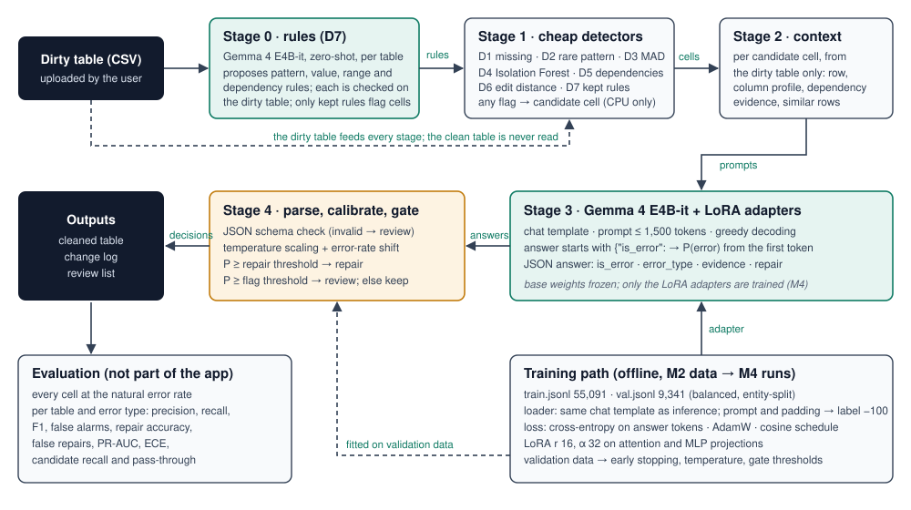
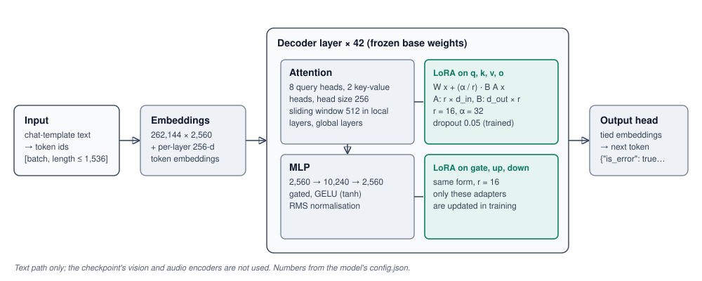

# ContextGuard: Milestone 3 Report
## Model Architecture and End-to-End Pipeline

**Course:** DSAI Lab Project, IIT Madras BS in Data Science and Applications · **Group 1** · **Submitted:** 5 Nov 2026
**Team:** Sidhaarth Shree, Jashan, Sahilpreet, Aaradhya · **Repository:** https://github.com/SidhaarthShree07/Group-1-DS-and-AI-Lab-Project

**Contents:** 1 Introduction · 2 Overall system architecture · 3 End-to-end workflow · 4 Model architecture selection · 5 Justification of model choices · 6 Model inputs and outputs · 7 Training strategy · 8 Model pipeline · 9 Retrieval and knowledge components · 10 Prompt engineering · 11 System integration · 12 Computational requirements · 13 Design decisions and trade-offs · 14 Risks and limitations · 15 Deliverables produced · 16 Summary and next steps · Appendices · AI usage disclosure · Team sign-off

**In one paragraph.** ContextGuard is a five-stage pipeline. The base model proposes data rules for a table, which are checked on the table itself (stage 0); cheap detectors choose candidate cells (stage 1); a prompt is built for each candidate from the dirty table only (stage 2); Gemma 4 E4B-it with LoRA adapters answers in JSON whether the cell is wrong, of which type, why, and what the repair is (stage 3); and a calibrated gate decides whether to repair, flag for review or keep the cell (stage 4). In this milestone every stage was implemented, and the whole pipeline was run on a small validation subset of 300 rows (3,500 cells) of three tables, with the zero-shot model and again with an adapter from a short LoRA smoke run, which trained, saved and reloaded correctly. Section 3.6 gives the counts, times and example outputs. Full model training is Milestone 4.

---

## 1. Introduction

**Project in brief.** ContextGuard finds cell-level errors in a table, names the error type, proposes a repair and says how confident it is (Milestone 1). Milestone 2 turned eight benchmark tables and five synthetic tables into 73,979 instruction–response examples (55,091 for training), split by entity without leakage, and rebuilt by one command.

**Objectives of Milestone 3.** (1) Select the model for every module and justify the choice against alternatives. (2) Describe the architecture, the data flow and how the prepared data matches the model's input. (3) Fix the training strategy, the loss and the metrics. (4) Build the complete pipeline and run it end to end on a small subset, with example outputs. The course team's five M3 items (dataset organisation, architecture with a diagram, justification, a small end-to-end run, loss and evaluation) sit in Sections 8, 2 and 4, 5, 3 and 7.

**How the architecture serves the project goals.**

| Goal (M1) | Where the architecture serves it |
|---|---|
| O1 / RQ1: detect errors better than rules, statistics, Raha and a zero-shot model | stages 1 to 3: the model judges each cell with evidence from the rest of the table |
| O2 / RQ2: repair safely | stage 4: a calibrated confidence with separate thresholds for flagging and for repairing |
| O3 / RQ3: work on unseen tables without labels | every input is computed from the table itself; no per-table labels or training |
| O4: cost | stage 1 sends only candidate cells to the model; stage 0 runs once per table |
| O5 / RQ4: downstream benefit | the cleaned table and change log are the output that the downstream test uses |
| O6: usable tool | the change log and the review list (Section 3.5) are what the demo shows (M6) |

---

<!-- pagebreak -->

## 2. Overall system architecture



### 2.1 Modules and data flow

The pipeline is linear; each stage reads the output of the previous one, and every stage reads the *dirty* table. No stage reads the clean table: it is used only to score the result.

| Stage | Module | What it does | Code |
|---|---|---|---|
| 0 | LLM rules (detector D7) | The base model proposes rules of four fixed kinds (pattern, allowed values, range, column A determines column B) from the column names and a profile of the dirty table, once per table. Each rule is checked on the dirty table; only rules that hold for at least 95% of values and flag at most 10% of a column are kept. | `src/detectors/llm_rules.py` |
| 1 | Cheap detectors D1 to D6 (+ D7) | D1 missing or placeholder value, D2 rare value pattern, D3 robust z-score (MAD), D4 Isolation Forest, D5 approximate dependencies (g3), D6 edit distance to frequent values, D7 kept rules. A cell flagged by any detector is a candidate. | `src/detectors/` |
| 2 | Context builder | For each candidate cell: the row with the cell marked, a profile of the column, dependency evidence and up to three similar rows, all from the dirty table (M2 Section 6.2). | `src/profiling/context.py` |
| 3 | Language model | Gemma 4 E4B-it with LoRA adapters; answers with JSON (`is_error`, `error_type`, `evidence`, `repair`); P(error) is read from the first answer token. | `src/llm/infer.py` |
| 4 | Parse, calibrate, gate | JSON schema check; temperature scaling and the shift to the table's error rate; repair, flag for review, or keep. | `src/evaluation/parse.py`, `calibrate.py`, `scripts/run_pipeline.py` |

### 2.2 External services and APIs

None at run time: the model runs locally. The model weights are downloaded once from the Hugging Face Hub (`google/gemma-4-E4B-it`, after accepting the licence there). No cloud API is called, so no table leaves the machine.

### 2.3 Technology stack

| Layer | Tools |
|---|---|
| Language and data | Python 3.11 or later; pandas 3.0.6 and NumPy 2.5 (pinned in `requirements.txt`) |
| Detectors | pandas, NumPy, scikit-learn (Isolation Forest) |
| Model | PyTorch 2.14, Transformers 5.20, PEFT (LoRA), Gemma 4 E4B-it in bf16 |
| Evaluation | our own metric code (`src/evaluation/`), no external service |
| Baselines | HoloClean, dBoost and Raha/Baran (Section 5.4) |
| Tests and build | pytest; `scripts/build_all.sh` for the data; `scripts/run_pipeline.py` for a run |
| Demo (M6) | Gradio |

---

## 3. End-to-end workflow

### 3.1 From user input to final output

1. The user uploads a CSV table. 2. Stage 0 proposes and checks rules; stage 1 marks candidate cells. 3. Stage 2 writes one prompt per candidate. 4. Stage 3 answers every prompt. 5. Stage 4 parses each answer, calibrates the confidence and decides. 6. The user receives the cleaned table, the change log (every repaired cell with old value, new value, confidence and evidence) and the review list (cells flagged but not repaired, and invalid answers). Figure 1 shows the same flow.

### 3.2 Inputs and outputs of each module

| Module | Input | Output |
|---|---|---|
| Stage 0 | dirty table | `rules.json`: every proposed rule with its support, the share of cells it flags, kept or dropped, and the reason |
| Stage 1 | dirty table, kept rules | `candidates.csv`: `table, split, row, column, d1 … d7, is_candidate` |
| Stage 2 | dirty table, candidate cells | one prompt per candidate (text, at most 1,500 tokens) |
| Stage 3 | prompts | `predictions.jsonl`: `id, table, split, row, column, raw_text, valid_json, is_error, error_type, evidence, repair, p_error, seconds` |
| Stage 4 | predictions | `decision` per cell; `change_log.csv`; review list |
| Scoring | predictions, candidates, cell truth | `metrics.json`, `metrics_by_table_type.csv` (table × error type) |

### 3.3 Error handling and fallbacks

| Failure | What happens |
|---|---|
| The model's answer is not valid JSON, misses a key, or contradicts itself (for example `is_error` false with a repair) | the cell is not repaired; it goes to the review list as "invalid answer" and is counted |
| A proposed rule does not compile, names an unknown column, or fails its check | the rule is dropped and logged with the reason; it never flags a cell |
| A detector cannot apply to a column (for example no numeric values for D3) | it skips that column |
| A prompt would exceed the token budget | the context is trimmed in a fixed order (fewer similar rows, shorter values, no frequent-values line; M2 Section 6.2) |
| The model runs out of GPU memory | the batch size is lowered and the batch repeated |
| The confidence is below the repair threshold | no repair: the cell is flagged for review or kept |

### 3.4 Storage and retrieval

There is no database. Data and results are files. `data/` holds the raw downloads, the processed cell files, the splits, the fine-tuning examples and the M3 subset (Section 8.1); none of it is in git except a 20-record sample. Every run writes `outputs/runs/<run-id>/` with the configuration (`run.json`: arguments, thresholds, library versions), the stage outputs of Section 3.2, `stage_counts.csv` and `stage_times.csv`. Run outputs are not committed; the summary tables are copied to `docs/tables/m3_*.csv`.

### 3.5 User interaction flow (planned for the demo, M6)

Upload a CSV → see the flagged cells, each with its evidence and confidence → accept or reject each proposed repair → download the cleaned CSV and the change log. Automatic repair without review happens only above the repair threshold; everything else is a suggestion.

### 3.6 Small-scale end-to-end run

The whole pipeline was run once on the M3 subset (Section 8.1: 100 validation rows each of Hospital, Flights and Beers; 3,500 cells, 448 errors) with the **zero-shot** model (no adapter yet), all three context blocks and stage 0 switched on. Calibration is the identity and the gate thresholds are placeholders (flag at P ≥ 0.5, repair at P ≥ 0.8) until they are fitted on validation data in M4. Command: `python scripts/run_pipeline.py --model <Gemma 4 E4B-it> --out outputs/runs/m3_e2e_full --d7`; scores re-computed with `scripts/score_run.py` (`docs/tables/m3_e2e_*.csv`).

**What every stage produced.**

| Table | Cells | Errors | Stage 0 rules proposed / kept | Candidates (share of cells) | Errors among candidates | Model calls | Invalid answers |
|---|---:|---:|---|---:|---:|---:|---:|
| Hospital | 1,900 | 51 | 11 / 7 | 323 (17.0%) | 45 (88.2%) | 323 | 0 |
| Flights | 600 | 207 | 5 / 5 | 171 (28.5%) | 147 (71.0%) | 171 | 0 |
| Beers | 1,000 | 190 | 11 / 7 | 271 (27.1%) | 72 (37.9%) | 271 | 0 |
| **Together** | 3,500 | 448 | 27 / 19 | 765 (21.9%) | 264 (58.9%) | 765 | 0 |

**Time per stage** (one GPU, shared with another job): loading the model 7 s; stage 0 13 to 25 s per table (one generation); stages 1 and 2 under 1 s per table; stage 3 54 to 99 s per table, about 0.30 s per cell; scoring 2 s. Peak GPU memory 16.8 GiB.

**Result of the run** (every cell scored at its natural error rate; zero-shot model, so this is a check that the pipeline works, not a ContextGuard result):

| Table | Precision | Recall | F1 |
|---|---:|---:|---:|
| Hospital | 0.42 | 0.88 | 0.57 |
| Flights | 0.94 | 0.48 | 0.64 |
| Beers | 0.74 | 0.37 | 0.49 |
| **All cells** | **0.70** | **0.48** | **0.57** |

Repair accuracy 13.8% of all errors (62 of 448); false-repair rate 47.9% of the repairs the model proposed (67 of 140); 29.8 false alarms per 1,000 correct cells; PR-AUC 0.80; expected calibration error 0.15; error-type macro-F1 0.72 on the detected errors. Gate decisions: 128 repairs, 177 flags for review, 460 cells kept.

**What the run shows.** (1) All stages work together: every answer was valid JSON, and the files of Section 3.2 were written and scored. (2) The candidate stage is the first limit: 41% of the errors never reach the model, most of them in Beers (`ounces` and `abv`, where the wrong format is the common one) and Flights (times that are valid times but the wrong ones). (3) The zero-shot model finds many of the errors it sees, but its repairs are weak and its false repairs many, which is what fine-tuning (M4) and the gate are for. (4) **Stage 0 added almost nothing in this trial:** of 27 proposed rules 19 passed the check, but together they added 5 candidate cells and no error. The reason is visible in `rules.json`: rules of the kind "allowed values" were built from the frequent values of the dirty profile, so they listed typos as allowed values (for example `yes`, `yxs`, `yex` for `emergency_service`), and a check on the dirty table cannot catch that. For M4 (experiment E6) the prompt will ask only for format and range rules and drop value lists that contain near-duplicates. Stage 0 is not fine-tuned (it uses the base weights, Section 5.1), so only its prompt and its rule check change. It stays in the architecture for now because it is cheap (one generation per table), is switched on by one flag (`--d7`) and can only add candidates, never change data; D7 is kept only if E6 shows a gain, otherwise it is switched off and the pipeline starts at stage 1.

**Example outputs** (from `predictions.jsonl`; values shortened):

| Case | Cell | Dirty → clean | Model answer |
|---|---|---|---|
| Correct detection and repair | Hospital `phone` | `3342xx2100` → `3342882100` | error, pattern, repair `3342882100`, P 1.00: "The phone number contains 'xx' which is not a valid digit format for this column." → repaired |
| Correct detection and repair | Hospital `state_average` | `xl_scip-inf-2` → `al_scip-inf-2` | error, pattern, repair `al_scip-inf-2`, P 1.00 → repaired |
| Correct detection, no repair possible | Flights `sched_arr_time` | empty → `1:39 p.m.` | error, missing, repair null, P 0.91: "The cell is empty, and the column profile shows 40.0% missing values." → flagged for review |
| False alarm | Beers `abv` | `0.063` (correct) | error, pattern, repair `0.063` (the same value), P 0.94 → repaired to itself. A post-processing rule "a repair equal to the dirty value means not an error" is added for M4 |
| False alarm | Hospital `score` | `82%` (correct) | error, pattern, repair `99%`, P 0.62 → flagged for review, not repaired |
| Missed error | Flights `act_arr_time` | `1:23 p.m.` → `1:30 p.m.` | not an error, P 0.00: "matches the common pattern" (a valid time that disagrees with other sources needs evidence the zero-shot model does not use) |

<!-- pagebreak -->

**Experiment E2 on the subset** (context blocks switched; same candidate cells, D1 to D6; zero-shot):

| Context in the prompt | Precision | Recall | F1 | F1 Hospital / Flights / Beers | False alarms per 1,000 correct cells | Repair accuracy | False-repair rate | PR-AUC |
|---|---:|---:|---:|---|---:|---:|---:|---:|
| Row only | 0.46 | 0.50 | 0.48 | 0.21 / 0.72 / 0.52 | 85.5 | 4.5% | 71.8% | 0.80 |
| Row + column profile | 0.44 | 0.50 | 0.47 | 0.24 / 0.70 / 0.48 | 95.0 | 6.0% | 64.3% | 0.72 |
| Full prompt (+ dependency evidence and similar rows) | **0.70** | 0.48 | **0.57** | 0.57 / 0.64 / 0.49 | **29.8** | **13.8%** | **47.9%** | 0.80 |

(`docs/tables/m3_e2_context.csv`; 760 candidate cells, every cell of the three tables scored.) On the zero-shot model the full prompt raises precision from 0.46 to 0.70 and cuts false alarms to about a third and false repairs from 72% to 48%, at about the same recall; the gain comes from the dependency evidence and the similar rows, not from the column profile, which alone does not help. The gain is large on Hospital (F1 0.21 to 0.57), where errors break dependencies, while on Flights the row alone does better (0.72 against 0.64) and on Beers about the same (0.52 against 0.49): many Flights errors are valid times that differ between sources, and the evidence of the other rows can mislead there (M1 Section 6.1 named this risk). This is one seed on 448 errors with the zero-shot model; E2 is repeated on the fine-tuned model in M4. **The stage 3 prompt is not changed for M4 because of this result:** the 55,091 training examples were built with it in M2, the training split contains Flights, and fine-tuning can teach the model when the other rows mislead. Only if the fine-tuned model still does worse on Flights with the full prompt do we change the context builder (for example, leave out similar rows that disagree with each other), rebuild the examples and train again.

**The same run with the smoke adapter** (Section 7.1; 100 training steps, not a trained model; `docs/tables/m3_e2e_adapter_check.csv`). The pipeline was run again with `--adapter`, to check that stage 3 works with LoRA weights loaded:

| Stage 3 model | Precision | Recall | F1 | F1 Hospital / Flights / Beers | False alarms per 1,000 correct cells | Repair accuracy | False-repair rate | PR-AUC |
|---|---:|---:|---:|---|---:|---:|---:|---:|
| Zero-shot, full prompt | 0.70 | 0.48 | 0.57 | 0.57 / 0.64 / 0.49 | 29.8 | 13.8% | 47.9% | 0.80 |
| After 100 LoRA steps | 0.53 | 0.56 | 0.55 | 0.29 / 0.78 / 0.53 | 72.4 | 28.3% | 72.7% | 0.87 |

The adapter loads and every answer stays valid JSON. After only 3,200 examples the repair accuracy already doubles and the ranking of cells improves (PR-AUC 0.80 to 0.87; Flights F1 0.64 to 0.78), but the model flags far more correct cells, above all in Hospital (error rate 2.7%). This is the expected effect of training on balanced data (half errors): without the prior shift of stage 4 the model assumes many more errors than a real table has. It shows why calibration and the gate are part of the architecture, and it is the first thing M4 measures with the fitted calibration.


---

## 4. Model architecture selection

### 4.1 Model used in each module

| Module | Model | Pre-trained or custom | Trained by us |
|---|---|---|---|
| Stage 0 rules | Gemma 4 E4B-it, base weights, zero-shot | pre-trained | no |
| Stage 1 detectors | D1 to D6: classical methods (string matching, robust statistics, Isolation Forest, g3 dependency scan, edit distance) | custom code, no learned weights except Isolation Forest fitted per table | no |
| Stage 3 judge | Gemma 4 E4B-it with LoRA adapters | pre-trained base, adapted with LoRA | LoRA adapters only (M4) |
| Stage 4 calibration | temperature scaling (one parameter) and a prior shift by the table's error rate | custom | fitted on validation data (M4) |

### 4.2 The language model

Gemma 4 E4B-it is an instruction-tuned decoder-only transformer. The checkpoint (`Gemma4ForConditionalGeneration`) also contains vision and audio encoders; ContextGuard uses only the text path, and LoRA adapters are attached only to the language model. The numbers below are read from the model's `config.json`.

| Property | Value |
|---|---|
| Layers | 42 decoder layers |
| Hidden size | 2,560 |
| Attention | 8 query heads, 2 key-value heads (grouped-query attention), head size 256 (512 in the global layers); local layers use a sliding window of 512 tokens |
| MLP | 10,240 intermediate size, GELU (tanh) |
| Vocabulary | 262,144 tokens, embeddings tied with the output layer |
| Per-layer embeddings | an extra 256-dimensional embedding per layer for every token (`hidden_size_per_layer_input`) |
| Context length | 131,072 positions (we use at most 1,536) |
| Parameters | 8.0 billion in the checkpoint including the vision and audio encoders (7.9 billion loaded in the M1 comparison); about 4.5 billion effective |
| Precision | bf16 |



**LoRA.** In each of the 42 layers, the projections q, k, v, o of attention and gate, up, down of the MLP get a pair of low-rank matrices (rank 16, alpha 32, dropout 0.05). The base weights stay frozen. The checkpoint holds 8.0 billion parameters including the vision and audio encoders; the model as loaded for training has 7.94 billion. LoRA rank 16 goes on 258 projection matrices: 7 per layer in the 42 layers, minus the key and value projections of the last 18 layers, which reuse the keys and values of earlier layers (`num_kv_shared_layers` = 18) and have no projections of their own. It trains **34.9 million parameters, 0.44%** (printed by `src/llm/train_lora.py`).

### 4.3 Stage 1 detectors

All detectors have one interface, `detect(dirty_df) -> DataFrame[row, column, detector, score]`, and read only the dirty table.

| Detector | Method | Flags |
|---|---|---|
| D1 | placeholder list (`""`, `nan`, `null`, `n/a`, `-`, `?`, `not available`, …) | missing or placeholder values |
| D2 | character pattern of each value (letters → a/A, digits → 9); rare patterns (≤ 2% of the column, or at most 2 occurrences) | format and typo errors |
| D3 | robust z-score with the median absolute deviation, threshold 3.5 | extreme numbers |
| D4 | Isolation Forest on the numeric columns | unusual combinations of numbers |
| D5 | approximate dependencies A → B (g3, key and support filters); rows that disagree with their group's majority | rule violations |
| D6 | normalised edit distance from rare values to frequent values of the column | typos of frequent values |
| D7 | kept stage 0 rules | pattern, value, range and dependency violations |

**Candidate recall on the validation splits** (`docs/tables/m3_candidate_recall.csv`, `scripts/evaluate_candidates.py`, D1 to D6). Candidate recall is the share of true errors that reach the model; it is the ceiling of the whole system.

| Table | Cells | Candidates (pass-through) | Errors | Errors among candidates (recall) | Recall missing / pattern / rule |
|---|---:|---:|---:|---:|---|
| Hospital | 2,907 | 471 (16.2%) | 79 | 65 (82.3%) | – / 68.8% / 85.7% |
| Flights | 2,160 | 434 (20.1%) | 723 | 429 (59.3%) | 100% / 38.6% / 7.1% |
| Beers | 3,630 | 909 (25.0%) | 679 | 252 (37.1%) | 100% / 8.9% / 66.7% |
| Rayyan | 1,650 | 838 (50.8%) | 141 | 66 (46.8%) | 100% / 73.0% / 28.6% |
| Movies | 18,853 | 9,224 (48.9%) | 1,054 | 451 (42.8%) | 100% / 42.3% / – |
| Tax | 45,000 | 3,290 (7.3%) | 51 | 46 (90.2%) | – / 100% / 79.2% |
| Inpatient | 6,677 | 1,021 (15.3%) | 695 | 548 (78.9%) | 100% / 82.2% / 51.7% |
| Facilities | 12,060 | 3,796 (31.5%) | 1,250 | 1,179 (94.3%) | 100% / 99.6% / 86.5% |

Format-only cells are not counted as errors. Missing values are always found; pattern and rule errors that look like normal values are the weak point (Beers `ounces`, where the wrong format is the common one; Flights times that are valid times). Thresholds were set once and not tuned on test data.

### 4.4 Input and output formats, and how the models are combined

Input: a dirty CSV. Between stages: the files of Section 3.2. The model's input is text (a chat message, Section 6); its output is a JSON string. The models are combined in a fixed order: the stage 0 model and the detectors only *add* candidates; the stage 3 model decides; the gate applies the decision. Stage 0 and stage 3 use the same base weights, so only one model is loaded.

---

## 5. Justification of model choices

### 5.1 Why each model was chosen

- **Gemma 4 E4B-it for stage 3.** In the M1 zero-shot comparison on 1,500 cells of five tables, over three sampling seeds, it scored 0.645 ± 0.007 against 0.603 for Qwen3.5-9B and 0.548 for Qwen3-4B-Instruct, with the lowest false-repair rate (0.39 against about 0.68 to 0.70) and 100% valid JSON (M1 Section 9; `outputs/reports/model_bakeoff/`). It fits on one GPU in bf16 (peak 19.0 GiB in that run). It is instruction-tuned, so it can be adapted with a small LoRA instead of full fine-tuning.
- **The same model for stage 0.** Proposing rules needs general knowledge of formats (zip codes, state codes, ranges), which the base model has; reusing it loads no second model.
- **Classical detectors for stage 1.** They are fast (Section 12), need no labels and look at different signals, so together they keep most errors while sending only part of the cells to the model.
- **Temperature scaling for stage 4.** One parameter, fitted on validation data; it does not change which cell ranks above which, only how confident the scores are.

### 5.2 Comparison with alternative approaches

| Approach | Example | Strength | Limitation for our purpose |
|---|---|---|---|
| Rules and constraints | HoloClean (B1), NADEEF | exact on known dependencies; repairs | rules must be written or mined; weak on tables without dependencies (Rayyan, Movies) |
| Statistics | dBoost (B2), D3, D4 | fast, no labels | rare is not wrong; most of our errors are not extreme numbers (M2 Section 5.3) |
| Learned per table | Raha and Baran (B3) | strong with 20 labels | labels needed again for every table; nothing transfers |
| Zero-shot or few-shot LLM | B4, B5 | no training | the M1 comparison: repair accuracy about a third and many wrong repairs |
| Large fine-tuned LLM | Jellyfish (7 to 13B) | multi-task, local | runs on every cell; its Hospital result is not an unseen-table result because Hospital was in its training data (M1 Section 5) |
| Cluster, label, classify | ZeroED | few model calls | detection only, no repair; uses large models by default (Qwen2.5-72B) |
| Error generation | TableEG | realistic errors | it generates errors, it does not clean; its released training files contain our unseen test tables |
| **ContextGuard** | | candidates + a small fine-tuned model with table evidence + calibrated gate | needs fine-tuning (M4); recall is capped by stage 1 (Section 14) |

The full comparison of the LLM cleaners with section references is in M1 Section 5 and M2 Section 2.3.

### 5.3 Advantages, disadvantages and computational considerations

Advantages: one model for detection, type and repair; evidence from the table itself, so no labels for a new table; a confidence that can be calibrated; local execution. Disadvantages: the candidate stage caps recall; a language model can be confidently wrong, which is why the gate exists; training needs a GPU. Computationally, the model is called only for candidates (pass-through 16% to 51% of cells on the validation splits, Section 4.3) and stage 0 once per table.

### 5.4 Expected performance and the first baseline runs

We expect the fine-tuned model to beat the zero-shot model clearly on repair accuracy and false repairs, because the M1 comparison showed these as its weakest points, and to beat the classical baselines most on tables with dependencies and repeated entities. We do not set exact targets before the M4 pilot (M1 decision). The first baseline runs give the classical reference on the test splits:

| Baseline (first run) | Hospital | Flights | Beers | Rayyan | Movies |
|---|---:|---:|---:|---:|---:|
| B1: violation check of the mined denial constraints (HoloClean itself not yet run) | 0.13 | 0.35 | 0.08 | 0.00 (no constraint mined) | 0.00 |
| B2: dBoost, one setting (histogram 0.5, 0.5; grid on the train split not yet done) | 0.09 | 0.57 | 0.53 | 0.11 | 0.00 (no cell flagged; being checked) |
| B3: Raha detection with a reduced strategy set and 20 labelled tuples (Baran not yet run) | 0.41 | 0.88 | 0.95 | 0.22 | 0.12 |

Detection F1 on the test splits, the 20 labelled tuples excluded from every method's scoring (Rule D8; `docs/tables/m3_baselines_first_run.csv`, `scripts/run_baselines.py`). These are **simplified first runs** that test the baseline input files and the scoring; they are not the baselines as published and are not compared with published numbers. The full runs (HoloClean with its repair, Raha's complete strategy set with Baran, dBoost's grid chosen on the train split) follow in M4 and M5.

### 5.5 Suitability for our data

The errors of our tables are mostly pattern and rule errors (M2 Section 10), many of which are visible only against other rows (a city that does not match its zip code). The prompt carries exactly that evidence, and the model reads values as text, which suits mixed text and number columns. Outliers exist only in the synthetic training data, so outlier results will be reported separately (M2 Section 14.2).

---

## 6. Model inputs and outputs

### 6.1 Input features and their representation

The input is text, not a feature vector. For one cell the prompt contains: the task and the four error types; the table, column and cell value; the whole row with the cell marked; the column profile (type, distinct values, missing share, frequent values, common patterns, numeric range, the value's own pattern and frequency); dependency evidence (columns that usually determine this one, with the group's majority value); and up to three similar rows (M2 Section 6.2, `src/profiling/context.py`). Example in Appendix C.

### 6.2 Output

The model answers with one JSON object: `{"is_error": true or false, "error_type": "missing|pattern|rule|outlier|none", "evidence": "<one sentence>", "repair": "<value or null>"}`. Decoding starts after the fixed prefix `{"is_error":`, so the first generated token is the decision, and P(error) is the softmax mass of "true" against "false" at that position.

### 6.3 Tokenisation and embedding strategy

- **Chat template.** The prompt is wrapped with the tokenizer's own chat template (`apply_chat_template`), identically in training (`src/llm/dataset.py`) and inference (`src/llm/infer.py`). For Gemma 4 E4B-it this is `<bos><|turn>user\n{prompt}<turn|>\n<|turn>model\n{answer}<turn|>\n`; thinking mode is off. A test checks that the training prompt equals the generation prompt.
- **Tokenizer.** Gemma 4's own tokenizer (262,144 tokens). The model's own token embeddings are used; there is no separate embedding model.
- **Shapes and tensor formats.** `input_ids`, `attention_mask` and `labels` are `int64` tensors of shape `[batch, length]`; `length` is the longest sequence of the batch (dynamic padding, no packing). Training pads on the right (pad id 0), generation on the left. Labels are −100 for every prompt and padding token, so the loss covers the answer tokens only.
- **Token lengths** (`docs/tables/m3_loader_stats.csv`, Gemma 4 tokenizer with the chat template):

| Split | Examples | Min | Median | 95th percentile | Max | Longest prompt | Longest answer | Over 1,536 |
|---|---:|---:|---:|---:|---:|---:|---:|---:|
| Train | 55,091 | 408 | 544 | 712 | 1,020 | 923 | 169 | 0 |
| Validation | 9,341 | 405 | 545 | 711 | 985 | 900 | 133 | 0 |

The longest example is the 1,009 tokens of prompt and answer measured in M2 plus the template tokens. The maximum length is set to 1,536 (budget plus template); no example is cut.

**Not applicable:** image and audio preprocessing (the vision and audio encoders of the checkpoint are not used).

---

## 7. Training strategy

### 7.1 Set-up (decision D12)

| Item | Choice | Reason |
|---|---|---|
| Fine-tuning or feature extraction | fine-tuning with LoRA | the task needs generation (evidence, repair), not a classifier on frozen features |
| Transfer learning | from the instruction-tuned Gemma 4 E4B-it | it already follows instructions and writes JSON (100% valid in M1) |
| Frozen and trainable layers | all base weights frozen; LoRA adapters on q, k, v, o, gate, up, down of the 42 language-model layers trainable | small number of trained parameters, one GPU, less overfitting |
| Optimiser | AdamW, no weight decay on the adapters | standard for LoRA |
| Learning rate | 2e-4, cosine schedule, 3% warm-up; gradient clipping at 1.0 | common LoRA starting point; tuned in M4 |
| Batch size | 4 examples per step × 8 accumulation steps = 32 | fits one GPU with gradient checkpointing |
| Epochs | 1 to 2 (about 1,720 optimiser steps per epoch on 55,091 examples) | fixed in M4 from the validation loss |
| Early stopping | validation loss every 200 steps; stop after 3 evaluations without improvement | the validation split is entity-disjoint from training |
| Checkpointing | adapter saved every 200 steps and at the end; the best and the last are kept | resume and choose the best |
| Precision and memory | bf16, gradient checkpointing | memory |
| Seed | 42 for sampling and shuffling | reproducibility |

`src/llm/train_lora.py` implements this. **Smoke run** (`docs/tables/m3_lora_smoke.csv`): 100 optimiser steps on a seeded sample of 3,200 training examples, batch 32, validation loss on 256 validation examples every 25 steps, on one GPU shared with another job.

| Step | Examples seen | Training loss | Validation loss |
|---:|---:|---:|---:|
| 0 | 0 | – | 1.220 |
| 25 | 800 | 0.059 | 0.100 |
| 50 | 1,600 | 0.047 | 0.086 |
| 75 | 2,400 | 0.042 | 0.080 |
| 100 | 3,200 | 0.060 | **0.079** |

The validation loss falls from 1.22 to 0.08, so the loader, the masking, the optimiser and the schedule work together; the saved adapter was loaded again and gave the same validation loss (0.0326 before and after on 16 examples); 22 minutes, peak GPU memory 30.1 GiB. A falling loss after 3,200 examples does not mean the model is good: the answers are short and partly predictable from the prompt, and only the M4 runs with the cell-level metrics show the effect of training.

### 7.2 Loss

Token-level cross-entropy over the answer tokens only:

**L = −(1 / |A|) · Σ log p(y<sub>t</sub> | y<sub>&lt;t</sub>)**, summed over the answer positions t in A (labels ≠ −100).

Prompt tokens are masked because the model must learn to answer, not to repeat the table. No class weights: the training set is balanced by construction (M2 Section 6.2), and the shift to real error rates is handled by calibration (7.3), not by the loss.

### 7.3 Confidence and calibration

P(error) comes from the first answer token. Temperature scaling divides the log-odds by one temperature T fitted on validation data (minimising the log loss). Because training and validation data are balanced (50% errors) but real tables are not, the calibrated log-odds are then shifted by log(π / (1 − π)) − log(0.5 / 0.5), where π is the table's error rate (M2 Section 14.3). Both are implemented in `src/evaluation/calibrate.py` with tests; they are fitted in M4. In the M3 run the calibration is the identity.

### 7.4 Evaluation metrics

| Metric | Definition | Question |
|---|---|---|
| Detection precision, recall, F1 | over all cells; per table and macro-averaged | RQ1, RQ3 |
| Error-type macro-F1 | over missing, pattern, rule, outlier, on correctly detected errors | RQ1 |
| Repair accuracy | errors flagged and repaired to exactly the clean value (Raha rule), over all errors | RQ2 |
| False-repair rate | wrong repairs over all repairs made (including repairs of correct cells) | RQ2 |
| False-alarm rate; false alarms per 1,000 cells | correct cells flagged over correct cells | real-rate use (M2 14.3) |
| PR-AUC; precision–coverage curve | from P(error) | RQ2 |
| Expected calibration error | 10 equal-width bins | RQ2 |
| Candidate recall; pass-through | errors among candidates over all errors; candidates over all cells | O4 |
| Bootstrap 95% intervals | resampling cells | all |

Every metric is reported per table and per error type with the number of errors behind it (`metrics_by_table_type.csv`); entries with fewer than 30 errors are marked. Format-only cells (`3` against `3.0`) are left out (not labels, M2 Section 6.2). Metrics are computed on every cell at the natural error rate; the balanced test file is only a quick check.

---

## 8. Model pipeline

### 8.1 Dataset organisation

After `bash scripts/build_all.sh` (M2), `data/` holds (`docs/tables/m3_data_tree.csv`, `scripts/show_data_tree.py`):

| Folder | Files | Size | Content | Written by |
|---|---:|---:|---|---|
| `data/raw/` | 29 | 182.2 MB | pinned downloads (Raha, BClean, ZeroED, UCI, Zenodo, TableEG annotations) | `scripts/download_data.py` |
| `data/processed/core/`, `external/`, `synthetic/` | 15 | 63.9 MB | one row per cell: dirty value, clean value, `is_error`, error type | `src/data/load_core.py`, `load_external.py`, `synthetic.py` |
| `data/processed/examples/` | 3 | 130.5 MB | `train.jsonl`, `val.jsonl`, `test.jsonl` | `src/llm/build_examples.py` |
| `data/splits/core/<table>/` | 45 | 25.1 MB | `{train,val,test}{,_clean,_cells}.csv`, split by entity | `src/data/split.py` |
| `data/splits/external/<table>/` | 27 | 20.8 MB | the same for Tax, Inpatient, Facilities | `src/data/load_external.py` |
| `data/splits/synthetic/<table>/` | 15 | 39.5 MB | training split only | `src/data/synthetic.py` |
| `data/subsets/m3/<table>/` | 9 | 0.3 MB | the M3 subset: 100 validation rows of Hospital, Flights, Beers | `src/data/make_subset.py` |
| `data/sample/` | 2 | 0.04 MB | the 20-record sample (the only data in git) | `src/llm/build_examples.py` |

**The M3 subset** (decision D17, `docs/tables/m3_subset_summary.csv`): 100 rows of each validation split, seed 42, every cell kept, so every stage sees the real error rate. It never touches a test split.

| Table | Subset rows | Cells | Errors | Error rate (subset / full validation) | Missing / pattern / rule |
|---|---:|---:|---:|---|---|
| Hospital | 100 | 1,900 | 51 | 2.68% / 2.72% | 0 / 14 / 37 |
| Flights | 100 | 600 | 207 | 34.50% / 33.47% | 98 / 66 / 43 |
| Beers | 100 | 1,000 | 190 | 19.00% / 18.71% | 54 / 131 / 5 |
| **Together** | 300 | 3,500 | 448 | | 152 / 211 / 85 |

### 8.2 Preprocessing before training and inference

| Step | What | Where (M2) | Code |
|---|---|---|---|
| Ground truth | Raha rule: unescape HTML, collapse runs of tab, newline and space, strip the ends; case is kept | §6.1 | `src/data/load_core.py` |
| Column alignment | dirty and clean columns matched by position | §6.1 | `load_core.py` |
| Format-only cells | the same number written differently is not a label | §6.2 | `load_external.py`, `build_examples.py` |
| Entity split | 70/15/15, grouped on the clean entity key | §9 | `src/data/split.py` |
| Example selection | every error and one correct cell per error, half of them hard negatives; at most 20% synthetic | §6.2 | `build_examples.py` |
| Token budget | at most 1,500 tokens, fixed trimming order | §6.2 | `src/profiling/context.py` |
| Chat template and masking | Section 6.3 | M3 | `src/llm/dataset.py` |

The dirty tables are not cleaned: they are the model's input.

### 8.3 Feature engineering, intermediate outputs, post-processing, final prediction

Feature engineering is the context of Section 6.1, built from the dirty table at run time, so a new table needs no preparation. Intermediate outputs are the files of Section 3.2. Post-processing (`src/evaluation/parse.py`): the answer is parsed (a Markdown code fence is tolerated), the four keys and their types are checked, `error_type` must be one of the five values, and contradictions are rejected (`is_error` false with a type or a repair; `is_error` true with type `none`); any failure gives "not flagged, invalid" and the cell goes to review. The final prediction per cell is the gate's decision: repair (P ≥ repair threshold and a repair is given), flag for review (P ≥ flag threshold), or keep. Cells that are not candidates are kept.

---

## 9. Retrieval and knowledge components

ContextGuard is not a retrieval-augmented system: there is no embedding model, vector database, chunking or re-ranking. The only retrieval is inside the context builder: the similar rows are the rows that share the value of the strongest determinant column (exact match, Section 6.1). Stage 0 uses the model's own general knowledge (formats, codes, ranges), and every rule it proposes is checked against the table before use (Section 2).

---

<!-- pagebreak -->

## 10. Prompt engineering

- **Templates.** Stage 3: the cell prompt of Section 6.1 (Appendix C). Stage 0: the rule prompt (column summaries; the four allowed rule kinds with their JSON form; "answer with a JSON list only"; Appendix C).
- **System prompt.** None: the task text is part of the user message, in training and in inference alike, so both see exactly the same text.
- **Zero-shot and few-shot.** Stage 0 and baseline B4 are zero-shot; B5 adds three demonstration pairs; stage 3 is fine-tuned (from M4).
- **Structured output.** A fixed JSON schema; decoding starts after the prefix `{"is_error":`, which also gives the confidence.
- **Hallucination mitigation.** (1) In training, the evidence sentence is built from a template and states only facts that are in the prompt (M2 Section 6.2), so the model is not taught to invent facts. (2) Stage 0 rules are checked on the table and only add candidates; they never change data. (3) The gate repairs only above a calibrated threshold. (4) The repair is compared with the cell's context in the change log, so a reviewer sees the evidence.
- **Guardrails.** JSON schema validation (Section 8.3); no repair below the threshold; invalid answers to review.
- **Tool use.** None.

---

## 11. System integration

The modules communicate through function calls inside one Python process and through files between runs. The interfaces were fixed at the start of the milestone and are listed in Appendix B. Shared schemas: the cell record (`table, split, row, column` as key), the candidate record, the prediction record and the metrics grid. There is no database and no orchestration framework (LangChain, LangGraph and similar are not used): the pipeline is a fixed linear sequence, so one driver script (`scripts/run_pipeline.py`) is enough and keeps every step testable.

---

## 12. Computational requirements

Stated as requirements, not as a description of our own machines.

| Item | Requirement |
|---|---|
| GPU | one GPU with about 20 GiB free for inference in bf16 (peak 19.0 GiB in M1); training with LoRA and gradient checkpointing: peak 30.1 GiB in the smoke run (4 examples per step, Section 7.1) |
| CPU | stage 1 runs on the CPU: D1 to D6 together about 7.9 s per 1,000 rows on the validation splits, most of it D6 (4.7 s) and D5 (1.8 s); memory a few MB (`docs/tables/m3_detector_cost.csv`) |
| Inference latency | about 0.30 s per candidate cell with the zero-shot model on a shared GPU (Section 3.6), so about 0.07 s per cell of the table at 22% pass-through; stage 0 adds 13 to 25 s per table |
| Storage | model weights about 16 GB (bf16); a LoRA adapter of 34.9 million parameters, 140 MB as saved; prepared data about 0.5 GB (`data/`, Section 8.1) |

| Detector | Seconds per 1,000 rows | Peak memory (MB) |
|---|---:|---:|
| D1 missing | 0.09 | 0.2 |
| D2 pattern | 0.32 | 3.1 |
| D3 robust z | 0.21 | 1.3 |
| D4 Isolation Forest | 0.79 | 1.4 |
| D5 dependencies | 1.81 | 1.4 |
| D6 edit distance | 4.67 | 0.6 |

---

## 13. Design decisions and trade-offs

| Decision | Rejected alternative | Why |
|---|---|---|
| The model judges only candidate cells | the model on every cell | cost grows with cells; experiment E3 measures what the filter loses |
| Evidence from the table in the prompt | the cell or row alone | errors are often visible only against other rows; experiment E2 measures it |
| One small model, LoRA | a larger model (9B and more), full fine-tuning | the M1 comparison favoured the smaller Gemma; LoRA fits one GPU and overfits less |
| Local execution | hosted models through an API | tables may hold private data; cost; reproducibility |
| No retrieval system | RAG with a vector database | the evidence is in the table itself |
| Rules from the model, checked on the table (stage 0) | rules written by hand, or rules applied without checking | hand rules do not transfer; unchecked rules can be invented |
| Training on our own examples | TableEG's released training files | they contain our unseen test tables |

Accuracy against speed: a stricter candidate filter is faster but caps recall (Section 4.3); the thresholds are chosen on validation data. Cost against performance: the 4.5B-effective model was chosen over a 9B model that was worse in the M1 comparison. Model size: smaller models (Qwen3-4B) were clearly worse zero-shot. Scalability: the dependency scan grows with the square of the number of columns, and model calls grow with the number of candidates; batching and the candidate filter keep both manageable for tables of tens of thousands of rows.

---

## 14. Risks and limitations

| Risk | Where | Mitigation |
|---|---|---|
| The candidate stage misses errors (recall 37% to 94% on the validation splits) | stage 1 | add D7; lower thresholds where pass-through allows; report the ceiling per table; E3 sends all cells for comparison |
| Detectors cannot see errors that look normal (Beers `ounces`: every value has the same wrong pattern, so pattern rarity fails) | stage 1 | D5 and D7 dependency rules; the model's context; reported per column |
| The model is confidently wrong | stage 3 | calibration and the gate; review list; false-repair rate reported |
| Stage 0 invents rules | stage 0 | fixed rule kinds, every rule checked on the table, rules only add candidates |
| Invalid JSON | stage 3 | prefix, schema check, invalid → review; counted |
| Outliers learned only from synthetic data | training | reported separately; E5 with and without synthetic data (M2 Section 14.2) |
| Error types of the external tables are heuristic | evaluation | reported separately (M2 Section 14.1) |
| Bias: English, mostly US tables | data | results are stated for these domains only |
| Pandas versions order ties differently in the prompts | reproducibility | pinned pandas 3.0.6 (M2 revision) |
| Long tables and many columns | scalability | candidate filter, batching; dependency scan cost stated |

Risks of the individual modules: **loader and subset**: a mismatch between the training and inference chat templates would silently degrade the model, now prevented by taking the template from the tokenizer and testing it; a sequence over the maximum length would cut the JSON answer, so the loader reports every example over the limit (none today). **Evaluation**: a model that answers in another format would count as "not flagged", so the share of invalid answers is reported with every result; calibration fitted on few validation errors of a table is unstable, so it is fitted on all tables together and checked per table. **Detectors**: fixed thresholds may suit some tables badly (pass-through 7% to 51%); D6 is the slowest detector and grows with the number of rare values; detectors cannot see errors that look like normal values.

---

## 15. Deliverables produced

| Deliverable | Path |
|---|---|
| Architecture diagram; model diagram | `docs/figures/m3/architecture.svg`, `model_lora.svg` |
| Pipeline driver and re-scoring | `scripts/run_pipeline.py`, `scripts/score_run.py` |
| Inference | `src/llm/infer.py` |
| LoRA training | `src/llm/train_lora.py` |
| Stage 0 rules | `src/detectors/llm_rules.py`, `tests/test_llm_rules.py` |
| Training data loader | `src/llm/dataset.py`, `tests/test_m3_jashan.py` |
| Subset and data tree | `src/data/make_subset.py`, `scripts/show_data_tree.py`, `docs/tables/m3_subset_summary.csv`, `m3_data_tree.csv`, `m3_loader_stats.csv` |
| Configuration | `configs/m3_smoke.yaml` |
| Parsing, metrics, calibration | `src/evaluation/parse.py`, `metrics.py`, `calibrate.py`, `tests/test_parse.py`, `test_metrics.py`, `test_calibrate.py` |
| Detectors and candidates | `src/detectors/d1_missing.py` … `d6_typo.py`, `candidates.py`, `tests/test_detectors.py`, `scripts/evaluate_candidates.py`, `docs/tables/m3_candidate_recall.csv`, `m3_detector_cost.csv` |
| Baseline first runs | `scripts/run_baselines.py`, `docs/tables/m3_baselines_first_run.csv` |
| Run results | `docs/tables/m3_e2e_*.csv` (including `m3_e2e_adapter_check.csv`), `m3_e2_context.csv`, `m3_lora_smoke.csv` |
| Prompt templates and model configuration | Appendix C; Section 4.2; `configs/m3_smoke.yaml` |

**Repository structure** (main folders): `src/data` (loading, splits, synthetic data, subset), `src/profiling` (context builder, dependency scan), `src/detectors` (D1 to D7, candidates), `src/llm` (examples, loader, training, inference), `src/evaluation` (parsing, metrics, calibration), `scripts` (download, build, pipeline, baselines, evaluation), `configs`, `tests`, `docs` (reports, tables, figures), `data` (not in git except the sample), `outputs` (run records, not in git).

---

## 16. Summary and next steps

**Architecture decisions.** A five-stage pipeline: model-proposed rules checked on the table, cheap detectors, a context prompt from the dirty table, Gemma 4 E4B-it with LoRA adapters answering in JSON, and a calibrated gate. One model serves stages 0 and 3; everything runs locally.

**Readiness for model training (M4).** Ready for the training runs: the training data loader works on all 55,091 training examples with the real chat template, the training script ran (validation loss 1.22 to 0.08 in 100 steps), inference, parsing, scoring and the whole pipeline ran end to end on the subset, and the interfaces between all modules are fixed and tested (93 tests). The LoRA smoke run trained, saved and reloaded an adapter (Section 7.1). Open before the real training runs: fit the calibration and the gate on validation data, and the real baseline runs (Section 5.4).

**Planned activities (M4, 19 Nov).** Training runs of the LoRA adapter on the full training set with early stopping; hyper-parameter experiments (learning rate, rank, epochs; regularisation through dropout and early stopping) with several seeds; calibration and gate thresholds fitted on the validation data at natural rates; E1 (base against fine-tuned), E2 on the fine-tuned model, E5 (with and without synthetic data, required for outliers), E6 (candidates with and without D7); the real HoloClean, Raha and Baran runs.

---

## Appendix A. Model and hyper-parameter configuration

| Group | Setting | Value |
|---|---|---|
| Model | checkpoint | `google/gemma-4-E4B-it`, bf16, text path only |
| | context used | 1,536 tokens (budget 1,500 + template) |
| LoRA | rank, alpha, dropout | 16, 32, 0.05 |
| | target modules | q, k, v, o, gate, up, down of the 42 language-model layers (258 matrices; the last 18 layers share keys and values) |
| | trainable parameters | 34.9 million (0.44% of 7.94 billion) |
| Training | optimiser | AdamW, weight decay 0, gradient clipping 1.0 |
| | learning rate | 2e-4, cosine, 3% warm-up |
| | batch | 4 × 8 accumulation = 32 |
| | epochs, early stopping | 1 to 2; validation loss every 200 steps, patience 3 |
| | checkpoints | every 200 steps; best and last kept |
| | seed | 42 |
| Inference | decoding | greedy, at most 160 new tokens, prefix `{"is_error":` |
| | batch | 12 prompts, sorted by length; left padding |
| Gate (placeholders until M4) | flag, repair thresholds | 0.5, 0.8 on the calibrated P(error) |
| Stage 0 | rule check | support ≥ 95%, flagged share ≤ 10%, dependency strength ≥ 0.90; at most 15 rules |
| Candidates | rule | a cell flagged by any of D1 to D7 |

The same values are in `configs/m3_smoke.yaml` and in the arguments of `src/llm/train_lora.py`.

## Appendix B. API specifications (interfaces between the modules)

| Function or file | Signature or format |
|---|---|
| `make_subsets(root, tables, n_sample_rows=100, seed=42)` | writes `data/subsets/m3/<table>/val{,_clean,_cells}.csv` |
| `ExampleDataset(path, tokenizer, max_len=1536)`; `collate(batch, pad_token_id)` | items: `input_ids`, `attention_mask`, `labels` (1-D `int64`); batch: `[batch, length]` |
| `detect(dirty_df)` (D1 to D7) | DataFrame `row, column, detector, score` |
| `build_candidates(dirty_df, table, split, detectors=None, d7_detector=None)` | `candidates.csv` columns `table, split, row, column, d1 … d7, is_candidate` |
| `llm_rules.build_prompt(table, dirty)`, `parse_rules(text)`, `check_rules(rules, dirty)`, `make_detector(rules)` | rules as JSON (Section 2) with `support, flagged_share, kept, reason` |
| `TableContext(name, dirty).prompt(row, column, blocks)` | prompt text |
| `Generator(model, adapter).answer(prompts)`, `.complete(prompts)` | `raw_text, p_error, seconds` per prompt |
| `parse_prediction(raw_text)` | `is_error, error_type, evidence, repair, valid_json` |
| `score(predictions, cells, candidates=None, output_csv_path=None)` | summary dictionary and `metrics_by_table_type.csv` |
| `fit_temperature(probs, labels)`, `adjust_prior(probs, natural_prior)` | temperature; adjusted probabilities |

## Appendix C. Prompt templates

**Stage 3 prompt** (`src/profiling/context.py`; real example from the validation split, row shortened):

```text
Task: decide whether the marked cell is an error. Use the row, the column profile and the dependency evidence.
Error types: missing (empty, null or placeholder value), pattern (wrong format, typo or inconsistent representation),
rule (violates a dependency with other columns), outlier (implausible value for this column).

Table: hospital | Column: name | Cell value: 'huntsvxlle hospxtal'

Row:
- provider_number: '10039'
- name: 'huntsvxlle hospxtal'   <-- SUSPECT
- city: 'huntsville'
- zip: '35801'
  … (all columns of the row)

Column profile:
- type: text/categorical, 8 distinct values, 0.0% missing
- most frequent values: 'huntsville hospital' (27), 'helen keller memorial h…' (25), …
- common patterns: a{5} a{6} a{8} a{8} (33%), a{10} a{8} (18%), …
- this value's pattern: a{10} a{8}; occurs 1 time(s) in the column

Dependency evidence:
- zip='35801' -> name is 'huntsville hospital' in 27 of 28 rows (this row has 'huntsvxlle hospxtal')

Similar rows (same value of the strongest determinant):
  zip='35801'; name='huntsville hospital'; provider_number='10039'; …

Answer with JSON only, in this format: {"is_error": true or false, "error_type": "missing|pattern|rule|outlier|none",
"evidence": "<one short sentence>", "repair": "<corrected value, or null if not an error>"}
```

Training answer: `{"is_error": true, "error_type": "rule", "evidence": "Rows with zip='35801' have 'huntsville hospital' in 27 of 28 rows, but this row has 'huntsvxlle hospxtal'.", "repair": "huntsville hospital"}`.

**Stage 0 prompt** (`src/detectors/llm_rules.py`):

```text
You are given the columns of a data table and a profile of its values. Some values may be wrong.
Propose at most 15 rules that correct values of this table must follow. Use only these four kinds:
- {"kind": "pattern", "column": "<column>", "regex": "<Python regular expression for the whole value>"}
- {"kind": "allowed_values", "column": "<column>", "values": ["<value>", ...]}  (only for columns with few distinct values)
- {"kind": "range", "column": "<column>", "min": <number>, "max": <number>}  (only for numeric columns)
- {"kind": "determines", "columns": ["<column A>", "<column B>"]}  (equal A values must have equal B values)
Propose a rule only if you are confident it holds for almost all correct rows. Answer with a JSON list only.

Table: <name> (<rows> rows)
Columns:
- <column>: <type>; <distinct> distinct; <missing>% missing; frequent: …; patterns: …; percentiles …
```

Both prompts are wrapped with the tokenizer's chat template (Section 6.3).

## Appendix D. References for the selected models

- Gemma 4 E4B-it model card and licence, Google, Hugging Face Hub (`google/gemma-4-E4B-it`).
- Hu, E. J., et al. (2022). *LoRA: Low-Rank Adaptation of Large Language Models.* ICLR 2022.
- Guo, C., et al. (2017). *On Calibration of Modern Neural Networks.* ICML 2017 (temperature scaling).
- Liu, F. T., Ting, K. M., Zhou, Z.-H. (2008). *Isolation Forest.* ICDM 2008.
- Iglewicz, B., Hoaglin, D. C. (1993). *How to Detect and Handle Outliers* (robust z-score).
- Huhtala, Y., et al. (1999). *TANE* (approximate dependencies, g3).
- Baselines: HoloClean (Rekatsinas et al., PVLDB 2017), Raha (Mahdavi et al., SIGMOD 2019), Baran (Mahdavi and Abedjan, PVLDB 2020), dBoost (via Raha's implementation). Full list: M1 report.

## Appendix E. Change log

See `CHANGELOG.md`, section "Milestone 3".

---

<!-- pagebreak -->

## AI usage disclosure

Follows the course's "Policy on Fair and Responsible use of AI & LLMs".

### 1. AI tools used

**Tool name:** Claude (Anthropic)

**Purpose of use:** Documentation formatting. Claude turned our own Markdown files into the submitted formats: the report Markdown (`Milestone3_Report.md`) into the report PDF, and the slide text (`M3_slide_text.md`) into the PowerPoint deck and its PDF copy. It handled layout, fonts, icons and charts drawn from the numbers already in our text. Other use was minor (small debugging and wording suggestions).

**Shared chat link / conversation file:** No public share link is available; the conversation logs can be provided on request.

**Contribution and validation:** The content of the report and the slides is our own. We compared every PDF page and every slide against the Markdown source and checked that no number or claim had changed.

### 2. Significant prompts and responses

**1. Report PDF**

- *Prompt:* "Use this Markdown file and make the report PDF from it."
- *Response used:* a formatted PDF of `Milestone3_Report.md`.
- *Action taken:* we checked the PDF page by page against the Markdown and fixed page breaks where a heading was left at the bottom of a page.

**2. Slide deck**

- *Prompt:* "Use this slide text and redesign this deck. Keep our style."
- *Response used:* a 12-slide deck built from `M3_slide_text.md`, in our original style.
- *Action taken:* we rejected the first design (wrong font and icon style), kept the second, and checked each slide against the slide text.

### 3. Team accountability declaration

We confirm that:

- All AI-generated content used in the project has been reviewed and validated by the team.
- Project decisions, experimental results and conclusions are supported by the team's own reasoning and evidence.
- Every team member understands their contributions and can explain and defend their work independently.

Each member confirms this declaration with the report sign-off below.

---

## Team sign-off

We confirm that we have read the final version of this report, that the sections we own are accurate, that every number in them comes from a script in the repository, and that the report is ready for submission.

| Name | GitHub | Sections owned | Review date | Confirmation |
|---|---|---|---|---|
| Sidhaarth Shree | SidhaarthShree07 | 1 to 4, 5 (base model, stage 0), 6, 7.1, 8 (rest), 9 to 13, 16, appendices | 5 Nov 2026 | confirmed in writing |
| Jashan | jashantiwari044 | 3.4, 6.3, 8.1, 8.2, 15 (repository tree) | 5 Nov 2026 | confirmed in writing |
| Sahilpreet | 23f3000115 | 5.2 (LLM cleaners), 7.2 to 7.4, 8.3 (post-processing), 10 (JSON validation) | 5 Nov 2026 | confirmed in writing |
| Aaradhya | adhi1911 | 4.3, 5.4 (baselines), 12 (detector cost) | 5 Nov 2026 | confirmed in writing |

Every member also owns their parts of Sections 14 and 15. A name is entered with a date only after that member has confirmed in writing; the page is final when no entry says pending.
