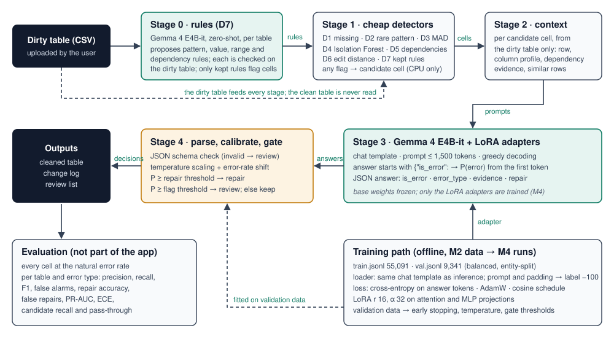
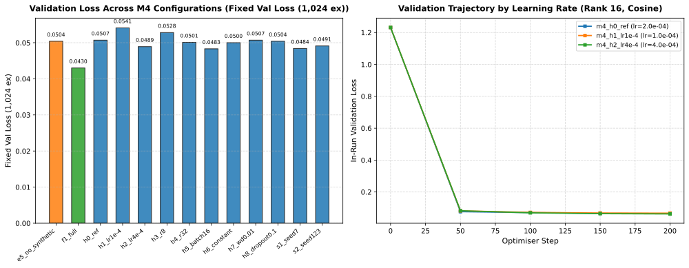
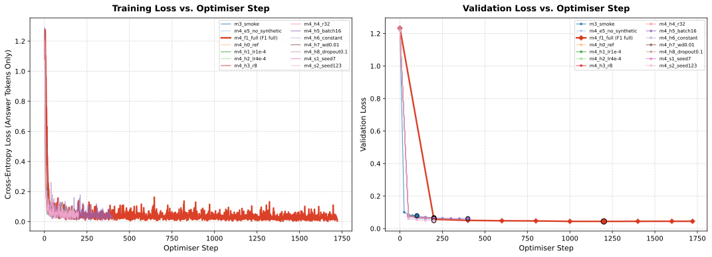

# ContextGuard: Milestone 4 Report
## Model Training, Selection and Evaluation

**Course:** DSAI Lab Project, IIT Madras BS in Data Science and Applications · **Group 1** · **Submitted:** 19 Nov 2026
**Team:** Sidhaarth Shree, Jashan, Sahilpreet, Aaradhya · **Repository:** https://github.com/SidhaarthShree07/Group-1-DS-and-AI-Lab-Project

**Contents:** 1 Introduction · 2 Training dataset · 3 Model configuration · 4 Training environment · 5 Training methodology · 6 Hyper-parameter experiments · 7 Optimisation methods · 8 Regularisation · 9 Training progress · 10 Model selection and evaluation · 11 Challenges · 12 Summary and next steps · 13 Engineering enhancement: repair validation layer · Appendices · AI usage disclosure · Team sign-off

**In one paragraph.** We trained LoRA adapters for Gemma 4 E4B-it on all 55,091 training examples. Over one epoch (1,722 steps, about six hours), the validation loss fell from 1.23 to 0.044; the best checkpoint is at step 1,200, and reloading it gives the same loss. Eleven short screening runs tested learning rate, LoRA rank, batch size, schedule, weight decay, dropout and synthetic data. Scored on the same 1,024 validation examples, no change beat the chosen setting by more than the spread between three seeds (0.0023). In the pipeline, fine-tuning raised detection F1 on the validation subset from 0.570 to 0.714 and repair accuracy from 13.8% to 35.7%. Two generic detectors, entity evidence in the prompt, a repair-confidence gate and a new repair validation layer took the final pipeline to a mean detection F1 of **0.741** on the five test tables, against 0.435, 0.433 and 0.207 for the simplified dBoost, Raha (with 20 labelled rows) and HoloClean baselines. ContextGuard is best on four of the five tables; on Flights, Raha with 20 labels scores higher (0.898 against 0.852). Of the 988 repairs it applied on the scored test rows, 975 are correct.

---

## 1. Introduction

**Recap of the model.** ContextGuard finds cell-level errors in a table, names the error type, proposes a repair and gives a confidence (Milestone 1). Milestone 2 built 73,979 instruction–response examples from eight benchmark tables and five synthetic tables, split by entity without leakage. Milestone 3 fixed the architecture (Figure 1, M3 report §2):
- cheap detectors choose candidate cells (stage 1);
- a prompt is built for each candidate from the dirty table only (stage 2);
- Gemma 4 E4B-it with LoRA adapters answers in JSON: error or not, the type, the evidence and a repair (stage 3);
- a gate decides whether to repair, flag the cell for review, or keep it (stage 4).

Every stage then ran end to end on a 3,500-cell validation subset, with the zero-shot model and a short LoRA smoke run.

**Objectives of training in Milestone 4.**
1. Train the adapter on the full training set, with early stopping on the validation loss.
2. Test the main hyper-parameters, with seeds, and justify the chosen setting.
3. Choose the checkpoint, and fix the gate on validation data.
4. Measure what the trained model changes in the pipeline (E1, E2, E3, E5, E6 from the M3 plan).
5. Compare the final pipeline with the baselines on the test splits, scored by the same rules.
6. Re-score the M3 repair counts and report every result as one outcome table per table (Section 10.6).

**What changed after the M3 plan.**
- **Stage 0 was dropped.** In stage 0, the model proposed data rules for each table (the old D7). Experiment E6 shows it added almost nothing (Section 10.3).
- **Two generic detectors were added** to stage 1, because of where the errors were missed: a format detector, now published as D7, and an entity-consensus extension of D5.
- **The gate also checks the repair value's confidence:** every token of the repair must have probability at least 0.9.
- **A repair validation layer was added**, at the course team's request (Section 13). It checks each repair against independent rules before the repair is applied.

Throughout, the pipeline uses no labels and no hand-written rules for the table it cleans. The validation layer's rule files are the one exception: Section 13 explains them and what happens without them.

---

## 2. Training dataset

**Final training and validation data.** The data is the Milestone 2 instruction set, unchanged (`docs/tables/m2_final_dataset_summary.csv`):

| Split | Benchmark examples | Synthetic examples | Total | Errors / correct cells |
|---|---|---|---|---|
| Train | 44,077 | 11,014 | **55,091** | 27,532 / 27,559 |
| Validation | 9,341 | 0 | 9,341 | 4,669 / 4,672 |
| Test | 9,547 | 0 | 9,547 | 4,772 / 4,775 |

**Split.**
- Every table is split by entity, so all rows of one hospital, flight or brewery stay in one split.
- The M2 leakage checks found no entity in two splits (`m2_leakage_checks.csv`).
- Model choices are made on the validation split. The test split is used only for the final comparison (Section 10.5).
- The pipeline experiments use the 300-row M3 validation subset: 100 rows each of Hospital, Flights and Beers, 3,500 cells and 448 errors, with the natural error rates.

**Composition.**
- Each error cell is paired with one correct cell, so the training data is balanced. Half of the correct cells are hard negatives: values that look unusual but are right.
- The error types in training are missing (6,957), pattern (12,313), rule (6,610) and outlier (1,652).
- Outliers come only from the synthetic tables, because the benchmark tables have almost none (M2 Section 5.3).

**Augmentation.**
- The synthetic examples are the data augmentation. Five public tables were corrupted with controlled recipes (typos, unit and format changes, dependency violations, outliers) and capped at 20% of the training set.
- They are only in the training split. Validation and test hold real benchmark errors only.
- Experiment E5 trains without them (Section 6).

**Preprocessing.** The data is the same as in M2 and M3:
- Each prompt holds the row, a profile of the column, dependency evidence and similar rows, all computed from the dirty table.
- The answer is the JSON the model must produce.
- Values are compared after Raha's normalisation (whitespace and HTML entities). Cells whose dirty and clean values differ only in format are not counted as errors.
- The longest example is 1,009 tokens with the Gemma 4 tokenizer (`m2_token_lengths_gemma.csv`). The training length limit is 1,536, so no example is cut.

---

## 3. Model configuration

**Architecture trained.**
- Gemma 4 E4B-it, an instruction-tuned decoder-only transformer, text path only: 42 layers, hidden size 2,560, 8 query and 2 key-value heads, vocabulary 262,144 (M3 §4.2).
- The model was chosen in Milestone 1 by a zero-shot comparison against Qwen3.5-9B and Qwen3-4B (score 0.645 against 0.603 and 0.548, with the lowest false-repair rate).

**Pretrained, not trained from scratch.** We fine-tune the pretrained instruction model. Training a language model from scratch is far outside our data and compute, and the task needs the model's knowledge of words, places and formats.

**LoRA configuration** (`configs/m4_f1_full.yaml`, `src/llm/train_lora.py`):

| Setting | Value |
|---|---|
| Target modules | q, k, v, o, gate, up, down projections (258 matrices) |
| Rank / alpha / dropout | 16 / 32 / 0.05 |
| Trainable parameters | 34,881,536 of 7,941,100,832 (0.44%); base weights frozen |
| Precision | bfloat16 weights, gradient checkpointing |
| Maximum length | 1,536 tokens |

Figure 2 of the M3 report shows where the adapters sit. There are 258 adapter matrices rather than 294 (42 layers × 7) because the last 18 layers reuse the keys and values of earlier layers, so those layers have no k and v projections of their own.

---

## 4. Training environment

**Hardware (stated generically).**
- One data-centre GPU, shared with other jobs. Each run was capped at a fixed share of GPU memory (0.40–0.45).
- Peak GPU memory: 30.5 GiB for training and about 18 GiB for inference.
- Logs and checkpoints were kept outside git; only summary tables are committed.

**Software** (versions from `train_summary.json` and `run.json`):

| Component | Version |
|---|---|
| Python | 3.12.3 |
| PyTorch | 2.14.1 (CUDA build) |
| Transformers | 5.20.1 |
| PEFT | LoRA adapters (`get_peft_model`) |
| pandas | 3.0.6 |
| Raha (baseline B3) | project source code, run with a fixed seed |

**Constraints.**
- **Time:** the full run took 357 minutes, so only one full run fitted in the milestone. The screening runs were therefore short (200 steps).
- **Memory:** the shared GPU forced a memory cap. The first full run, at a 0.40 cap, had too little headroom and was restarted at 0.45 (Section 11).
- **Data access:** the adapter weights (about 140 MB each) are not in git; everything else is. Training code, configs, logs and tables are listed in `docs/tables/m4_training_artifacts.csv`.

---

## 5. Training methodology

**Workflow.**
1. `src/llm/train_lora.py` loads the training examples and applies the Gemma 4 chat template.
2. It masks every prompt token (label −100), so the loss is computed only on the answer.
3. It trains the LoRA adapters, evaluating every 200 steps on a fixed sample of 512 validation examples.
4. It keeps the adapter with the lowest validation loss, saves the last one separately, and reloads the best one to check that it gives the same loss.
5. `scripts/eval_adapters.py` then scores every adapter on one shared sample of 1,024 validation examples, so that runs can be compared.
6. `scripts/run_pipeline.py` runs the chosen adapter in the pipeline.

**Batch size and epochs.**
- Micro-batch 4 with gradient accumulation 8, so the effective batch is 32.
- One epoch over 55,091 examples is 1,722 optimiser steps.
- The run was allowed one epoch, with early stopping after 3 evaluations without improvement. A second epoch did not fit the time budget, and the validation loss had stopped improving by step 1,200 (Section 9).

**Loss function.** Cross-entropy over the answer tokens only:

$$\mathcal{L}(\theta) = -\frac{1}{\sum_t m_t}\sum_t m_t \log P_\theta(y_t \mid y_{<t}, x)$$

Here $m_t = 1$ for answer tokens and 0 for prompt and padding tokens. The answer covers the error decision, the type, the evidence and the repair, so one loss trains all four.

**Learning strategy.** Supervised fine-tuning on balanced examples:
- The model learns the decision and the repair together.
- $P(\text{error})$ is read from the first answer token ("true" against "false").
- The confidence of a repair is the lowest token probability inside the repair value ($p_\text{repair\_min}$).
- The training balance differs from real tables, where most candidates are correct. Section 8 explains how that is handled.

---

## 6. Hyper-parameter experiments

**Plan.** Eleven screening runs change one setting at a time from a reference run (h0), plus two seed repeats:
- each run has 200 steps on the same 6,400 training examples (batch 16: 400 steps over the same examples);
- each run is scored on its own 256 validation examples every 50 steps;
- E5 removes the synthetic examples.

Because each run drew its own validation sample, the in-run losses are not comparable across runs. Every adapter was therefore scored again on the same 1,024 validation examples (`docs/tables/m4_fixed_val_eval.csv`). That fixed-sample loss is the comparison column below.

**Results** (`docs/tables/m4_hparam_runs.csv`, `m4_training_runs.csv`, `m4_fixed_val_eval.csv`):

| Run | Change from h0 | Fixed-sample val loss | Difference from h0 |
|---|---|---|---|
| base model | no adapter | 1.2014 | |
| h0 (reference) | lr 2e-4, rank 16, alpha 32, batch 32, cosine, dropout 0.05, wd 0, seed 42 | 0.0507 | |
| h1 | learning rate 1e-4 | 0.0541 | **+0.0034** |
| h2 | learning rate 4e-4 | 0.0489 | −0.0018 |
| h3 | rank 8 (alpha 16) | 0.0528 | +0.0021 |
| h4 | rank 32 (alpha 64) | 0.0501 | −0.0006 |
| h5 | batch 16 (400 steps) | 0.0483 | −0.0024 |
| h6 | constant learning rate | 0.0500 | −0.0007 |
| h7 | weight decay 0.01 | 0.0507 | 0.0000 |
| h8 | dropout 0.1 | 0.0504 | −0.0003 |
| s1, s2 | seeds 7 and 123 | 0.0484, 0.0491 | −0.0023, −0.0016 |
| E5 | no synthetic examples | 0.0504 | −0.0003 |
| **F1 (full run)** | all 55,091 examples, 1 epoch, best step 1,200 | **0.0430** | |

**Seed spread.** The three seeds of the same setting give 0.0507, 0.0484 and 0.0491. Their range is 0.0023 and their mean 0.0494 (`m4_seed_spread.csv`). Any difference smaller than this range is treated as noise.

**Reading and justification.**
- Only the lower learning rate (h1, +0.0034) is worse by more than the seed range. Rank 8 (h3, +0.0021) is about at the edge.
- Learning rate 4e-4, rank 32, batch 16, a constant schedule, weight decay and dropout 0.1 all fall inside the seed range. At this budget they make no measurable difference.
- So no tested change beats the reference beyond seed noise. Rank 32 would double the trainable parameters for no measurable gain.
- The full run F1 uses the reference setting. This justifies that choice after the fact: F1 had to start before the screening finished (Section 11).
- **E5:** removing the synthetic data does not change the validation loss (0.0504 against 0.0507). This is expected: the validation split has no synthetic examples, and its benchmark errors contain almost no outliers, which only the synthetic data teaches. E5 therefore cannot show the value of the synthetic data on these tables. The outlier type will be tested on the unseen tables in M5.
- **Figure 2** shows the fixed-sample comparison, and Figure 3 the loss curves of all runs.

---

## 7. Optimisation methods

| Method | Setting | Why |
|---|---|---|
| Optimiser | AdamW (β = 0.9, 0.999) | standard for LoRA; adapts the step per parameter |
| Learning rate | 2e-4, 3% linear warm-up, then cosine decay to 0 | common LoRA range; h1 shows 1e-4 is too slow for this budget |
| Gradient clipping | global norm 1.0 | guards against loss spikes from long or unusual examples |
| Mixed precision | bfloat16 weights and activations | halves memory against float32 and needs no loss scaling |
| Gradient checkpointing | on | trades compute for memory, so the effective batch of 32 fits the memory cap |
| Early stopping | on the validation loss, patience 3 evaluations (every 200 steps) | keeps the best checkpoint and stops a run that no longer improves |

A constant learning rate (h6) and a decaying one performed the same within the seed spread. We kept cosine decay because it gives the final steps small updates, so the last checkpoint stays close to the best one (Section 9).

---

## 8. Regularisation

| Technique | Used? | Detail |
|---|---|---|
| LoRA dropout | yes, 0.05 | 0.1 (h8) gave the same loss |
| Weight decay | no (0.0) | 0.01 (h7) gave the same loss. With only 0.44% of the weights trained, and one epoch, there is little room to overfit |
| Early stopping | yes | patience 3; the best adapter is at step 1,200 of 1,722 |
| Data augmentation | yes | the 11,014 synthetic examples (Section 2); E5 in Section 6 |
| Label smoothing | no | $P(\text{error})$ is read from the answer tokens and used as a confidence. Smoothing would pull every probability towards the middle and distort the gate thresholds |
| Class weighting | not as loss weights | handled by balanced training data plus a prior-shift correction (below) |
| Cross-validation | no | one full run takes about six hours, so k-fold training is not possible. The split is by entity, with a fixed validation split, and three seeds measure the variance instead |

**Class imbalance.** On real tables, most candidates are correct cells. Among our candidates, the error rate ranges from 13% (Hospital) to 91% (Flights). The training data is balanced (prior $p_0 = 0.5$), so the model is not drawn towards "no error". A model trained at prior $p_0$ can be moved to a table with candidate error rate $\pi$ without retraining, by shifting the log-odds:

$$\operatorname{logit} P(y{=}1\mid x) = \operatorname{logit} P_0(y{=}1\mid x) + \log\frac{\pi}{1-\pi} - \log\frac{p_0}{1-p_0}$$

On a new table, $\pi$ is unknown. It is estimated without labels by the EM procedure of Saerens et al. (2002), which is studied in Section 10.2.

---

## 9. Training progress

**Loss curve of the full run F1** (`docs/tables/m4_f1_train_log.csv`):

| Step | 0 | 200 | 400 | 600 | 800 | 1,000 | **1,200** | 1,400 | 1,600 | 1,722 |
|---|---|---|---|---|---|---|---|---|---|---|
| Validation loss (512 examples) | 1.2333 | 0.0568 | 0.0504 | 0.0481 | 0.0470 | 0.0445 | **0.0442** | 0.0447 | 0.0450 | 0.0449 |
| Learning rate | 0 | 1.96e-4 | 1.79e-4 | 1.51e-4 | 1.16e-4 | 7.9e-5 | 4.4e-5 | 1.8e-5 | 2.6e-6 | 0 |

**Convergence.**
- Most of the drop happens in the first 200 steps (1.23 → 0.057), as the model learns the answer format and the easy decisions.
- After that, the loss falls slowly until step 1,200, and is flat from there.
- The early-stopping condition (three evaluations without improvement) was met at step 1,722, which was also the last step. So the run used the full epoch and early stopping saved no time. It did choose the checkpoint: the adapter from step 1,200 is the one used.
- Reloading that adapter gives the same validation loss (0.0442), so the saved weights are the trained ones.

**Over- or underfitting.**
- **No sign of overfitting.** The validation loss after step 1,200 rises by at most 0.0008, which is less than the seed spread. The per-step training loss is noisy (one batch of 32 examples per log line) but does not drop away from the validation loss.
- **No sign of underfitting either.** On the shared sample, the full run's loss (0.0430) is clearly below every 200-step screening run (0.048–0.054), so more data and steps did help.
- **Screening runs:** their best step is always the last one (200), so they were still improving. That is why we compare them at equal budget only.

**Stability.** Three seeds differ by 0.0023 on the shared sample. On their own samples they differ by 0.0166, which comes from the different validation examples, not from the training.

---

## 10. Model selection and evaluation

### 10.1 Checkpoint

- **Chosen:** the F1 adapter at step 1,200 (`m4_f1_full/adapter`).
- **Metric:** the validation loss on the answer tokens. It covers the decision, the type, the evidence and the repair together, and it is available during training.
- **Check in the pipeline:** the checkpoint was also checked in the pipeline on the validation subset (E1 below). Pipeline metrics (F1, repair accuracy, false repairs) were used for the pipeline choices, not to pick among checkpoints.

### 10.2 Gate thresholds and calibration

**Gate used in the pipeline** (`configs/m4_final_pipeline.yaml`):
- flag a cell if $P(\text{error}) \ge 0.5$;
- repair it if $P(\text{error}) \ge 0.8$ **and** every token of the repair value has probability at least 0.9;
- otherwise, a flagged cell goes to review.

The thresholds are applied to the raw $P(\text{error})$. They were fixed in advance and not tuned on the test data.

**Calibration study** (`scripts/fit_calibration.py`; fitted on the full validation run, reported on the test run; `docs/tables/m4_calibration.csv`):
- **Temperature scaling** on balanced validation candidates: $T = 0.826$; validation BCE 0.0754 → 0.0740.
- **EM prior estimate** on the test candidates, without labels. It falls back to a default rate only when EM fails (no convergence, or a value at the boundary); the raw estimate is always reported:

| Table | Candidates | True error rate | EM estimate | Iterations | ECE raw → temperature → temperature + EM |
|---|---|---|---|---|---|
| Hospital | 551 | 13.25% | 13.29% | 5 | 0.028 → 0.022 → **0.008** |
| Beers | 1,421 | 44.62% | 45.81% | 3 | 0.016 → 0.014 → **0.014** |
| Flights | 688 | 91.42% | 97.64% | 13 | 0.100 → 0.098 → **0.064** |
| All | 2,660 | 50.23% | 48.85% | 5 | 0.033 → 0.031 → 0.031 |

- **Fitting the thresholds on validation:** the F1-maximising flag threshold is 0.378. The lowest repair-confidence threshold that keeps the validation false-repair rate at or below 10% is 0.648 (cap met).

**Reading.**
- The fine-tuned model is already well calibrated: ECE 0.033 on test, 0.024 on the validation subset against 0.148 for the base model.
- The EM estimate is close on Hospital and Beers. On Flights it overestimates the rate by about 6 points, because almost every candidate is an error.
- The fixed repair-confidence bar (0.9) is stricter than the fitted 0.648. We kept 0.9: on validation it gives a false-repair rate of about 1% at the gate (10 of 1,035), and a wrong repair costs more than a review.
- Calibration is therefore reported as a study: the M4 pipeline does not apply it. The calibration does not change the ranking of cells, only the probability values. Applying the EM prior inside the gate is left for the unseen tables in M5, where the error rate really is unknown.

### 10.3 What the trained model changes in the pipeline (validation subset, 3,500 cells)

**E1: base model against fine-tuned** (both with D1–D6 candidates; `docs/tables/m4_pipeline_runs.csv`):

| Metric | Base | Fine-tuned |
|---|---|---|
| Detection F1 (Hospital / Flights / Beers) | 0.570 (0.573 / 0.639 / 0.493) | **0.714** (0.849 / 0.795 / 0.545) |
| Precision / recall | 0.703 / 0.480 | 0.904 / 0.589 |
| Repair accuracy (correct repairs / all errors) | 13.8% | **35.7%** |
| False alarms per 1,000 correct cells | 29.8 | **9.2** |
| PR-AUC / ECE | 0.796 / 0.148 | **0.996 / 0.024** |
| Error-type macro-F1 | 0.717 | 0.829 |
| False-repair rate of the model's own repairs | 47.9% | 45.2% |

- Fine-tuning helps every table and nearly every metric.
- Recall (0.589) equals the candidate recall: the model flags every error that reaches it, and the errors it misses never became candidates.
- The model's own repairs are still often wrong (45%), mostly on Flights. This is what the confidence gate and the validation layer address.

**E2: context ablation (fine-tuned).** With the row only, F1 is 0.657; with the full prompt, 0.714 (Hospital 0.577 → 0.849, Flights 0.770 → 0.795). The context blocks matter after fine-tuning too, which settles the M3 doubt about Flights.

**E3: every cell against candidates only** (`m4_e3.csv`; decision rule: widen if precision falls by at most 0.05):

| Table | Model calls | Precision | Recall | Decision |
|---|---|---|---|---|
| Beers | 266 → 1,000 | 0.973 → 0.990 | 0.379 → 1.000 | widen |
| Hospital | 323 → 1,900 | 0.818 → 0.833 | 0.882 → 0.980 | widen |
| Flights | 171 → 600 | 0.902 → **0.734** | 0.710 → 0.961 | do not widen |
| All | 760 → 3,500 (4.6×) | 0.904 → 0.839 | 0.589 → 0.980 | widen where errors are missed |

- **When shown the missed errors, the model finds them.** On Beers and Hospital it does so without losing precision, so the limit there was the detectors, not the model.
- Sending every cell costs 4.6× the model calls, and on Flights precision falls by 0.17. So, as planned, the candidate stage was widened with targeted detectors instead (Section 10.4).

**E5:** see Section 6.

**E6: stage 0 rules** (`m4_e6.csv`; the four criteria were fixed before the runs):
1. **Candidate recall:** +0.45 points overall, +3.9 on Hospital, against 2 and 5 required. **Fail.**
2. **Repair accuracy, false repairs and false alarms:** not worse. Pass.
3. **Model calls:** +0.26%. Pass.
4. **Kept rules valid on the clean table:** 4 of 4. Pass.

Stage 0 therefore fails criterion 1 and is dropped. The pipeline now starts at stage 1, and the name D7 passes to the new format detector.

**Rule validity check** (`scripts/check_rule_validity.py`, `m4_rule_validity_e6.csv`): this check also shows its own limit.
- The Hospital rule "state is `al`" holds on 100% of the clean validation rows and catches 2 real errors there.
- But the validation split happens to contain only Alabama hospitals, while the test split has 18 Alaska (`ak`) rows. On test, the rule would flag 18 correct cells.
- Clean support on one split is necessary for a valid rule, not sufficient.

### 10.4 From the trained model to the final pipeline

E1 and E3 showed that the model finds errors once it sees them, so the missed errors are a detector problem. The missed errors (`m4_missed_errors.csv`) were mainly two kinds:
- Beers `ounces`, `abv` and `ibu` written with units or percent signs;
- Flights times that are valid times but disagree with the other sources for the same flight.

Two generic detectors were added. Neither reads column names or labels.

| Detector | What it flags | How it works |
|---|---|---|
| **D7 format mix** (`src/detectors/d7_format_mix.py`) | values of a mostly numeric column that carry units, percent signs or placeholders, or write one unit in several ways | the value formats of each column, computed from the dirty table (a column is checked only if at least 80% of its values are numeric) |
| **D5 entity consensus** (`src/detectors/d5_entity_consensus.py`) | cells that differ from the reliability-weighted consensus of their entity | finds an entity key from the data (a pair of repeated columns that identifies every row, such as source + flight). Silent when every row is its own object, as on Beers, Rayyan and Movies |

**Entity evidence in the prompt.**
- The context builder now also shows the model the rows of the same entity, with the reliability-weighted majority value. This is truth discovery: sources that agree with the majority more often get more weight.
- The minimum dependency strength for this entity key is 0.5. Every other dependency keeps the 0.9 bar used in training.
- The adapter was not retrained for this; the prompt only gains one more block of evidence.

**Effect on the validation data.**

Candidate recall on the validation splits (`m4_candidate_recall.csv`):

| Table | D1–D6 | + D7 + D5 consensus | Pass-through |
|---|---|---|---|
| Hospital | 82.3% | 91.1% | 16.2% → 16.4% |
| Flights | 59.3% | 79.0% | 20.1% → 29.4% |
| Beers | 37.1% | **98.1%** | 25.0% → 36.5% |
| Rayyan, Movies | 46.8%, 42.8% | unchanged | unchanged |

Steps on the validation subset (`m4_inference_variants.csv`):

| Configuration | F1 | Candidate recall | Gate repairs right / wrong |
|---|---|---|---|
| fine-tuned, D1–D6 (E1) | 0.714 | 58.9% | 156 / 113 |
| + D7 format detector | 0.890 | 85.3% | 274 / 113 |
| + entity evidence | 0.894 | 85.3% | 330 / 36 |
| + repair-confidence gate (final) | **0.894** | 85.3% | **313 / 8** |

- **D7** fixes Beers (F1 0.545 → 0.995).
- **Entity evidence** fixes most wrong Flights repairs (wrong gate repairs 113 → 36).
- **The repair-confidence gate** removes almost all the rest (36 → 8), at the cost of sending 17 correct repairs to review.

### 10.5 Final result on the test splits

**Protocol.**
- The configuration was frozen (`configs/m4_final_pipeline.yaml`) and run on the test splits of Hospital, Flights, Beers, Rayyan and Movies (`scripts/run_m4_final_eval.sh`).
- It is scored on exactly the cells the baselines are scored on: Raha's 20 labelled rows per table are left out for every method (`scripts/score_like_baselines.py`).
- ContextGuard uses no labels from the test table.

**Baselines** (`scripts/run_baselines_full.py`, `docs/tables/m4_baselines_full.csv`). All three are simplified versions and are labelled that way everywhere:
- **B1 HoloClean (simplified):** violations of denial constraints mined from the training split, repaired by a majority vote.
- **B2 dBoost (simplified):** its statistical, histogram and Gaussian detectors, with the settings tuned on the training split.
- **B3 Raha + Baran (simplified):** Raha's detection code with a reduced strategy set. It labels exactly our 20 rows (`labelled_tuples_20.json`, fixed seed, so runs repeat exactly), and a simplified Baran value transfer repairs the flagged cells.

**Detection F1 on the test splits** (`docs/tables/m4_test_vs_baselines.csv`):

| Table | ContextGuard F1 (P / R) | HoloClean (simpl.) | dBoost (simpl.) | Raha, 20 labels (simpl.) | ContextGuard − best |
|---|---|---|---|---|---|
| Hospital | **0.886** (0.84 / 0.94) | 0.842 | 0.350 | 0.350 | +0.044 |
| Flights | 0.852 (0.96 / 0.77) | 0.087 | 0.566 | **0.898** | −0.046 |
| Beers | **0.972** (0.97 / 0.98) | 0.106 | 0.537 | 0.903 | +0.068 |
| Rayyan | **0.493** (0.65 / 0.40) | 0.000 | 0.299 | 0.014 | +0.194 |
| Movies | **0.503** (0.76 / 0.38) | 0.000 | 0.422 | 0.000 | +0.081 |
| **Mean** | **0.741** | 0.207 | 0.435 | 0.433 | |

**Repairs on the same cells.**

| Table | Applied repairs (right / wrong) | To review | Repair accuracy (right / errors) | Best baseline repairs (right / executed) |
|---|---|---|---|---|
| Hospital | 55 / 0 | 16 | 83.3% | HoloClean 56 / 67 |
| Flights | 325 / 13 | 198 | 47.7% | Raha + Baran 72 / 598 |
| Beers | 595 / 0 | 22 | 97.1% | Raha + Baran 328 / 505 |
| Rayyan | 0 / 0 | 80 | 0% (no rule file) | Raha + Baran 0 / 9 |
| Movies | 0 / 0 | 564 | 0% (no rule file) | none |
| **All** | **975 / 13** (98.7% right) | 880 | | |

**Reading.**
- **Detection.** ContextGuard has the best detection F1 on four of the five tables, without labels. Its mean is 0.741, against 0.435 for the best baseline mean.
- **Flights.** Raha with 20 labelled rows leads, by 0.046. Flights is the table where 20 labels help Raha most: errors are frequent (one cell in three) and look alike across sources.
- **Repairs.** ContextGuard applies few wrong repairs: 13 of 988, all on Flights. The baselines' repairs are mostly wrong, except HoloClean on Hospital. On Hospital, HoloClean repairs one more error than we do (56 against 55), but also makes 11 wrong repairs.
- **Rayyan and Movies.** They have no validation rule file, so all their repairs go to review (Section 13). Their detection recall is low (0.40 and 0.38) because candidate recall is low (44.5% and 37.5%): most of their errors never reach the model.

**All rows, Hospital, Flights and Beers together** (`m4_final2_test_hfb`, 8,821 cells, 1,441 errors):
- F1 0.911 (P 0.953, R 0.872); PR-AUC 0.994; ECE 0.033; error-type macro-F1 0.867.
- Candidate recall 92.7%, pass-through 30.2%.
- Of the 184 missed errors, 105 never became candidates (Hospital 3, Flights 88, Beers 14), and the model kept 79 (it gave them P < 0.5).
- **Validation splits, same configuration** (`m4_final2_val_all`): F1 0.906 (Hospital 0.861, Flights 0.830, Beers 0.984). This is close to the test result, so the choices made on validation data hold on test.
- **Cost:** 2,660 model calls in 23 minutes for 8,821 cells. Movies needs 9,148 calls (73 minutes) because its candidate stage passes 49% of the cells.

**Sample outputs.** `docs/milestones/M4/sample_outputs.md` (from `scripts/pick_examples.py`, seed 42) lists examples per outcome and table. Some of them:
- **Correct repairs:** Beers `ounces` "16.0 ounce" → "16"; Hospital `type` "acutexcarexhospitals" → "acute care hospitals"; Hospital `name` "xlxskx regionxl hospitxl" → "alaska regional hospital".
- **Wrong repairs (all on Flights):** an actual departure "7:41 p.m." repaired to "7:42 p.m." when the true value is "7:14 p.m.".
- **Validation interceptions:** a Hospital `measure_name` repair that dropped half of the description was rejected by the rule "measure code → measure name", and the cell went to review.

### 10.6 Outcome tables and the M3 repair counts

**One outcome table per table.** Every run is scored by `score_decisions` (`src/evaluation/metrics.py`; tables `m4_outcomes_*.csv`). Each cell is counted once, in one of these groups:
- repaired right;
- repaired wrong;
- sent to review (an error, or a correct cell);
- kept (a missed error, or a correct cell).

The gate decision and the final decision after validation are scored separately. From the same table we report detection precision, recall and F1, repair accuracy, the false-repair rate, false alarms per 1,000 correct cells and the review share. Repair safety is judged on the applied repairs: 975 right and 13 wrong on test. A repair equal to the old value counts as "keep".

**The 140 and 128 repairs of the M3 run.** The M3 report counted 140 cells where the model said "error" and proposed a repair, and 128 repairs accepted by the gate. They are re-scored from the M3 base-model run (`scripts/rescore_m3_gate.py`, `m3_rescored_gate.csv`):

| Level | Right | Wrong | No change | Total |
|---|---|---|---|---|
| The model's own proposals | 62 | 67 | 11 | 140 |
| Gate repairs (Beers 11 / 15 / 5, Flights 10 / 1 / 1, Hospital 41 / 41 / 3) | 62 | 57 | 9 | 128 |
| After the validation layer | 59 | 1 | | 60 |

The other 12 proposals (10 wrong, 2 no-op) were below the repair threshold and went to review.

---

## 11. Challenges

- **GPU memory and time.** The GPU was shared, so each job had a memory cap.
  - The first full run, at a 0.40 cap, had only about 3 GB of headroom and was stopped after 22 minutes. It was restarted at 0.45, with the allocator's expandable segments enabled.
  - At about six hours per epoch, only one full run fitted. F1 was therefore started with the M3 setting before the screening runs finished, and Section 6 checks that choice afterwards.
- **Comparing runs fairly.** Each screening run drew its own validation sample after its training sample, so the seed runs and E5 were first compared on different examples. The 0.0166 in-run seed spread was mostly sampling. Re-scoring every adapter on one fixed sample (`eval_adapters.py`) fixed this, and `train_lora.py` now has a `--val-seed` option.
- **Class imbalance.** The training data is balanced, but candidate error rates range from 13% to 91%. This is handled by the prior-shift study and fixed thresholds on raw $P(\text{error})$ (Sections 8 and 10.2), not by loss weights.
- **Recall ceiling of the candidate stage.** It was the largest limit.
  - In E1, recall equalled candidate recall.
  - The new detectors raised candidate recall a lot on Beers and Flights, but on Rayyan and Movies it is still below 50%, and Movies passes half its cells to the model.
- **Wrong repairs on Flights.** Flights times are valid times that disagree between sources, so the model has to guess the true time. Entity evidence and the repair-confidence gate cut the wrong gate repairs from 113 to 8 on the subset, but Flights still has all 13 wrong test repairs.
- **Data quality and rules.** Rules mined from data can hold only because of which rows a split happens to contain (the Alabama case in Section 10.3). Stage 0 was dropped for this reason, among others.
- **Baseline reproducibility.** Our Raha run first let Raha choose its own 20 rows, and the results changed from run to run: Hospital F1 0.43–0.60 and Flights 0.85–0.91 over four runs. Raha now labels exactly our 20 rows with a fixed seed, and two runs give identical results. The table above uses the fixed version.
- **Sensitivity.** Most settings tested in Section 6 change the loss less than the seed spread. The model is stable with respect to them, but the screening cannot rank them more finely.

---

## 12. Summary and next steps

**Best configuration.**
- **Training:** Gemma 4 E4B-it with LoRA rank 16, alpha 32 and dropout 0.05; AdamW with lr 2e-4, 3% warm-up and cosine decay; effective batch 32; one epoch on 55,091 examples; best checkpoint at step 1,200 (validation loss 0.0442; 0.0430 on the shared sample, against 1.2014 for the base model).
- **Pipeline:** D1–D6 plus the D7 format detector and the D5 entity-consensus extension; entity evidence in the prompt; a gate at 0.5 / 0.8 on $P(\text{error})$ with repair confidence 0.9; and the repair validation layer.

**Key observations.**
1. Fine-tuning works: F1 0.570 → 0.714 and repair accuracy 13.8% → 35.7% with the same candidates, with a near-perfect ranking (PR-AUC 0.996).
2. After fine-tuning, the limit is which cells reach the model, not the model. Generic detectors aimed at the missed error kinds raised candidate recall far more than stage 0 did.
3. Hyper-parameters around the chosen setting do not matter beyond seed noise at this budget.
4. Wrong repairs need separate controls: the repair-confidence gate and the validation layer. On test, 98.7% of the applied repairs are correct.
5. ContextGuard beats every simplified baseline on four of five test tables without labels. Raha with 20 labelled rows is still better on Flights.

**Readiness for Milestone 5.**
- The adapter, the frozen configuration and the scripts reproduce every table in this report.
- 145 tests pass.

**Next steps (M5).**
- Evaluate on the unseen tables (Restaurant, Marketing, Soccer, Billionaire and the German slice) and run the downstream test on Credit.
- Use the EM prior estimate in the gate on those tables, and compare the known rate, a fixed default and the estimate.
- Retrain with the entity evidence in the training prompts, and allow the model to abstain on the repair value.
- Raise candidate recall on Rayyan and Movies.
- Run the model-choice pilot the course team asked for: a short fine-tune of a Qwen model with the same setting, to compare with Gemma.
- Compare against Raha at several label budgets.

---

## 13. Engineering enhancement: repair validation layer

**Why.** The course team asked for an independent check of repairs before they are applied. The gate alone looks only at the model's own confidence. In E1 the fine-tuned model's gate repairs were 156 right and 113 wrong (a 42% false-repair rate), mostly on Flights.

**What it does** (`src/validation/repair_validator.py`, run with `run_pipeline.py --validate`).
- After the gate, every proposed repair is checked against independent rules for its table (`configs/validation/<table>.yaml`).
- **Column rules:** the format and range of the repaired value. Examples: CMS measure IDs for Hospital, IATA flight codes and 12-hour times for Flights, and plausible abv and ibu ranges for Beers.
- **Relation rules:** for example "a measure code has one measure name", or "a flight has one scheduled departure time". The other rows of the table are used as evidence, weighted by row reliability.
- Every rule names its source (the data publisher's definition or a standard). None is inferred from the table being cleaned.

**Each repair gets one outcome:**
- **validated:** applied;
- **rejected:** sent to review as "repair rejected by validation";
- **cannot be validated:** no rule covers the column, so the repair is sent to review;
- **no change:** the repair equals the old value, so the cell is kept.

Every check is written to `validation_log.jsonl`, and the validated change log and review list are separate files.

**Results** (`scripts/validate_repairs.py`, `m4_validation_comparison.csv`):

| Run | Gate repairs right / wrong | After validation: applied right / wrong | Correct repairs rejected | Cells to review |
|---|---|---|---|---|
| M3 base run on the subset | 62 / 57 | 59 / 1 | 3 | 177 → 236 |
| E1 fine-tuned (subset) | 156 / 113 | **135 / 5** (false-repair rate 42.0% → 3.6%) | 21 | 16 → 145 |
| Final, validation splits | 1,025 / 10 | 1,021 / 4 | 4 | 10 more |
| Final, test (all rows) | 1,047 / 16 | 1,043 / 14 | 4 | 6 more |

- On E1, the layer blocks 108 of 113 wrong repairs, at the cost of 21 correct ones and more reviews.
- In the final pipeline, the repair-confidence gate already removes most wrong repairs, so the layer removes fewer: 6 on validation and 2 on test.
- It costs about 4 ms per repair, about 1 second per run, against minutes of model time.

**Limit.** The layer needs a rule file per table. Without one, every repair is "cannot be validated" and goes to review: this is what happens on Rayyan and Movies. The system never applies a repair it cannot check, and it never asks the user for rules during a run.

---

## Appendix A. Configuration files

| File | What it is |
|---|---|
| `configs/m4_final_pipeline.yaml` | the frozen pipeline: detectors, context, adapter, gate, validation layer |
| `configs/m4_f1_full.yaml` | the full training run |
| `configs/m4_h0_ref.yaml` … `m4_h8_dropout0.1.yaml`, `m4_s1_seed7.yaml`, `m4_s2_seed123.yaml`, `m4_e5_no_synthetic.yaml` | the screening runs, generated from each run's `train_summary.json` (`scripts/generate_configs.py`) |
| `configs/m4_train.yaml` | template for new training runs |
| `configs/m4_calibration_study.yaml` | parameters of the calibration study (not used by the pipeline) |
| `configs/validation/{hospital,flights,beers}.yaml` | independent rules of the validation layer, each with its source |

## Appendix B. Scripts and tables

| Result | Table(s) | Script |
|---|---|---|
| Training runs, losses | `m4_training_runs.csv`, `m4_f1_train_log.csv`, `m4_hparam_runs.csv` | `src/llm/train_lora.py`, `scripts/plot_training.py` |
| Fixed-sample losses | `m4_fixed_val_eval.csv` | `scripts/eval_adapters.py` |
| Seed spread, figures | `m4_seed_spread.csv`, `docs/figures/m4/*.svg` | `scripts/plot_training.py` |
| Pipeline experiments E1, E2, E3, E6 | `m4_pipeline_runs.csv`, `m4_e3.csv`, `m4_e6.csv` | `scripts/run_m4_pipeline_runs.sh`, `scripts/build_m4_experiments.py` |
| Candidate recall, missed errors | `m4_candidate_recall.csv`, `m4_missed_errors.csv` | `scripts/evaluate_m4_candidates.py`, `scripts/analyze_missed_errors.py` |
| Inference steps on the subset | `m4_inference_variants.csv` | `scripts/run_m4_variants.sh` |
| Rule validity | `m4_rule_validity.csv`, `m4_rule_validity_e6.csv` | `scripts/check_rule_validity.py` |
| Validation layer | `m4_validation_comparison.csv`, `m4_validation_on_m3_*.csv` | `scripts/validate_repairs.py` |
| Calibration, outcome tables, M3 re-score | `m4_calibration.csv`, `m4_outcomes_*.csv`, `m3_rescored_gate.csv`, `docs/figures/m4/reliability_diagram.png` | `scripts/fit_calibration.py`, `scripts/rescore_m3_gate.py` |
| Baselines, test comparison | `m4_baselines_full.csv`, `m4_test_vs_baselines.csv` | `scripts/run_baselines_full.py`, `scripts/score_like_baselines.py`, `scripts/build_test_vs_baselines.py` |
| Sample outputs, artifacts | `m4_sample_outputs.csv`, `sample_outputs.md`, `m4_training_artifacts.csv` | `scripts/pick_examples.py` |

## Appendix C. Change log

| Date | Change |
|---|---|
| 17 Nov | Early stopping, epochs and validation sampling options in `train_lora.py`; full run F1 and screening runs started; validation layer added |
| 18 Nov | E1, E2, E3, E6 runs; fixed-sample re-scoring of all adapters; stage 0 dropped; D7 format detector and D5 entity consensus added; repair-confidence gate; final runs on validation and test |
| 18–19 Nov | Raha baseline fixed to our 20 labelled rows with a fixed seed; baseline table regenerated; outcome tables and calibration study on the real runs |

---

## AI usage disclosure

Follows the course's "Policy on Fair and Responsible use of AI & LLMs".

### 1. AI tools used

**Tool name:** Claude (Anthropic)

**Purpose of use:** Documentation formatting. Claude turned our own Markdown files into the submitted formats: the report Markdown (`Milestone4_Report.md`) into the report PDF, and the slide text (`M4_slide_text.md`) into the PowerPoint deck and its PDF copy. It handled layout, fonts, icons and charts drawn from the numbers already in our text. Other use was minor (small debugging and wording suggestions).

**Shared chat link / conversation file:** No public share link is available; the conversation logs can be provided on request.

**Contribution and validation:** The content of the report and the slides is our own. We compared every PDF page and every slide against the Markdown source and checked that no number or claim had changed.

### 2. Significant prompts and responses

**1. Report PDF**

- *Prompt:* "Use this Markdown file and make the report PDF from it."
- *Response used:* a formatted PDF of `Milestone4_Report.md`.
- *Action taken:* we checked the PDF page by page against the Markdown and fixed page breaks where a heading was left at the bottom of a page.

**2. Slide deck**

- *Prompt:* "Use this slide text and redesign this deck. Keep our style."
- *Response used:* a 14-slide deck built from `M4_slide_text.md`, in our original style.
- *Action taken:* we checked each slide against the slide text.

### 3. Team accountability declaration

We confirm that:

- All AI-generated content used in the project has been reviewed and validated by the team.
- Project decisions, experimental results and conclusions are supported by the team's own reasoning and evidence.
- Every team member understands their contributions and can explain and defend their work independently.

Each member confirms this declaration with the report sign-off below.

---

## Team sign-off

We confirm that we have read the final version of this report, that the sections we own are accurate, that every number in them comes from a script in the repository, and that the report is ready for submission.

| Name | GitHub | Sections owned | Review date | Confirmation |
|---|---|---|---|---|
| Sidhaarth Shree | SidhaarthShree07 | 1, 3, 5, 7, 10.1, 10.3 (E1, E2), 10.4, 10.5, 11, 12, 13, appendices | 19 Nov 2026 | confirmed in writing |
| Jashan | jashantiwari044 | 2, 4 (versions), 6, 9, 10.3 (rule validity), sample outputs, Appendix B (artifacts) | 19 Nov 2026 | confirmed in writing |
| Sahilpreet | 23f3000115 | 5 (loss), 8 (class weighting, prior shift), 10.2, 10.6 | 19 Nov 2026 | confirmed in writing |
| Aaradhya | adhi1911 | 10.3 (E3, E6), 10.4 (candidate recall), 10.5 (baselines), 11 (recall ceiling) | 19 Nov 2026 | confirmed in writing |

A name is entered with a date only after that member has confirmed in writing; the page is final when no entry says pending.
