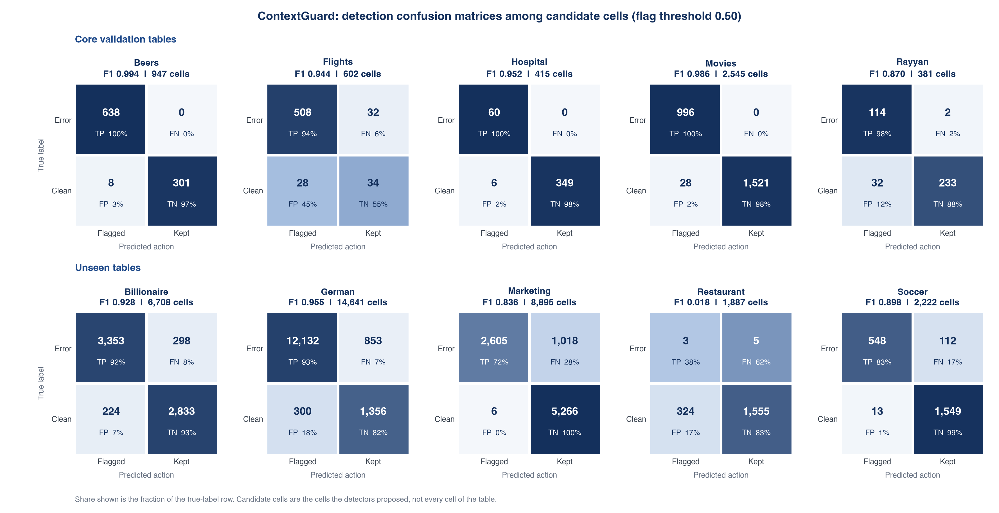
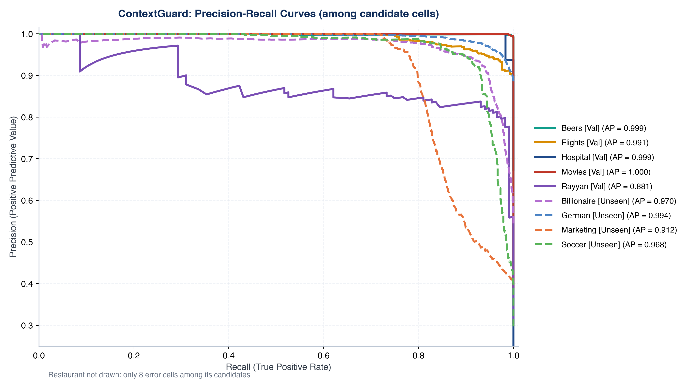
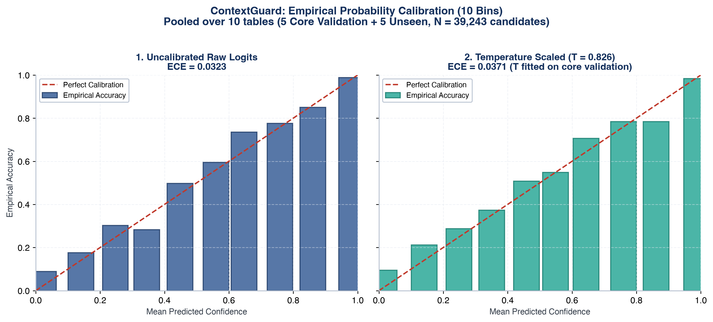

# ContextGuard: Milestone 5 Report
## Final Pipeline, Evaluation on Unseen Tables and Analysis

Group 1, DSAI Lab. 26 November 2026. Every number in this report comes from a run file or a table in `docs/tables/`.

---

## 1. Introduction

ContextGuard cleans a table in four steps. Detectors propose candidate cells (D1 to D7). A profile of the table and, where available, rows that describe the same entity are added to each candidate as context. A fine-tuned Gemma 4 E4B-it model (merged LoRA, bfloat16) answers for each cell whether it is wrong and what the value should be. A gate turns the answer into one of three user-facing states: **verified** (an independent rule confirms the repair), **not verified** (the model repaired it and no rule covers the column) and **needs review** (the repair is withheld for a person).

Milestone 4 trained and evaluated the model on the five core tables. Milestone 5 asks three questions:

1. Does the pipeline hold up on tables it has never seen (O3, O4)?
2. How does it compare with Raha and Baran, HoloClean and dBoost on those tables (O2)?
3. Does cleaning help a downstream model (O5)?

This report covers the changes made after M4, how the final model was chosen, and the results. Choices were made on the **validation splits of the five core tables only**. The unseen tables are used to report the chosen pipeline, not to select it.

---

## 2. Experimental setup

**Software.** Python with `torch 2.14.1`, `transformers 5.20.1`, `accelerate 1.15.0`, `scikit-learn 1.9.1`, `pandas 3.0.6`, `numpy 2.5.4`, `matplotlib 3.11.2` and `pytest 9.2.0` (pinned in `requirements.txt`; the full list is in `docs/evaluation_environment_m5.md`). The model is Gemma 4 E4B-it with a merged LoRA adapter in bfloat16. One seed (42) is used for splits, sampling and the baseline protocol; model calls are greedy, so a run repeats exactly.

**Data.** Training and model choice use the five core tables (Beers, Flights, Hospital, Movies, Rayyan) with the 70 / 15 / 15 entity split of M2. The unseen tables were prepared once by `scripts/prepare_unseen_data.py` and checked against the M1 error audit (`audit_match` is true for every table):

| Table | Rows | Columns | Cells | Error cells | Error rate |
|---|---|---|---|---|---|
| Restaurant | 12,007 | 11 | 132,077 | 633 | 0.48% |
| Soccer | 1,999 | 10 | 19,990 | 796 | 3.98% |
| Billionaire | 2,614 | 22 | 57,508 | 5,195 | 9.03% |
| Marketing | 8,993 | 14 | 125,902 | 26,815 | 21.30% |
| German | 5,000 | 9 | 45,000 | 18,678 | 41.51% |
| Credit (downstream test only) | 150,000 | 11 | 1,650,000 | 38,936 | 2.36% |

Credit is used as a 30,000-row subset for the downstream test (section 6.4). **No unseen table was used to choose a model, a threshold or a detector**; choices were made on the validation splits of the core tables.

**Workflow.** One command per run (`scripts/run_pipeline.py` with the flags in section 3.3) writes the predictions, candidates, cells and change log of a table; every number in this report is recomputed from those files by a script in `scripts/` and stored in `docs/tables/`. Hardware details are left out of the repository by course policy.

## 3. Model training summary

### 3.1 What changed after M4

| Change | Why | Where decided |
|---|---|---|
| M5 detectors (free-text gate on D2, extended D7 formats) | M4 detectors sent far too many cells to the model on long-text tables | validation |
| Candidate filter on D2 (section 3.4) | D2 fires on most cells of name and title columns, so its flag carries no information there | validation |
| Retrain with new error families and blank-cell context (section 3.2) | the M4 training data had no abbreviations, scrambled categories or realistic misspellings in near-unique columns, and only low rates of empty cells | validation |
| Final model as a weight average (section 3.3) | each retrain moved a few cells in both directions; averaging removed single-model noise | validation |

### 3.2 Retraining

**Data.** Four error families were injected into the *clean train splits* of the five core tables: realistic typos (keyboard-neighbour substitution, deletion, transposition, doubling), abbreviations and initials, scrambled categorical values, and high-rate empty cells in repeating columns. The validation splits, test splits and unseen tables were never read. The final training mix has 20,722 examples: newly generated examples, a replay of the M4 examples, and 1,040 examples of cells that are genuinely empty.

**Empty cells.** The labels of the core tables treat an empty cell in two different ways: in the validation splits 966 of 1,325 empty cells are labelled correct (the value is legitimately absent) and 359 are labelled errors (a value is missing). A model trained on such labels leans toward leaving empty cells alone, whereas in real data an empty cell is more often a missing value. For empty cells only, the prompt of the second retrain adds (a) the closed set of allowed values when the column has five distinct values or fewer and (b) how many of the other cells in the row are filled. Prompts for cells that are not empty are unchanged.

**Runs.**

| Model | Training | Selected checkpoint |
|---|---|---|
| M4 model | 1 epoch, M4 data | M4 |
| Retrain 1 epoch | new error families | rejected on validation |
| Retrain A (2 epochs) | new error families, 2 epochs | step 200 |
| Retrain B (2 epochs + blank context) | A plus empty-cell context and genuine-empty examples | step 100 (early stop at step 250) |

### 3.3 Final model: weight average

Retrain A and Retrain B each gained on some tables and lost on others by a few cells (section 6.1). We averaged the weights of the M4 model, Retrain A and Retrain B with equal weight (all three are fine-tunes of the same base model, and their tensor lists match exactly). This is one model at inference time, with the same size and speed as the M4 model. The recipe and the choice of weights were fixed before the blend was evaluated.

### 3.4 Candidate filter on D2

A cell flagged only by D2, in a column where D2 flags more than 50% of the cells, is not sent to the model. A cell that any other detector also flagged is always kept. On validation this removes 2,051 of 7,198 model calls (28%) and cuts false flags from 129 to 113; F1 is unchanged at 0.932 (precision 0.950 to 0.956, recall 0.916 to 0.910).

---

## 4. Evaluation methodology

- **Selection data:** the validation splits of Hospital, Flights, Beers, Rayyan and Movies (29,200 cells). All model and pipeline choices use these.
- **Reported data:** the unseen tables, scored with the same scorer as the baselines, with the 20 labelled rows used by Raha left out (seed 42, fixed order), so every system is scored on the same cells.
- **Selection rule for a retrained model:** adopt only if validation F1 does not drop and wrong repairs do not rise, compared with the model it replaces. Applied to the blank-context retrain this rule is not met (section 6.1), and that run is reported in the ablation.
- **Cross-validation is not used:** splits are fixed and grouped by entity so that no entity appears on both sides.

---

## 5. Performance metrics

**Definitions.** Every candidate cell ends in one of seven groups: repaired right, repaired wrong (on an error), repaired wrong (on a clean cell), review (error), review (clean), kept (missed error) and kept (clean). Detection counts a cell as found when it is repaired or sent to review: TP = repaired right + repaired wrong (error) + review (error), FP = repaired wrong (clean) + review (clean), FN = kept (missed), TN = kept (clean). Precision, recall and F1 follow. **Applied false-repair rate** = wrong applied repairs / applied repairs. **ECE** is the mean gap between confidence and accuracy over 10 equal-width bins.

**X10 (thresholds and calibration, five core test tables).** Each change had to pass a rule fixed beforehand:

| Parameter | Tested | Kept | Result |
|---|---|---|---|
| Flag threshold | 0.378 | 0.5 | mean F1 falls from 0.7445 to 0.7357 and F1 falls on three tables; kept 0.5 |
| Repair confidence | 0.648 | 0.9 | gate-level false-repair rate rises from 3.4% to 6.5%; kept 0.9 |
| Temperature | 0.826 | none | ECE falls on 5 of 5 tables (Hospital 0.0278 to 0.0219, Rayyan 0.0747 to 0.0594) with the cell ranking unchanged |

Temperature scaling lowers ECE table by table; pooled over the five core and five unseen tables the ECE is 0.032 before scaling and 0.037 after (Figure 3), so calibration is already good (ECE about 0.03) without it. The test tables were used for this choice, so they are not a clean holdout for it; the unseen tables are untouched.

**X11 (error-rate prior on the unseen tables).** The error rate of a new table is unknown, so the gate's prior is estimated without labels by EM (Saerens et al., 2002):

| Table | True candidate error rate | Default prior 0.5, gap | EM estimate, gap |
|---|---|---|---|
| German | 0.887 | 0.387 | 0.919, **0.032** |
| Billionaire | 0.545 | 0.045 | 0.567, **0.021** |
| Soccer | 0.297 | 0.203 | 0.218, **0.079** |
| Marketing | 0.407 | 0.093 | 0.282, 0.126 |

EM finds the direction and size of the shift on German, Billionaire and Soccer without a single label.

**Is the estimate used in the gate? No.** M4 left this open: the prior-shift correction was only studied there, and the question was whether it holds on tables we have not seen. We replayed the flag decision on the finished unseen runs with the prior set to the training value 0.5 (the final pipeline), to the EM estimate and to the true error rate of the candidates (an oracle that no real table offers). F1 on the baseline cells (`docs/tables/m5_x11_gate_prior.csv`):

| Prior in the flag gate | Soccer | Billionaire | German | Marketing | Restaurant | Mean F1 |
|---|---|---|---|---|---|---|
| 0.5, as trained (final pipeline) | 0.807 | 0.766 | 0.780 | 0.177 | 0.006 | **0.507** |
| EM estimate | 0.721 | 0.770 | 0.790 | 0.175 | 0.003 | 0.492 |
| True rate (oracle) | 0.759 | 0.770 | 0.791 | 0.176 | 0.003 | 0.500 |

The correction helps a little on Billionaire and German (+0.004 and +0.010 with the EM estimate) and hurts on Soccer, where the estimate (0.22) is below the true rate (0.30), so the mean falls. Even the true rate does not beat the trained prior (0.500 against 0.507). The prior is therefore left at 0.5, and the EM estimate is reported as a study: it recovers the error rate of an unseen table without labels, but using it in the gate brings no gain on these tables.

**X15 (hallucinated repairs).** A repair is *grounded* when it comes from the values of its own column or equals the clean value; otherwise it is hallucinated. Before the gate, 7.96% (German), 16.47% (Billionaire), 19.25% (Soccer) and 1.30% (Marketing) of proposed repairs are hallucinated; among the repairs the pipeline applies the shares are 0.24%, 2.23%, 4.61% and 0.00%. Clean cells changed into a wrong value fall from 247 to 5 on German and from 217 to 31 on Billionaire. On Flights, Hospital, Movies and Beers every applied repair is grounded.

The applied-repair counts of X11 and X15 cover every cell of the run, so Billionaire shows 4.7% applied wrong there against 4.0% in section 6.3, which leaves out Raha's 20 rows and the number-format cells.

## 6. Experimental results

### 6.1 Choosing the final model (validation, five core tables, 29,200 cells)

| | M4 model | Retrain A | Retrain B | **Final (average)** |
|---|---|---|---|---|
| F1 | 0.925 | 0.931 | 0.928 | **0.932** |
| Precision | 0.939 | 0.942 | 0.938 | **0.950** |
| Recall | 0.911 | **0.921** | 0.917 | 0.916 |
| Wrong repairs | 350 | 340 | 346 | **327** |
| False flags on clean cells | 158 | 153 | 161 | **129** |
| Calibration error (ECE) | 0.018 | 0.025 | 0.022 | **0.014** |
| Macro F1 over tables | 0.898 | **0.914** | 0.895 | **0.914** |

Wrong repairs and false flags are counted at the gate over all 29,200 validation cells of the five tables. They are not comparable with the M4 test figure of 13 wrong among 988 applied repairs, which counts only the repairs applied after the validation layer, on the test rows of Hospital, Flights and Beers.

**Applied repairs, after the validation layer (the measure M4 reported).** On the same validation splits, the repairs the pipeline applies (verified and not verified) are:

| | M4 model | Retrain A | Retrain B | Final |
|---|---|---|---|---|
| Applied repairs | 1,784 | 1,845 | 1,787 | 1,827 |
| Wrong | 11 | 16 | 16 | 15 |
| Wrong rate | 0.62% | 0.87% | 0.90% | 0.82% |

The final model applies 43 more repairs than the M4 model, and 4 more of them are wrong. The wrong ones are in Rayyan (9) and Movies (3), Beers (2) and Hospital (1); Flights has none.

Per table F1:

| Table | M4 | A | B | Final |
|---|---|---|---|---|
| Beers | 0.993 | 0.993 | 0.994 | 0.994 |
| Flights | 0.829 | 0.847 | 0.835 | 0.835 |
| Hospital | 0.866 | 0.911 | 0.847 | 0.917 |
| Movies | 0.953 | 0.954 | 0.962 | 0.963 |
| Rayyan | 0.849 | 0.862 | 0.834 | 0.861 |

**Empty cells in validation (966 labelled correct, 359 labelled errors):**

| Model | Genuine empty cells left alone | Empty-cell errors caught |
|---|---|---|
| M4 | 879 | 359 |
| Retrain A | 952 | 359 |
| Retrain B | 950 | 359 |
| Final | 941 | 359 |

Retrain A was chosen first, because it had the best validation F1 of the models trained so far. Reviewing how the core tables label empty cells then led to Retrain B, which gives the model more evidence on empty cells. It still catches all 359 empty-cell errors, but it over-acts on cells that should stay as they are: in Hospital it flags 13 of the 320 genuinely empty cells (Retrain A flags 0), Hospital F1 falls from 0.911 to 0.847, and validation F1 falls below Retrain A. The weight average keeps the empty-cell errors (359 of 359) and is more selective on Hospital (2 of 320 genuinely empty cells flagged, F1 0.917). Over all five tables it has the lowest number of false flags (129) and wrong repairs (327) of the four models. Across all tables it does not flag fewer genuinely empty cells than Retrain B (25 against 16 of 966; the difference is in Movies), so its gain is selectivity, not a general lean toward leaving empty cells alone. The final model is therefore the average.

### 6.2 Detector change (validation, M4 model)

| Table | M4 detectors F1 | M5 detectors F1 | Model calls |
|---|---|---|---|
| Rayyan | 0.492 | 0.849 | 838 to 441 |
| Movies | 0.552 | 0.953 | 9,224 to 4,636 |

### 6.3 Unseen tables, final pipeline

The final pipeline (final model, M5 detectors, blank-context lines, D2 filter) was run once on each unseen table. Scores are on the same cells as the baselines (section 7): the 20 rows used to label Raha are left out, and so are the cells that only differ by a number format. A cell counts as flagged when its final state is verified, not verified or needs review.

| Table | Errors | Precision | Recall | F1 | Repairs applied | Applied repairs wrong | Model calls |
|---|---|---|---|---|---|---|---|
| Soccer | 789 | 0.977 | 0.688 | **0.807** | 215 | 6.0% | 2,222 |
| Billionaire | 5,131 | 0.938 | 0.648 | **0.766** | 1,418 | 4.0% | 6,726 |
| German | 18,599 | 0.976 | 0.649 | **0.780** | 5,451 | 1.5% | 14,645 |
| Marketing | 26,772 | 0.998 | 0.097 | 0.177 | 320 | 13.4% | 8,895 |
| Restaurant | 633 | 0.009 | 0.005 | 0.006 | 59 | 98.3% | 1,887 |
| **Mean F1** | | | | **0.507** | | | |

Restaurant has 633 errors in 131,857 cells (0.5%), the lowest error rate of the unseen tables, so a small number of false flags dominates precision; the D2 filter sent 1,887 of its 46,092 candidate cells to the model.

The repair counts in this table are on the baseline cells (Raha's 20 rows and the number-format cells left out). The evaluation tables in section 5 (X11, X15) count every cell of the run, so Billionaire shows 4.7% of applied repairs wrong there against 4.0% here; the other tables agree to the first decimal.

Every repair in this table was applied by the pipeline without a human: the unseen tables have no rule files, so they are marked *not verified*, and the repairs the pipeline is less sure of are left for review. The prompts depend only on the dirty table and the cell, so the D2 filter is applied to the finished runs by dropping the cells it withholds (an exact replay).

### 6.4 Downstream test on Credit (X12)

30,000 Credit rows were cleaned (7,808 errors, of which 6,761 are empty cells). Detection F1 is 0.898 (precision 0.894, recall 0.902). Gradient boosting, a random forest and logistic regression were trained on dirty, cleaned and clean versions of the same 30,000 training rows and tested on 30,000 clean test rows.

| Classifier | Dirty ROC-AUC | Cleaned ROC-AUC | Clean ROC-AUC | Share of gap closed |
|---|---|---|---|---|
| Gradient boosting | 0.8565 | 0.8592 | 0.8604 | 69% |
| Random forest | 0.8362 | 0.8388 | 0.8411 | 53% |
| Logistic regression | 0.7099 | 0.7076 | 0.7097 | not defined (no gap) |

The dirty-to-clean gap is 0.004 to 0.005 ROC-AUC for the tree models and none for the linear model. The cleaned file applies only the repairs the pipeline accepts without review (589 cells, marked not verified); the 14,773 flagged cells whose repair is withheld ("needs review") stay as they were. Applying every proposed repair as well lowers ROC-AUC below the dirty baseline for gradient boosting (0.8544) and the random forest (0.8190), while it raises it for logistic regression (0.7325), so the effect of the withheld repairs is not the same for every classifier.

---

## 7. Baseline comparison

HoloClean, dBoost and Raha with Baran were run on the five unseen tables by Aaradhya with the 20 labelled rows left out (`m5_baselines_unseen.csv`). The final pipeline is scored on the same cells (`scripts/score_unseen_like_baselines.py`). F1 (precision / recall):

| Table | ContextGuard | Raha + Baran (20 rows) | dBoost | HoloClean |
|---|---|---|---|---|
| Soccer | **0.807** (0.977 / 0.688) | 0.458 (0.601 / 0.370) | 0.108 | 0.023 |
| Billionaire | **0.766** (0.938 / 0.648) | 0.572 (0.742 / 0.465) | 0.353 | 0.423 |
| German | 0.780 (0.976 / 0.649) | **0.873** (0.895 / 0.851) | 0.433 | 0.675 |
| Marketing | 0.177 (0.998 / 0.097) | 0.366 (0.384 / 0.349) | **0.413** | 0.027 |
| Restaurant | 0.006 | 0.000 | 0.002 | 0.000 |
| **Mean F1** | **0.507** | 0.454 | 0.262 | 0.229 |

- **Mean F1:** ContextGuard 0.507, against 0.454 for Raha and Baran, 0.262 for dBoost and 0.229 for HoloClean. ContextGuard has the best F1 on Soccer and Billionaire, and on Soccer, Billionaire and German it finds more errors than HoloClean, the only other system with precision above 0.9 there.
- **Repair quality:** of the repairs each system applies, ContextGuard's are wrong 1.5% to 13.4% of the time (German 1.5%, Billionaire 4.0%, Soccer 6.0%, Marketing 13.4%), against 21% to 77% for Raha and Baran (German 21%, Billionaire 47%, Marketing 77%, Soccer 77%), without any labelled rows for ContextGuard.
- **No labelled rows:** ContextGuard uses no labelled rows of the table it cleans. Raha is given 20 labelled rows.

## 8. Hyperparameter analysis

| Item | Result | Decision |
|---|---|---|
| X1 quantisation | merged bf16: F1 0.898, 0.231 s per call, 16.8 GiB; 8-bit 0.862 s per call; 4-bit changes 6.5% of gate decisions | merged bf16 (4-bit fails the 98% decision-agreement rule) |
| X2 model choice (full run, 908 calls) | Gemma F1 0.898, 11 wrong gate repairs (3.3%); Qwen3-4B F1 0.907, 28 wrong (7.7%) | Gemma: fewer wrong repairs matter more than 0.009 F1 |
| X4 abstain variant | F1 0.903 against 0.898, but wrong gate repairs 22 against 11 | not adopted |
| X11 prior in the gate (section 5) | EM estimate mean F1 0.492, true rate 0.500, trained prior 0.507 | prior kept at 0.5 |
| X10 thresholds (section 5) | flag 0.378 and repair-confidence 0.648 fail their pass rules; temperature 0.826 passes | flag 0.5, repair 0.8, repair-confidence 0.9 kept |
| Retraining epochs and blank context | section 6.1 | final average |

---

## 9. Ablation study

Each component was removed from the finished final runs and the result rescored (no new model calls).

**Detectors (Aaradhya).** Dropping the candidates that only one detector found:

| Removed | F1 drops by |
|---|---|
| D7 (number and date formats) | Beers 0.457, Movies 0.404, Rayyan 0.317 |
| D5 entity consensus | Flights 0.091, Hospital 0.051 |

On the unseen tables neither matters much; D7 alone finds 92 more errors on German.

**Gate, validation layer and contested-column rule (Sidhaarth).** Repairs applied and how many are wrong:

| Variant | Validation: applied (wrong) | Unseen: applied (wrong) |
|---|---|---|
| Final pipeline | 1,826 (14, 0.8%) | 7,438 (196, 2.6%) |
| Without the validation layer and the contested-column rule | 1,830 (15, 0.8%) | 7,447 (203, 2.7%) |
| Without the repair-confidence gate (0.9) | 2,234 (188, 8.4%) | 11,366 (1,341, 11.8%) |
| Without any repair gate | 2,352 (301, 12.8%) | 19,123 (6,440, 33.7%) |

The repair-confidence gate is the component that keeps applied repairs correct: without it the share of wrong repairs is about four times higher on both validation and the unseen tables. The validation layer and the contested-column rule change little in the final model (they hold back 4 repairs on validation, 1 of them wrong); the unseen tables have no rule files, so the validation layer has nothing to check there.

---

## 10. Error analysis

- **Empty cells are ambiguous in benchmark labels** (section 3.2). Credit and Marketing label empty cells as errors; the validation tables mostly do not.
- **Hand review of wrong repairs (X13):** exact match counts a repair as wrong whenever it differs from the clean value. A sample of 58 applied repairs scored as wrong (up to 15 per unseen table, fixed seed) was labelled by hand: 47 are wrong and 11 are valid alternatives (NRW for Nordrhein-Westfalen, 0.0 for 0.00, a typo fixed that the benchmark also contains), none unclear. Billionaire accounts for 9 of the 11. Weighting each table by its own number of wrong applied repairs, about 45 of the 195 wrong repairs are valid alternatives, which moves applied-repair accuracy from 97.4% to about 98.0% (an estimate from a sample of 58).
- **Marketing:** 10% of its 26,815 errors are empty cells, and the final pipeline catches nearly all of them. The other 90% (23,157 errors) are valid category values placed in the wrong row, which no detector can see, so they are never sent to the model; recall on Marketing is bounded by candidate recall (about 13%), not by the model.
- **Missed errors by stage (Aaradhya):** on the validation splits almost nothing is missed except the contested Flights times; on Soccer the model rejects 96 typos it is shown.
- **Repairs on the unseen tables:** the repairs the pipeline applies on its own, without a human, are right in 98.5% of cases on German, 95.3% on Billionaire, 94.0% on Soccer and 86.6% on Marketing (applied wrong repairs 1.5%, 4.7%, 6.0% and 13.4%). Credit detection F1 is 0.898.

---

## 11. Robustness

The five unseen tables differ in size (1,999 to 12,007 rows), width (9 to 22 columns) and error rate (0.5% to 41.5%), and none was used to choose anything. Results by error rate, from section 6.3:

| Table | Error rate | Precision | Recall | F1 | Applied repairs wrong |
|---|---|---|---|---|---|
| Restaurant | 0.5% | 0.009 | 0.005 | 0.006 | 98.3% |
| Soccer | 4.0% | 0.977 | 0.688 | 0.807 | 6.0% |
| Billionaire | 9.0% | 0.938 | 0.648 | 0.766 | 4.0% |
| Marketing | 21.3% | 0.998 | 0.097 | 0.177 | 13.4% |
| German | 41.5% | 0.976 | 0.649 | 0.780 | 1.5% |

Precision stays between 0.94 and 1.00 on the four tables with 4% to 42% errors, which is the range the error rate of a real table usually falls in, and the gate's prior estimate (EM, section 5) tracks the true error rate without labels. At 0.5% errors a few hundred false flags outweigh the 633 errors, so precision depends on the base rate. Recall depends on which cells the detectors propose (section 10), not on the table size: Marketing's recall is limited by candidate recall, German's and Soccer's are close to 0.65 to 0.69. Results by error type, and the errors that are missed at each stage, are in section 10.

---

## 12. Computational performance

| Item | Value |
|---|---|
| Model | Gemma 4 E4B-it, merged LoRA, bfloat16; the final model has the same architecture and size as the M4 model |
| Time per model call | 0.231 s (merged), against 0.364 s with a separate adapter |
| Peak GPU memory | 16.8 GiB |
| Model calls saved by the M5 detectors and the D2 filter | Rayyan 838 to 441, Movies 9,224 to 4,636; 28% fewer calls from the D2 filter on validation |

---

## 13. Limitations

- **Empty cells are a policy, not a fact.** Whether an empty cell is an error depends on how a table was labelled, and nothing in the table says which. The final model catches all empty-cell errors in validation and leaves 941 of 966 legitimately empty cells alone, but it will flag some on tables that treat blanks as normal.
- **Recall is bounded by the detectors.** On Marketing 90% of errors are never sent to the model.
- **Repairs need a reference.** Where no rule or other row gives the right value (for example a number at an unknown scale), a repair is a guess; the pipeline marks such repairs not verified or leaves them for review.
- **The D2 filter trades recall for precision** on tables with many unique names (on German it raises precision and lowers recall).
- **Single seeds.** Retraining shifts a few cells on each table in both directions; differences of about 0.01 F1 between models are within that.
- **Raha was run with 20 labelled rows;** more labels would raise its score.

---

## 14. Possible improvements

- **Candidates for non-empty errors.** The detectors decide what the model sees; on Marketing most errors are non-empty values that no detector sends. New detectors for these error types would raise recall directly.
- **Reference values.** A repair is only checkable when a rule or another row gives the right value. Adding rule files for more tables moves repairs from *not verified* to *verified*.
- **Empty cells per table.** A per-table setting for how empty cells are treated (error or legitimate value) would remove the one choice the model cannot make from the table alone.
- **Larger labelled evidence for the gate.** The gate thresholds were fitted on validation; a small labelled sample of a new table could refit them for that table.

---

## 15. Discussion

- **Unseen tables (O3, O4).** The final pipeline cleans five tables it never saw with no labelled rows, and reaches a mean F1 of 0.507 on them, against 0.454 for Raha with 20 labelled rows. It is best on Soccer and Billionaire, and Raha is best on German and dBoost on Marketing. Marketing is limited by which cells the detectors propose, not by the model.
- **Baselines (O2).** On the unseen tables the repairs ContextGuard applies on its own are wrong 1.5% to 13.4% of the time, against 21% to 77% for Raha and Baran, and no human is involved in applying them.
- **Model choice.** The final model was chosen on the validation splits: of the four models compared it has the highest F1, precision and calibration and the fewest wrong repairs and false flags. Averaging the weights of three models removed the single-model differences that each retrain introduced.
- **Downstream use (O5).** On Credit, training on the pipeline's output moves the downstream ROC-AUC from the dirty value towards the clean value for gradient boosting (69% of the gap) and a random forest (53%); the linear model has no gap.
- **Repair states.** Repairs are verified only when an independent rule confirms them. On the unseen tables no rule covers the columns, so applied repairs are marked *not verified* and the less certain ones are left for review.

---

## 16. Conclusion

ContextGuard cleans tables it has never seen, without labelled rows, with detection precision above 0.93 on four of the five unseen tables and a mean F1 above the baselines' mean. The M5 changes (a new detector set, a candidate filter, blank-cell context in retraining and a final model that averages three) were each chosen on the validation splits of the core tables. Every repair is labelled by how it was checked, and the repairs the pipeline applies by itself are mostly right.

---

## Appendix A. Configuration files

| File | What it is |
|---|---|
| `configs/m4_final_pipeline.yaml` | the M4 pipeline configuration (the M5 changes are command-line flags, below) |
| `configs/m4_f1_full.yaml`, `configs/m4_train.yaml` | training configuration of the M4 model and the template of the retrains |
| `configs/validation/{hospital,flights,beers}.yaml` | independent rules of the validation layer, each with its source |
| `docs/protocol/` | the baseline protocol (labelled rows, seed, scoring) |
| `docs/evaluation_environment_m5.md` | pinned software versions and reproduction commands |

Final pipeline flags: `--m5-detectors --blank-context --d2-fire-gate 0.5 --evidence-threshold 0.5 --skip-missing-keys --weighted-majority --repair-conf 0.9 --validate --apply-unverified --contested-threshold 0.7 --flag-threshold 0.5 --repair-threshold 0.8` (`scripts/run_m5_final.sh`).

## Appendix B. Scripts and tables

| Result | Table(s) in docs/tables | Script |
|---|---|---|
| Quantisation, model choice, abstain variant (X1, X2, X4) | `m5_x1_quantisation.csv`, `m5_x2_model_choice_200steps.csv`, `m5_x2_model_choice_full.csv`, `m5_x4_abstain_val.csv` | `scripts/run_pipeline.py`, `scripts/merge_adapter.py` |
| Detector set and options (X7) | `m5_x7_options.csv`, `m5_x7_options_train.csv`, `m5_x7_sweep.csv`, `m5_candidate_recall*.csv`, `m5_detector_*.csv` | `src/detectors/`, `scripts/evaluate_x7_options.py`, `scripts/evaluate_m5_candidates.py` |
| D2 fire-rate filter | `m5_d2_fire_filter.csv`, `m5_d2_fire_filter_train.csv` | `src/detectors/d2_fire_gate.py`, `scripts/d2_fire_gate_check.py`, `scripts/evaluate_d2_fire_filter.py` |
| Retraining data and blank-cell context | | `src/data/augment_m5.py`, `src/profiling/context.py`, `scripts/add_blank_context.py`, `scripts/blank_negatives.py`, `scripts/mix_m5_examples.py` |
| Final model (weight average) | | `scripts/blend_models.py`, `scripts/merge_adapter.py` |
| Final runs and unseen scoring | `m5_final_rows.csv`, `m5_baselines_unseen.csv` | `scripts/run_m5_final.sh`, `scripts/score_unseen_like_baselines.py`, `scripts/score_m5_final_runs.py` |
| Baselines (HoloClean, dBoost, Raha and Baran) | `m5_baselines_full.csv`, `m5_dboost_grid.csv`, `m5_raha_label_budgets.csv`, `m5_raha_unseen_labelling.csv` | `scripts/run_baselines_m5.py`, `scripts/rescore_m5_baselines.py`, `scripts/baseline_workers/` |
| Ablation (X14) | `m5_x14_ablation_m4_test.csv`, `m5_x14_detector_ablation.csv`, `m5_detector_ablation.csv` | `scripts/ablate_run.py` |
| Missed errors, precision rule | `m5_missed_errors*.csv`, `m5_precision_rule.csv`, `m5_precision_replay.csv`, `m5_e3_replay.csv` | `scripts/analyze_missed_errors.py`, `scripts/check_precision_rule.py`, `scripts/replay_m4_runs.py` |
| Strict-mode curve | `m5_strict_mode_curve.csv` | `scripts/strict_mode_curve.py` |
| EM prior in the gate (X11) | `m5_x11_gate_prior.csv` | `scripts/em_prior_gate_replay.py` |
| Thresholds, priors, hallucination, plots (X10, X11, X15) | `docs/tables/m5/x10_*.csv`, `x11_unseen_priors.csv`, `x15_hallucination_groundedness.csv`, `docs/figures/m5/*.png` | `scripts/run_x10_threshold_grid.py`, `scripts/run_x11_unseen_priors.py`, `scripts/run_x15_hallucination_groundedness.py`, `scripts/generate_m5_plots.py` |
| Unseen data, Credit, hand review (X12, X13) | `m5_unseen_data_summary.csv`, `m5_credit_downstream*.csv`, `m5_wrong_repair_*.csv`, `m5_qualitative_examples.csv` | `scripts/prepare_unseen_data.py`, `scripts/run_credit_downstream.py`, `scripts/sample_wrong_repairs.py`, `scripts/collect_m5_qualitative.py` |

Run folders of the final pipeline (predictions, candidates, cells and change log per table): `blend_val`, `blend_unseen_{soccer,german,billionaire,marketing,restaurant}`, `blend_credit30k`.

## Appendix C. Change log

| Date | Change |
|---|---|
| 20 to 22 Nov | M5 detector set (D2 free-text gate, D7 extension), candidate recall tables, baselines on the unseen tables |
| 22 to 24 Nov | Four error families added to the clean training splits, retrains A and B, blank-cell context, quantisation and model-choice runs |
| 24 to 25 Nov | D2 fire-rate filter, weight-average model, validation-layer rescoring, unseen runs with the final model |
| 26 Nov | Restaurant run, X10 to X15 on the final runs, report and slides |

---

## Appendix D. Figures

All figures are drawn from the stored predictions of the final runs and cover the **cells the detectors proposed** (the candidates), not every cell of the table, so an F1 in a figure is higher than the same table's F1 in section 6.3, which counts every cell. They show the five core validation tables and the five unseen tables.

*Figure 1. Detection confusion matrices among candidate cells at flag threshold 0.5.*

*Figure 2. Precision-recall curves among candidate cells (validation solid, unseen dashed). Restaurant is not drawn: only 8 error cells are among its candidates.*

*Figure 3. Reliability diagrams pooled over the ten tables, before and after temperature scaling (T = 0.826).*

---

## AI usage disclosure

Follows the course's "Policy on Fair and Responsible use of AI & LLMs".

### 1. AI tools used

**Tool name:** Claude (Anthropic)

**Purpose of use:** Documentation formatting. Claude turned our own Markdown files into the submitted formats: the report Markdown (`Milestone5_Report.md`) into the report PDF, and the slide text (`M5_slide_text.md`) into the PowerPoint deck and its PDF copy. It handled layout, fonts, icons and charts drawn from the numbers already in our text. Other use was minor (small debugging and wording suggestions).

**Shared chat link / conversation file:** No public share link is available; the conversation logs can be provided on request.

**Contribution and validation:** The content of the report and the slides is our own. We compared every PDF page and every slide against the Markdown source and checked that no number or claim had changed.

### 2. Significant prompts and responses

**1. Report PDF**

- *Prompt:* "Use this Markdown file and make the report PDF from it."
- *Response used:* a formatted PDF of `Milestone5_Report.md`.
- *Action taken:* we checked the PDF page by page against the Markdown and fixed page breaks where a heading was left at the bottom of a page.

**2. Slide deck**

- *Prompt:* "Use this slide text and redesign this deck. Keep our style."
- *Response used:* a 14-slide deck built from `M5_slide_text.md`, in our original style.
- *Action taken:* we checked each slide against the slide text.

### 3. Team accountability declaration

We confirm that:

- All AI-generated content used in the project has been reviewed and validated by the team.
- Project decisions, experimental results and conclusions are supported by the team's own reasoning and evidence.
- Every team member understands their contributions and can explain and defend their work independently.

Each member confirms this declaration with the report sign-off below.

---

## Team sign-off

We confirm that we have read the final version of this report, that the sections we own are accurate, that every number in them comes from a script in the repository, and that the report is ready for submission. The numbers that appear in more than one place (report, slides, tables) were checked against each other by the lead.

| Name | GitHub | Sections owned | Review date | Confirmation |
|---|---|---|---|---|
| Sidhaarth Shree | SidhaarthShree07 | 1, 3, 4, 6 to 10, 12 to 16, appendices | 26 Nov 2026 | confirmed in writing |
| Jashan | jashantiwari044 | 2 (data), 6.4 (Credit), 10 (hand review X13), 11, qualitative examples | 26 Nov 2026 | confirmed in writing |
| Sahilpreet | 23f3000115 | 2 (environment), 5 (metrics, X10, X11, X15), appendix figures | 26 Nov 2026 | confirmed in writing |
| Aaradhya | adhi1911 | 7 (baselines), 9 (detector ablation), 10 (missed errors), detector set (X7) | 26 Nov 2026 | confirmed in writing |

A name is entered with a date only after that member has confirmed in writing; the page is final when no entry says pending.
